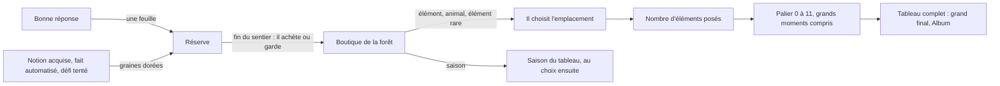

# Numebois : plan d'action

Ce document est vivant : il est mis à jour à chaque nouvelle demande (voir [Tenue du plan](#tenue-du-plan-et-personnalisations-copilot)). Le cahier des charges d'origine reste dans [PLAN.md](PLAN.md), et le workflow GitHub dans [GITHUB_WORKFLOW.md](GITHUB_WORKFLOW.md).

Numebois est un jeu web éducatif pour un enfant de CE2 : chaque exercice réussi fait grandir une forêt cartoon. Il couvre les tables, le calcul mental, les opérations posées (addition, multiplication par 1 chiffre) avec un atelier guidé, les fractions, les unités et conversions, les mesures, l'heure et les durées. S'y ajoutent de petites leçons interactives, un mode « rafale » pour automatiser les calculs et des défis chronométrés bienveillants.

Stack : Vite + TypeScript + Preact, scène 3D Three.js en style cartoon low-poly, PWA hors-ligne sur la tablette de l'enfant (Lenovo Tab M10 Gen 3), déploiement GitHub Actions vers GitHub Pages. Tout le contenu (notions, leçons, quêtes) est du TypeScript typé, organisé en modules par domaine. Ajouter « les divisions » ou « les triangles » revient à ajouter un module selon une recette fixe.

## Objectif principal : donner envie, malgré la difficulté à se concentrer

L'enfant a beaucoup de mal à se concentrer. Le but n°1 est qu'il ait envie de revenir de lui-même pour embellir sa forêt, et qu'il travaille ses leçons sans s'en rendre compte. Chaque choix de conception est jugé à cette aune.

1. **Boucles très courtes :**
   - un micro-retour à chaque bonne réponse (une feuille qui jaillit et rejoint sa réserve, une étincelle) ;
   - à la fin de chaque sentier, de quoi acheter au moins un élément (voir [Boucle de progression](#boucle-de-progression)) ;
   - jamais plus de quelques questions sans changement visible.
2. **La fin toujours visible :** le sentier s'affiche comme un chemin de 10 pierres. Il sait à tout moment combien il en reste. Longueur par défaut : court (environ 5 minutes). Une mini-session de 2 minutes compte aussi.
3. **C'est sa forêt :** il accumule des ressources et décide lui-même quoi acheter, quand, et où le poser parmi 2 ou 3 emplacements qui brillent.
4. **Un but visible pour le tableau :** les grands moments du tableau (dans la clairière : un lac, une grande montagne) sont des paliers annoncés avant d'arriver (silhouette dans la brume, cuvette sèche, puis étincelles dorées au palier d'avant) et se révèlent au fil du jeu, avec un grand final quand le tableau est complet. Une saison achetée reste ensuite au choix de l'enfant pour ce tableau.
5. **De petites surprises :** de temps en temps, une visite imprévue et offerte (oiseau rare, papillons, arc-en-ciel). Pas de tirage au sort.
6. **Le travail déguisé :**
   - le mot « leçon » n'apparaît jamais : c'est « Plume te montre une astuce » ;
   - les exercices parlent du décor du tableau (glands, cabane, ruisseau, horloge du moulin) ;
   - les devoirs de la semaine deviennent des « quêtes ».
7. **Concentration protégée :**
   - pendant une question, une seule chose à l'écran, sans menu ni animation qui attire l'œil en dehors des moments de récompense ;
   - les animaux et les éléments ne sont interactifs (les toucher les fait réagir) qu'entre deux questions ou à la fin du sentier.
8. **Manipuler plutôt qu'écrire :** horloge, règle, parts et opérations posées se manipulent au doigt, ce qui est plus engageant que la saisie seule.
9. **Revenir le lendemain sans punition :** si l'enfant a joué la veille, une petite nouveauté l'attend (une fleur éclose, un animal arrivé). Aucune série qu'on peut perdre, aucun message de manque.
10. **À éviter :** chronomètre imposé, classement, tirage au sort ou pochette surprise, ressource qu'on peut perdre, notifications, compte à rebours, tout ce qui ressemble à une punition.

## Boucle de progression

Décisions du propriétaire (2026-11-23) : l'enfant accumule des ressources et les dépense quand il le décide. C'est la référence pour toute la mécanique de jeu.

1. **Deux ressources, jamais perdues :** les **feuilles**, une par bonne réponse (sentier, rafale, défis) ; les **graines dorées**, plus rares, gagnées en apprenant (notion acquise, fait automatisé, défi tenté). La réserve passe d'un tableau au suivant ; une erreur ou une absence ne retire rien.
2. **Il dépense quand il le décide, à la fin du sentier :** après le résumé, la boutique de la forêt s'ouvre (plus tard aussi à la fin d'une rafale ou d'un défi). Il achète, ou garde tout pour plus tard. Pendant le sentier, rien à acheter : seule la réserve grossit.
3. **Ce qui s'achète** (catalogue propre à chaque décor) : les éléments à poser (arbres, massifs, rochers, objets), les animaux et les éléments rares, les saisons du tableau en cours. Proposition à calibrer (#29) : éléments en feuilles ; animaux, éléments rares et saisons en graines dorées. Un article peut demander un palier (le loup a besoin du promontoire du palier 10). Un article hors de portée montre ce qu'il reste à gagner, jamais un message de manque.
   - **Boutique de la clairière (#83, `src/scene/shop.ts`) :** au plus 4 articles, en cartes de 148 px avec une grande image et un prix : « Une pousse » (4 feuilles ; elle devient un arbre ou un massif selon la place choisie parmi celles qui brillent, #25), puis les animaux ouverts à ce palier (un de chaque espèce) et le prochain à venir. Les animaux (2 graines dorées) s'ouvrent aux paliers où ils arrivaient (`ANIMAL_OFFERS` : biche 3, renard 5, cerf 7, seconde biche 8, loup 10) ; un animal pas encore ouvert dit « Encore 3 pousses », un article trop cher « Encore 2 feuilles ». Les images des animaux sont rendues une fois par le moteur de la scène (de trois quarts, `src/scene/render/portrait.ts`). Un animal acheté entre aussitôt dans la prairie (gerbe d'étincelles, caméra qui se penche, « Une biche arrive ! ») et la description du tableau le garde (`animals`). Les animaux achetés ne sont jamais retirés par la qualité automatique.
   - **Saisons du tableau (#82) :** la boutique vend la saison suivante de l'année, une à la fois, juste après « Une pousse » : un tableau commencé en été propose l'automne, puis l'hiver, puis le printemps (proposition à calibrer, #29 : 3 graines dorées, `SEEDS_PER_SEASON` ; la deuxième saison du tableau s'ouvre au palier 3, la troisième au palier 7, la quatrième au palier 10, `SEASON_STAGES`). Une saison achetée arrive aussitôt sous le voile de lumière (« L'automne arrive ! »). Les saisons du tableau (`seasons`, celle de départ puis celles achetées) et la saison montrée (`season`) restent dans sa description ; le tableau suivant n'a que sa saison de départ.
4. **Les paliers avancent tout seuls** avec le nombre d'éléments posés ; ils ne s'achètent pas. Les grands moments (lac, montagne) sont des paliers (#81). Le tableau est complet quand ses emplacements sont remplis.
5. **À surveiller avec l'enfant (#12) :** la forêt ne change plus pendant le sentier, seulement à la fin (environ toutes les 5 minutes en sentier court) ; la boutique doit rester courte (quelques articles, grandes images, un toucher) pour ne pas devenir un menu où il se perd.

Tickets : réserve et micro-retour (#22), boutique (#83), pose et paliers (#24), emplacement (#25), saisons (#82), éléments rares (#46), calibrage (#29).

## Décisions

- **Stack :** Vite + TS strict + Preact (interface et widgets en DOM/SVG, par-dessus la scène) + Three.js en WebGL2 (paysage 3D uniquement). PWA hors-ligne via vite-plugin-pwa.
- **Visuels : le rendu est la priorité n°1, c'est la motivation première de l'enfant.** Style cartoon low-poly en 3D temps réel. Base : les packs **KayKit** de Kay Lousberg (Forest Nature Pack et Medieval Hexagon Pack, licence CC0, conçus pour le mobile, une seule texture de dégradé partagée). Le MCP Blender sert à compléter dans le même style (stades de croissance, cabane, grands moments, animaux si besoin). Le code ajoute la vie : lumière, ciel, brouillard, vent, eau, particules, animations de pousse, ambiance qui s'enrichit. Le rendu est validé par une tranche verticale avant de construire le reste du jeu.
- **Assets :** seulement les versions gratuites de KayKit (CC0) ; pas de pack payant, les modèles et variantes manquants sont générés (code ou MCP Blender). Pas de dépôt privé. Les fichiers bruts des packs et nos sources Blender restent hors du dépôt (`assets/` et `assets-private/` en local, ignorés par git). Les modèles optimisés par la chaîne de traitement (`public/assets/kaykit.glb`, CC0) entrent dans le dépôt avec un fichier `LICENSES.md` (décision du propriétaire, 2026-11-22, ticket #3) : le site publié affiche ainsi les vrais modèles. Tout autre pack (animaux, sons) doit avoir une licence vérifiée compatible (CC0 de préférence) : les animaux Quaternius (CC0) suivent le même chemin (`public/assets/animals.glb`, #10).
- **Scène de démonstration (2026-11-22, `src/scene/`) :**
  - **Un seul atlas pour les deux packs.** La disposition est déclarée une seule fois dans `src/scene/atlas.ts`. L'atlas KayKit Forest (1024², 8×4 cases) garde ses 3 cases d'origine ; les nouvelles couleurs occupent des cases libres ; les 7 cases du Medieval Hexagon utilisées par nos modèles (montagnes, nénuphars, plante d'eau, nuages) et par l'eau y sont copiées au pixel près, et les UV de ces modèles sont seulement décalés d'un nombre entier de cases. La fusion est donc sans perte, avec un seul matériau. Il reste 2 cases libres : ajouter des bâtiments du pack hexagonal demanderait un atlas plus large ou une deuxième texture. Pas de mipmaps (les dégradés n'en ont pas besoin, et ils feraient baver les cases voisines).
  - **Manifeste et modèles optimisés commités.** `npm run assets` écrit `public/assets/kaykit.glb` et `src/scene/assets.gen.ts` (noms, tailles, triangles), commités tous les deux (#3) ; un test échoue s'ils ne correspondent plus. Sans le GLB (clone sans ce fichier, `?assets=placeholder`), la scène utilise des formes de remplacement de même taille et un atlas peint depuis la disposition.
  - **Pousse et vent dans le shader.** Chaque arbre est généré adulte ; ses sommets portent un point d'origine et deux âges de naissance, et une petite texture de données donne l'âge de chaque arbre. Faire pousser un arbre ne modifie donc aucune géométrie, et toute la forêt reste un seul appel de dessin.
  - **Tableau flottant.** La clairière flotte dans le ciel, entourée de nuages KayKit ; son ruisseau tombe dans le vide.
  - **Fleurs et champignons générés en TypeScript** (`src/scene/props.ts`), sans passer par Blender.
  - **Le relief est un axe de progrès des paliers (demande du propriétaire, 2026-11-22).** Le terrain de la clairière dépend du palier (`RELIEF_BY_STAGE` dans `src/scene/terrain/clearing.ts`) : le tableau s'agrandit à chaque palier (27 × 21 unités au palier 0, 60 × 54 au palier 11), les montagnes du fond montent (corniche au palier 2, colline au palier 3, puis de 11 à 26 unités de haut, avec neige à partir du palier 6), et l'eau en descend (de 0 à 7 chutes, une de plus à la fois ; le petit étang de la source reçoit la première cascade au palier 2 et déborde en ruisseau au palier 3 ; un ruisseau venu de l'est rejoint le ruisseau principal au palier 5, un troisième se jette dans le lac au palier 9). Les éléments sont placés une fois pour toutes dans la disposition finale, tirée de la graine : un palier décide seulement lesquels sont présents et à quelle hauteur. Un arbre garde donc sa place, sa graine et sa forme d'un palier au suivant. La caméra se cadre toute seule sur le bord du tableau et les sommets. Changer de palier reconstruit le tableau ; la transition animée reste à concevoir.
  - **Douze paliers, progressifs (demande du propriétaire, 2026-11-22).** Plus de paliers donnent plus d'occasions de progresser : chaque palier est un petit pas, et la plupart apportent une seule nouveauté. Les valeurs sont écrites en colonnes, une ligne par paramètre et une valeur par palier (`RELIEF_BY_STAGE` pour le relief, `LIFE` dans `src/scene/render/richness.ts` pour les densités et la vie), ce qui rend chaque progression lisible et facile à régler. La lumière glisse entre cinq ambiances (matin brumeux, matin clair, midi, après-midi chaud, heure dorée), atteintes aux paliers 0, 3, 6, 9 et 11. Le nombre de paliers est déclaré une seule fois (`STAGES` dans `src/scene/description.ts`).
  - **Chaque graine, une clairière différente (demande du propriétaire, 2026-11-22).** Sinon le jeu lasse vite. La topologie reste la même (massif et cascade au fond, lac, ruisseau vers l'avant, affluents de l'est et de l'ouest), mais la graine tire toute la disposition (`drawLayout` dans `src/scene/terrain/clearing-layout.ts`) : position des groupes, hauteur, profil et arêtes des sommets, tracé des ruisseaux, bord du tableau, buttes, emplacements d'arbres et rochers, lisière, part de sapins ; la végétation a son essence et sa fleur préférées (`floraOf` dans `src/scene/populate.ts`). Les règles de composition sont du code : un tirage qui ne les respecte pas est refait. Pour juger un changement, comparer plusieurs graines (`npm run capture -- --seed 1,2,3,4`).
- **Contenu en TypeScript, pas en YAML :** c'est toujours l'agent qui ajoute les notions et les quêtes, à la demande du propriétaire. Le compilateur et les tests vérifient tout, sans schéma ni validateur à part.
- **Un module par domaine** (`src/domains/<domain>/`), branché sur un registre. Le moteur (sentier, maîtrise, rafale, défis) est générique et ne connaît aucun domaine en particulier.
- **Surimpression du jeu (2026-11-23, `src/ui/`) :** Preact par-dessus la scène. Réserve en haut à gauche (feuilles et graines dorées, #22 ; un appui long ouvre l'espace parent), chemin de pierres en haut au centre, saisons du tableau et bouton du son en haut à droite ; l'exercice est sur l'ardoise (ci-dessous), qui s'écarte pendant une graine dorée. Le jeu s'affiche par défaut ; `?scene` (captures de `npm run capture`, specs du rendu) et `?debug` montrent le paysage seul. Gains et prix dans `src/core/economy.ts` (une feuille par bonne réponse, une graine dorée par notion acquise ou fait automatisé, 4 feuilles par élément et 2 graines dorées par animal pour commencer, #29).
- **Écran d'exercice : l'ardoise (choix du propriétaire, 2026-11-23, #84) :** parmi trois maquettes (pupitre à droite, ardoise au centre, établi en bas), le propriétaire choisit l'ardoise : la concentration d'abord.
  - Pendant une question, la forêt s'assombrit (calque `#dim`), et l'exercice tient sur une ardoise au centre, toujours de la même taille (840 × 692 px en 1280×800) : la consigne en haut, la zone de travail à gauche (l'énoncé, ou un widget large : horloge, opération posée…), la zone de réponse en bas à droite (pavé, choix), toujours au même endroit sous le doigt.
  - Plume est perchée sur le bord gauche de l'ardoise. Calme pendant la question, elle donne l'indice dans une bulle, sous la zone de travail, qui ne couvre jamais la zone de réponse ; après la deuxième erreur, sa bulle montre la méthode et le bouton « Suivant » (ou Entrée), et le widget montre la réponse en jaune. Elle saute de joie après une bonne réponse. Son modèle 3D (#26) est dessiné dans son propre petit canevas : elle respire et cligne des yeux, penche la tête quand elle donne l'indice, sautille en battant des ailes après une bonne réponse.
  - Pendant une graine dorée, l'ardoise s'écarte et la forêt s'éclaire. À la fin du sentier, la forêt reprend tout l'écran et le résumé s'affiche en bas au centre, avec Plume, la boutique de la forêt (#83) et « Encore un sentier » ; il s'écarte pendant qu'un élément pousse ou qu'un animal arrive.
  - L'énoncé est écrit d'autant plus gros qu'il est court (quatre tailles, de 56 à 28 px). L'assombrissement est un calque CSS : à mesurer sur la tablette (une fusion plein écran de plus par image).
- **Accueil et promenade dans la forêt (décisions du propriétaire, 2026-11-23, #72) :** le jeu s'ouvre sur la forêt éclairée et une carte d'accueil en bas au centre (« Bonjour ! Ta forêt t'attend. », « Se promener » et le grand bouton « Commencer le sentier ») ; `?practice` commence directement par la question. « Se promener », depuis l'accueil ou la fin du sentier, écarte la carte et laisse l'enfant explorer : un doigt déplace la vue, deux doigts pincent pour zoomer, tournent et glissent vers le haut ou le bas pour la plongée (souris : glisser, clic droit ou Maj pour tourner, molette). Limites (`EXPLORE_LIMITS`, `src/scene/render/explore.ts`) : ±35° autour du cadrage, plongée ±8°, zoom jusqu'à ×2,5 ; la vise se déplace dans une ellipse du tableau qui grandit avec le zoom (nulle au cadrage), si bien qu'on ne sort jamais du tableau. Une petite carte en bas donne le geste, « Revenir » (au cadrage, visible dès que la vue a bougé) et « J'ai fini » (retour à la carte de départ) ; la vue revient en glissant au cadrage dès la fin de la promenade. Pendant une question, aucun geste ne déplace la caméra. Le fond peint reste placé d'après la caméra du cadrage (`Stage.home`) ; de près, le plan de coupe se rapproche pour ne pas couper les arbres. `?view=yaw,pitch,zoom,x,z` (parts des limites) montre une vue explorée dans `?scene`, pour les captures.
- **Sauvegarde :** un seul enfant, IndexedDB sous le préfixe `numebois:` (l'origine github.io est partagée avec les autres dépôts), export/import JSON. Les identifiants de notions sont stables. Le tableau en cours porte son décor (`biome`, version 4 du format, #31). La compatibilité devient obligatoire dès que le propriétaire déclare « l'enfant joue pour de vrai » (voir [GITHUB_WORKFLOW.md](GITHUB_WORKFLOW.md#compatibilité-des-sauvegardes)).
- **Paysage seulement (propriétaire, 2026-11-22) :** la tablette n'est jamais utilisée en portrait. Ni mise en page ni tests en portrait ; la PWA verrouillera l'orientation (`orientation: "landscape"` dans le manifeste).
- **Tablette cible (propriétaire, 2026-11-22) :** Lenovo Tab M10 Gen 3 (2022), 64 Go, 4 Go de RAM. D'après la fiche technique (à confirmer sur l'appareil) : Unisoc T610, GPU Mali-G52 MP2, écran 10,1 pouces 1920×1200, Android 11. Le GPU est d'entrée de gamme : le budget de rendu est mesuré sur elle en priorité, et le palier de qualité par défaut en dépendra. Les tests l'émulent en paysage 1280×800 (viewport CSS supposé à un `devicePixelRatio` de 1,5, à vérifier : l'espace parent affiche la taille vue par le jeu, à lire dans l'application installée).
- **Pas de synthèse vocale :** textes courts, gros caractères.
- **Bienveillance partout :** aucune ressource perdue, indices progressifs, comparaison uniquement avec soi-même, aucune formulation d'échec.
- **Opérations posées V1 :** addition (2 ou 3 nombres, jusqu'à 4 chiffres) et multiplication par un nombre à 1 chiffre. Pas de soustraction posée.
- **Hors périmètre V1** (à ajouter plus tard, module par module) : division, géométrie, soustraction posée, multiplication par 2 chiffres, synthèse vocale, plusieurs profils, synchronisation.

## Tenue du plan et personnalisations Copilot

- Ce fichier porte la vision : décisions, recettes, journal. Les tickets GitHub portent l'avancement. À chaque demande (« ajouter les divisions », « l'enfant doit travailler les triangles »…), l'agent met à jour dans le même commit les décisions, les recettes et le journal en bas du fichier. Le tableau de couverture est mis à jour à chaque jalon terminé, pas à chaque commit.
- Les instructions et skills Copilot sont maintenus en continu (voir [Personnalisations Copilot](#personnalisations-copilot)). Dès qu'une préférence ou une correction durable du propriétaire apparaît, l'agent met à jour le bon fichier dans le même commit, et le signale en une ligne à la fin de sa réponse.

## Conventions et glossaire

Le code (identifiants, fichiers, dossiers) est en anglais. Les textes affichés, les leçons, les docs et les instructions Copilot sont en français.

| Terme du jeu (FR)             | Nom dans le code |
| ----------------------------- | ---------------- |
| notion                        | `Skill`          |
| fait (7×8)                    | `Fact`           |
| domaine                       | `Domain`         |
| sentier                       | `Trail`          |
| rafale                        | `Drill`          |
| défi                          | `Challenge`      |
| tableau                       | `Painting`       |
| Album                         | `Album`          |
| décor                         | `Biome`          |
| grand moment                  | `Reveal`         |
| emplacement                   | `Slot`           |
| feuilles                      | `leaves`         |
| graine dorée                  | `seeds`          |
| réserve                       | `Reserve`        |
| boutique de la forêt          | `Shop`           |
| quête (devoirs de la semaine) | `Quest`          |
| astuce de Plume (leçon)       | `Lesson`         |
| ardoise (écran d'exercice)    | `Slate`          |
| Carnet de la forêt            | `Notebook`       |

Domaines : `numbers`, `mental-math`, `times-tables`, `column-arithmetic` (opérations posées), `fractions`, `units`, `measures`, `time`, `word-problems`. Puis à la demande : `division`, `geometry`…

Widgets : `Keypad`, `Choice`, `FractionInput`, `TimeInput`, `Clock`, `Ruler`, `ScaleDial` (balance, verre doseur), `ConversionTable`, `FractionParts`, `NumberLine`, `ColumnOperation`.

## Couverture du programme

À vérifier contre le programme officiel en vigueur et les devoirs de l'enfant. La colonne « Rafale » indique que la notion peut se travailler en enchaînement libre jusqu'à l'automatisme.

| Domaine (module)    | Notions                                                                                                                      | Interaction                                  | Leçon               | Rafale                    | Chrono             | État                   |
| ------------------- | ---------------------------------------------------------------------------------------------------------------------------- | -------------------------------------------- | ------------------- | ------------------------- | ------------------ | ---------------------- |
| `numbers`           | Lire et écrire jusqu'à 10 000, comparer, ranger, décomposer (M/C/D/U), droite graduée                                        | Pavé, choix <, >, =, droite graduée          | Valeur des chiffres | Oui                       | Non                | Prévu M1               |
| `mental-math`       | Addition et soustraction de tête ≤ 100, compléments à 10 et 100, passage de la dizaine, +9/+11, doubles et moitiés, ×10/×100 | Pavé                                         | Stratégies          | Oui                       | Oui                | Prévu M1               |
| `times-tables`      | Tables de 2 à 10, commutativité, produit à trou                                                                              | Pavé, quadrillage de points                  | Quadrillage         | Oui (suivi fait par fait) | Oui                | Prévu M1               |
| `column-arithmetic` | Addition avec retenues, multiplication par 1 chiffre                                                                         | Atelier « opération posée »                  | Pas à pas guidé     | Oui                       | Non                | Prévu M3               |
| `fractions`         | Demi, tiers, quart… dixième : lire, colorier, droite graduée, comparer à 1, fraction d'une quantité                          | Parts à colorier, saisie a/b, droite graduée | Oui                 | Oui                       | Non                | Prévu M5               |
| `units`             | Longueurs km/m/dm/cm/mm, masses kg/g, contenances L/dL/cL, monnaie : relations, conversions, ordres de grandeur              | Tableau de conversion, choix                 | Oui                 | Oui                       | Non                | Prévu M4               |
| `measures`          | Règle (cm, mm), tracer un segment, ligne brisée, graduations (balance, verre doseur)                                         | Règle, graduations                           | Oui                 | Non                       | Non                | Prévu M4               |
| `time`              | Lire l'heure (pile, demie, quarts, 5 en 5, minute près), placer les aiguilles, 14 h = 2 h, durées, h/min/s, calendrier       | Horloge, saisie hh:mm, frise, calendrier     | Oui                 | Oui (lecture de l'heure)  | Lecture de l'heure | Prévu M4               |
| `word-problems`     | Énoncés à variables sur le thème de la forêt, en une ou deux étapes, mobilisant les autres domaines                          | Pavé, choix                                  | Non                 | Non                       | Non                | Prévu M1, puis enrichi |

## Architecture

- `src/core/` : moteur générique en TS pur.
  - `rng.ts`, `expr.ts` (interpréteur limité, pas d'`eval`) ;
  - `mastery.ts` (cycle de vie et Leitner), `facts.ts` (suivi fait par fait), `trail.ts` (sentier), `drill.ts` (rafale), `challenge.ts`, `records.ts` ;
  - `registry.ts` et `types.ts` : les contrats `Domain`, `Skill`, `Generator`, `Exercise`, `Lesson`, `Quest` ;
  - `content.ts` : les règles de contenu vérifiées sur chaque exercice tiré (`exerciseErrors` : réponse exacte et de la forme que rend le widget, 2 à 4 choix, phrases de 12 mots, bulles de 3 phrases ou lignes et 120 caractères, énoncé de 25 mots, aucun mot d'échec, fait déclaré).
- `src/domains/<domain>/` : un module autonome.
  - `index.ts` : `defineDomain` (id, nom affiché en français, icône, liste des notions) ;
  - `skills.ts` : notions avec id stable, prérequis, niveaux de difficulté internes, drapeaux `drill`/`challenge` ;
  - `generators.ts`, `validate.ts`, `hints.ts` : fonctions pures ;
  - `facts.ts` (facultatif) : découpage en faits élémentaires pour l'automatisation, par exemple « 7×8 » ou « 3+7=10 » ;
  - `lessons/*.ts` : leçons écrites avec `defineLesson` ;
  - `widgets/*.tsx` : seulement si le domaine a besoin d'une interaction qui lui est propre ;
  - `problems.ts` : modèles d'énoncés ;
  - `*.test.ts`.
- `src/domains/index.ts` : le registre, une ligne par domaine.
- `src/ui/widgets/` : widgets partagés (voir le glossaire). Un widget par type de saisie (`ExerciseInput`), déclaré dans `src/ui/widgets/index.tsx`. Un nouveau type ne compile pas sans ses quatre morceaux : le type, sa règle de réponse (`ANSWER_FITS`, `src/core/content.ts`), son widget et son pilote de test (`DRIVERS`, `tests/e2e/helpers.ts`). Le widget reçoit l'exercice et son état (`locked`, `right`, `shown` : la réponse montrée après la deuxième erreur) et renvoie une réponse (`onSubmit`). Il se place lui-même sur l'ardoise avec `Work` et `AnswerZone`. Les modes `demo` et `guided` viendront avec le `LessonPlayer` (#50). La validation et les indices viennent du domaine.
- **Regarder ou manipuler (décision pour #21 et les ateliers) :** ce que l'enfant regarde et ce qu'il manipule restent séparés. Une illustration en lecture seule (droite graduée à lire, horloge, parts coloriées, quadrillage) sera un champ `figure` de l'exercice, affiché dans `Work` sous l'énoncé ; la saisie (`ExerciseInput`) dit seulement comment il répond. Lire une graduation = figure « droite graduée » + pavé ; placer un nombre = saisie `number-line` qui occupe `Work wide`. Le premier besoin (#21) crée `figure`, sur le même modèle que les saisies (un composant par type, exhaustif).
- **Essayer une notion :** `?practice=<notion>&level=<n>` joue cette notion seule à partir de ce niveau, sur un tableau neuf, sans lire ni écrire la sauvegarde (tests, revue d'une nouvelle notion sur la tablette).
- `src/quests/YYYY-MM-DD.ts` : `defineQuest` (titre de quête, période, décor facultatif pour le prochain tableau, notions travaillées avec paramètres, rafale recommandée, leçons, défis). Une quête tient en une dizaine de lignes.
- `src/scene/` : paysage Three.js, `render/` (moteur de rendu), `biomes/` (décors) et `painting.ts`. Le module `word-problems` puise le vocabulaire et les objets du décor en cours pour habiller les énoncés.
- `src/ui/` : surimpression (`game.tsx`), ardoise (`slate.tsx` : `Slate`, `Work`, `AnswerZone`, `Statement`) et Plume (`plume.tsx`). Gabarit des widgets larges : la zone de travail fait environ 430 × 450 px à côté de la zone de réponse (300 px de large) ; `Work wide` prend toute la largeur (environ 760 px) pour une règle ou une droite graduée, et la zone de réponse passe dessous.

### Leçons sans YAML

Une leçon est une courte liste d'étapes typées dans le module :

- `explain` : texte court et widget en démo animée, avec un petit script d'actions (par exemple « déplacer la grande aiguille sur 30 », « surligner la colonne des unités ») ;
- `manipulate` : consigne, widget en mode libre et condition de réussite ;
- `guidedExample` : widget en mode guidé, par exemple une opération posée commentée par Plume ;
- `check` : 2 ou 3 exercices tirés des générateurs du domaine, sans effet sur la maîtrise.

`LessonPlayer` les joue toutes de la même façon. Les illustrations sont les widgets eux-mêmes, donc pas d'images à produire. Une leçon fait au plus 6 étapes (vérifié par un test).

## Recette : ajouter une notion ou un domaine

Exemples de demandes : « ajouter les divisions », « l'enfant doit travailler les triangles ». Le skill `add-skill` en donne la liste de contrôle.

1. Mettre à jour ce plan : décisions, journal.
2. Si le domaine existe, ajouter la notion dans son `skills.ts`. Sinon, créer `src/domains/<domain>/` et l'enregistrer dans `src/domains/index.ts`.
3. Écrire générateurs, validation et indices, avec leurs tests (1 000 graines, contraintes respectées). Les règles communes (`exerciseErrors`) sont vérifiées sans rien ajouter par `tests/unit/content.test.ts`.
4. Réutiliser un widget partagé si possible. Sinon, ajouter un type de saisie à `ExerciseInput`, sa règle de réponse, son widget dans `src/ui/widgets/index.tsx` (placé sur l'ardoise avec `Work`, ou `Work wide`, et `AnswerZone`) et son pilote de test.
5. Écrire une leçon courte, et éventuellement des modèles de problèmes.
6. Déclarer les prérequis pour placer la notion dans le parcours.
7. Facultatif : une quête qui active la notion cette semaine, avec un décor assorti si besoin.
8. `tests/e2e/notions.spec.ts` joue déjà chaque notion sur l'ardoise (indice, réponse montrée, dernier niveau, capture jointe) ; ajouter un test Playwright pour ce que le widget a de propre (glisser, aimanter), puis relire les captures et essayer `?practice=<notion>`.

Ajouter un décor (« fais un tableau de montagne »), détail dans le skill `add-biome` :

0. Maquette d'abord : un terrain de concept derrière `?biome=` (relief, eau, arbres, sans emplacements ni grands moments animés), captures aux paliers 0, 6 et 11 à côté de la clairière, validées par le propriétaire avant de construire le décor.
1. Terrain : un module `src/scene/terrain/<nom>.ts` qui implémente l'interface `Terrain` (sol, eau, hauteur en tout point, emplacements d'arbres par rôle, gros rochers, cascades, berges, cultures, pièces qui tournent, cadrage). Le sol et le dessous du diorama viennent de `terrain/diorama.ts` ; tout le reste (arbres, végétation, lumière, effets) est partagé.
2. Décor : `src/scene/biomes/<nom>.ts`, ajouté à `BIOMES` (et son identifiant à `BIOME_IDS`) : nom, terrain, noms des paliers, colonnes de vie et de son remplacées, teinte de la lumière, effets inédits, vocabulaire ; ses animaux dans `ANIMAL_OFFERS`.
3. Couleurs : une nouvelle couleur est une nouvelle case dans `src/scene/atlas.ts` (jamais une case d'origine), puis `npm run assets`. Les bâtiments du pack hexagonal réutilisent des cases existantes (`HEX_ALIASES`).
4. Modèles KayKit : les ajouter à `src/scene/asset-catalog.ts`, puis `npm run assets` (le manifeste est régénéré). Un modèle manquant est généré en TypeScript (`src/scene/props.ts`) ; le MCP Blender n'est qu'un recours.
5. 22 emplacements, grands moments (des paliers, annoncés au palier d'avant), effet inédit, ambiance sonore, boutique, vocabulaire des problèmes.
6. Vérifier : tests Vitest (budget de triangles, emplacements valides sur des centaines de graines, grands moments, sons), spec Playwright du paysage, puis revue visuelle avec le skill `visual-review`.

Exemples anticipés :

- **Division :** partage, quotient et reste, ? × 6 = 42. Prérequis : tables. Réutilise le pavé et une saisie « quotient + reste », et ajoute une manipulation de partage de glands. La division posée viendra plus tard, en étendant le widget `ColumnOperation`.
- **Triangles :** module `geometry` avec un nouveau widget de géométrie en SVG : toucher les sommets, tracer avec règle et équerre, reconnaître et classer les triangles (rectangle, isocèle, équilatéral). Prérequis : mesures (règle).

## Rendu : un paysage de plus en plus riche et joli

C'est le cœur de la motivation. Chaque bonne réponse doit se voir, et chaque tableau doit devenir nettement plus beau du début à la fin.

### Direction artistique

1. **Style cartoon low-poly en 3D temps réel,** celui des packs KayKit : formes simples et arrondies, couleurs franches et chaleureuses, une seule texture de dégradé partagée par tous les modèles. Aucun asset d'un autre style ne s'y mélange.
2. **Sources d'assets :**
   - [KayKit Forest Nature Pack](https://kaylousberg.itch.io/kaykit-forest) : arbres, buissons, herbes, rochers. Version gratuite uniquement : les variantes de couleur et les modèles manquants sont générés.
   - [KayKit Medieval Hexagon Pack](https://kaylousberg.itch.io/kaykit-medieval-hexagon) : tuiles hexagonales (rivières, lacs, côtes), moulins à vent et à eau, maisons, puits, montagnes, nuages.
   - **MCP Blender :** compléments dans le même style, en réutilisant la texture de dégradé KayKit. Il produit la cabane, les grands moments et les éléments rares (les arbres, les fleurs et les champignons sont générés dans le jeu). Il exporte aussi en lot et fait les rendus de contrôle.
   - **Répartition (décision du propriétaire) : le code compose, KayKit fournit les pièces.** Procédural en TypeScript pour ce qui est continu ou dépend de la forme du décor ; assets pour les objets posés.
     - Arbres : procéduraux (voir plus bas).
     - Terrain : procédural (relief bas-poly à facettes, couleurs de l'atlas selon la hauteur et la pente, bord de diorama).
     - Ruisseaux et lacs : tracé procédural (courbe qui creuse le terrain), ruban d'eau animé dans le shader (rides et écume qui défilent, couleurs franches de l'atlas, opaque) ; berges garnies de rochers et d'herbes KayKit le long du tracé.
     - Cascade : falaise en rochers KayKit empilés, nappe d'eau procédurale animée, écume et embruns en particules ; retouche dans Blender si c'est un grand moment.
     - Rochers, buissons, herbes : modèles KayKit (43 rochers, 22 buissons, 20 touffes d'herbe dont une version prévue pour un shader de vent), posés par le code selon la densité du palier de richesse, en `InstancedMesh` (un appel de dessin par modèle) ; saisons par cases de l'atlas (mousse, neige, herbe sèche).
     - Fleurs et champignons : générés en TypeScript dans le style KayKit (`src/scene/props.ts`), colorés par des cases de l'atlas choisies par instance.
     - Cabane, moulin : modèles (KayKit ou MCP Blender).
   - **Saisons des arbres (prototype Blender, remplacé par la génération dans le jeu ; on en garde les cases de couleurs de l'atlas et les recettes de saison) :** l'atlas `forest_texture.png` reçoit de nouvelles cases de dégradé dans les emplacements que KayKit réserve aux couleurs supplémentaires ; les cases d'origine ne bougent pas. Chaque variante garde le maillage, l'échelle et le matériau unique de l'arbre KayKit, seuls les UV changent. La neige vient du dégradé lui-même (le haut des cases éclaire les faces tournées vers le ciel). 120 modèles :
     - feuillus `Tree_1`, `Tree_2` : `Spring`, `Blossom`, `Summer`, `Fruit` (pommes), `AutumnGold`, `AutumnOrange`, `AutumnRed`, `AutumnMixed` (couleur tirée par touffe), `Winter` ;
     - parasols `Tree_3` : les mêmes sans `Fruit` ; sapins `Tree_4` : `Spring`, `Summer`, `AutumnLarch`, `Winter`, `Festive` (boules et étoile) ; arbres nus : `Summer`, `Winter` (neige sur les branches).
   - **Nouvelles essences (prototype Blender, remplacé par les familles procédurales) :** assemblées à partir des touffes et des troncs KayKit (mêmes faces, UV, normales et matériau, seulement déplacés et mis à l'échelle), en tailles A, B, C : `Tree_Lollipop` (sucette, avec `Fruit`), `Tree_Poplar` (peuplier), `Tree_Oak` (grand chêne), `Tree_Birch` (bouleau, écorce blanche tachetée), `Tree_Fir` (sapin de Noël, avec `Festive`). Les pousses `Sapling_Round`, `Sapling_Cube`, `Sapling_Umbrella`, `Sapling_Pine` servent de premier stade de croissance. Toutes reçoivent les variantes de saison : 249 modèles au total.
     - Scripts reproductibles dans `assets-private/forest-seasons/` : `atlas.py` (disposition des cases), `make_atlas.py`, `species.py` (assemblage), `build_seasons.py` (variantes, export, rendus). On y trouve aussi le `.blend`, les glTF (saison, variante et provenance dans les `extras`) et les rendus de contrôle.
   - **Forêt procédurale dans le style KayKit (décision du propriétaire) :** le code génère le squelette de l'arbre (tronc, racines, branches), habillé de tubes low-poly lisses collés à la case d'écorce KayKit ; les feuillages sont les touffes du pack, posées au bout des branches. Une graine donne un arbre ; couper le même squelette selon l'âge (0 à 1) donne ses stades de croissance, donc un arbre peut pousser branche par branche à chaque bonne réponse. Environ 2 000 à 5 000 triangles par arbre adulte. Prototype : `assets-private/procedural-trees/kaykit_tree.py` (familles `Round`, `Cube`, `Gnarly`, `Umbrella`). Le style « peint » à cartes de feuilles (`gen_tree.py`) est écarté.
     - **Générée dans le jeu, en TypeScript (décision du propriétaire, tant qu'on n'est pas bloqué) :** `src/scene/trees/` porte l'algorithme du prototype. Générateur aléatoire à graine (jamais `Math.random`) pour que l'Album rejoue les mêmes arbres ; touffes KayKit chargées depuis le manifeste ; arbres d'un tableau regroupés en un seul appel de dessin (fusion ou `BatchedMesh`) ; pousse et vent par attributs de sommets (âge d'apparition, souplesse) dans le shader. Blender reste disponible pour créer de nouvelles pièces et faire des rendus de contrôle.
   - **Animaux (décision du propriétaire, 2026-11-23, #9) :** la biche, le cerf, le renard et le loup du pack Quaternius « Ultimate Animated Animals » (CC0, environ 2 000 triangles, squelette et clips de repos, broutage et marche). On ne garde que les clips doux (ni attaque, ni mort, ni coup reçu). Préparés dans Blender : un seul matériau (couleurs portées par les sommets), donc un appel de dessin par animal, et environ 300 ko par animal avec 4 clips après compression (l'animation pèse l'essentiel). Pack CraftPix « Free Wild Animal » écarté : licence non CC0 qui interdit de redistribuer les fichiers, aucune animation, et petits animaux à peine visibles. À la distance de la caméra, la biche ne fait qu'une vingtaine de pixels de haut : il faut grossir les animaux (1,5 à 2 fois) et aviver leurs couleurs, trop ternes sur l'herbe KayKit. Plume la chouette (#26), vue de près à côté de la question, est modélisée avec le MCP Blender par un script commité (`scripts/plume.py`).
   - **Troncs tombés et souches (#76) :** `WoodLog`, `WoodLog_Moss`, `WoodLog_Snow`, `TreeStump`, `TreeStump_Moss`, `TreeStump_Snow` du pack Quaternius « Ultimate Nature » (CC0, juin 2019), lus en OBJ par `npm run assets` : chaque couleur unie du pack devient une case de l'atlas KayKit (bois → `DarkBark`, bois coupé et champignons → `Cream` et `Earth`, mousse → `Summer`, neige → `SnowGround`), éclairée par le haut comme KayKit. Ils partagent donc le matériau et l'atlas des autres modèles, en `InstancedMesh` sans ombre.
3. **Forme du tableau : la clairière à relief libre (décision du propriétaire, 2026-11-22).** Un diorama 3D flottant, vu en légère plongée avec une caméra presque fixe, bordé de forêt, adossé à des montagnes d'où descendent cascades et ruisseaux jusqu'au lac. Il grandit et prend du relief de palier en palier (voir [les paliers](#ce-que-le-code-ajoute-la-vie)). L'île de tuiles hexagonales, maquettée pour comparaison, est écartée et son code a été retiré (#2) ; les montagnes du pack restent au catalogue pour un grand moment possible (#7).
4. **Compositions réglées par le code :** pour chaque décor, l'agent écrit de vraies règles de composition (premier plan qui encadre, profondeur, lisibilité depuis la caméra, respiration), et la graine les applique : chaque tableau a sa propre disposition. Vu de la caméra, un arbre cache le sol loin derrière lui : aucun emplacement devant le lac, les chutes, les bassins ou le confluent. L'enfant choisit entre 2 ou 3 emplacements qui sont tous beaux : son choix ne peut pas enlaidir la scène.
5. **Emplacements et grands moments de la clairière (#7, #81, à valider par le propriétaire) :**
   - 22 emplacements tirés de la graine (`slots` dans `src/scene/terrain/clearing-layout.ts`), dans l'ordre où ils s'ouvrent : par le premier palier qui les montre, puis les plus proches du centre du premier tableau ; au moins 4 dès le palier 0, puis le tableau qui s'agrandit en ouvre d'autres, strictement dans cet ordre. Un sur quatre est un massif (un grand buisson, deux petits et les fleurs du tableau), les autres reçoivent un arbre. Règles vérifiées pour chaque graine : rien devant l'eau, loin des ruisseaux, espacés, donc beaux quel que soit l'ensemble rempli.
   - 2 grands moments, qui sont des paliers (#81) : colonnes `chain` et `beavers` de `RELIEF_BY_STAGE` (`src/scene/terrain/clearing.ts`), d'où le terrain tire leur état `Reveal` (`waiting` : sa forme seulement ; `announced` : étincelles dorées, au palier d'avant ; `shown`) :
     - **le lac des castors** (décision du propriétaire, 2026-11-23 ; palier 8) : le ruisseau de l'est (palier 5) traverse une cuvette de sable, visible dès le premier tableau, puis rejoint le ruisseau principal ; au palier 8, un barrage de castors à la sortie de la cuvette en fait un lac avec un îlot et son petit arbre. Le ruisseau garde le même tracé avant et après : le lac le recouvre, et il repart sous le barrage. Le lac est plus grand que celui de la cascade à chaque palier (rayon de 2,4 à 2,8 au palier 0, 2,3 fois plus au palier 11, croissance rapide au début) ; il s'agrandit vers l'avant, sa rive intérieure ne bouge pas, et le pré s'aplanit autour, à un niveau entre le bassin de l'est et le confluent. Barrage : un monticule de boue sous des branches entrecroisées (`beaverDam` dans `src/scene/props.ts`, environ 440 triangles), avec trois gros troncs Quaternius posés en biais (#76) ; quelques souches fraîchement rongées autour du lac ;
     - **la chaîne lointaine** (palier 6) : trois montagnes (la grande et deux plus basses derrière elle) sur leur propre île flottante, au loin dans le coin du ciel opposé au soleil, silhouette dans la brume dès le palier 0, puis colorées et enneigées au palier 6 « neiges » ; elle garde sa place à l'écran quelle que soit la taille du tableau.
   - La saison n'est plus un grand moment : elle s'achète (#82, #83).
   - Description du tableau : `elements` (emplacement et jour de chaque élément posé, dans l'ordre, #23). Dans le jeu, c'est le tableau en cours de la sauvegarde ; pour les captures et `?debug`, `fill` en tire une part des 22 emplacements (`DEMO_FILL` par palier). Aux premiers paliers, au-delà d'environ 30 % tous les emplacements ouverts sont déjà remplis.
   - Le palier vient du nombre d'éléments posés (`ELEMENTS_AT_STAGE` : 0, 1, 2, 3, 5, 7, 9, 11, 13, 15, 17, 19 ; #24, #29) : un élément par palier au début, puis deux. Les emplacements ouverts laissent toujours au moins deux places libres au choix (300 graines mesurées : jamais bloqué, un seul cas à une place). Le tableau prépare, cachés, l'arbre ou le massif de 3 emplacements libres au plus (`candidateSlots` : le premier à s'ouvrir, un du milieu, le dernier) : un nouvel élément pousse sans reconstruire la scène. Un arbre de l'enfant pousse à moitié et grandit à chaque élément posé après lui, adulte au cinquième. Chaque emplacement ouvert garde sa place, rempli ou non, et les arbres de l'enfant n'attirent ni buisson, ni tronc, ni champignon : poser un élément ne déplace rien d'autre.
   - Le lac ne déplace que ce qu'il touche : buissons, herbes, fleurs, rochers et vie ambiante tirent leurs nombres élément par élément (ou par catégorie), jamais dans un flux partagé dont la consommation dépend du terrain.

### Ce que le code ajoute (la vie)

1. **Profondeur :** brouillard de distance teinté, ciel en dégradé, arrière-plan lointain (montagnes et nuages KayKit), vignette douce.
2. **Lumière :**
   - lumière hémisphérique et soleil directionnel, dont la couleur et l'angle sont propres à chaque tableau et à chaque palier (matin doré, après-midi, coucher de soleil) ;
   - ombres douces, limitées au diorama ;
   - halos et rayons de soleil simulés par des sprites, pas par du post-traitement coûteux ;
   - reflets sur l'eau.
3. **Mouvement :**
   - vent : un shader de sommets fait onduler la végétation depuis sa base, avec des rafales qui traversent la scène ;
   - eau animée (ondulation des sommets et texture qui défile) ;
   - nuages qui dérivent ;
   - la caméra respire très légèrement entre les questions ; hors du sentier, l'enfant peut se promener dans sa forêt (#72, voir « Accueil et promenade »).
4. **Vie :** animaux animés (déplacements courts, réactions au toucher entre deux questions), oiseaux qui traversent, papillons, pollen, feuilles qui tombent, lucioles le soir.
5. **Pousse :** chaque nouvel élément sort de terre avec un effet d'étirement, une gerbe d'étincelles et de feuilles, et un léger mouvement de caméra vers lui. Les arbres passent par des stades visibles.
6. **Paliers de richesse dans chaque tableau : 12 paliers (0 à 11), nombreux et progressifs.** La richesse ne fait pas que s'accumuler. Chaque palier change visiblement l'ambiance (lumière, ciel, vie, son) **et le relief** : le tableau s'agrandit un peu, et la plupart des paliers apportent une nouveauté. On part de presque rien pour finir sur un paysage spectaculaire, par petits pas.
   - 0 « prairie » : une petite prairie nue, une source qui forme un petit étang, un grand arbre, trois jeunes pousses ; dépouillée mais déjà jolie ;
   - 1 « premières fleurs » : la prairie s'étend, premières fleurs, premier arbre de la forêt ;
   - 2 « cascade » : une corniche rocheuse et la première cascade, nénuphars ;
   - 3 « ruisseau » : le lac déborde en un ruisseau qui traverse la prairie et tombe dans le vide ; une colline monte derrière la corniche ;
   - 4 « montagne » : la colline devient une montagne, deuxième chute ;
   - 5 « confluent » : un ruisseau venu de l'est, avec sa chute et son bassin, rejoint le premier en traversant la cuvette sèche ; papillons, champignons ; des étincelles dorées sur la chaîne lointaine ;
   - 6 « neiges » : sommet enneigé, la chaîne lointaine sort de la brume, colorée et enneigée ; lumière de midi, prairie en fleurs ;
   - 7 « grande cascade » : troisième chute de la cascade principale, la forêt s'épaissit ; des étincelles dorées sur la cuvette ;
   - 8 « lac des castors » : un barrage de castors fait de la cuvette un lac avec son îlot ; deuxième chute à l'est, une colline se lève à l'ouest, oiseaux ;
   - 9 « trois ruisseaux » : un troisième ruisseau descend de l'ouest jusqu'au lac ; rayons de soleil, cascades qui scintillent ;
   - 10 « doré » : massif plus haut, forêt dense, la lumière tourne à l'or, premières lucioles ;
   - 11 « féerique », le grand final : massif au plus haut, heure dorée, lucioles, rond de sorcières et arc-en-ciel.

   **Les grands moments sont des paliers (décision du propriétaire, 2026-11-23, #81).** Un seul axe de progression pour l'enfant : pas de deuxième mécanisme qui change la même scène à un autre rythme. Chaque grand moment montre sa forme avant son palier (silhouette dans la brume, cuvette sèche) et des étincelles dorées l'annoncent au palier d'avant ; la saison n'est plus un grand moment, elle s'achète (#82, #79). La chaîne lointaine se colore et s'enneige au palier 6 « neiges », le lac des castors arrive au palier 8 (après le confluent du palier 5), à valider sur les planches (voir [Boucle de progression](#boucle-de-progression)).

   **Sa saison (demande du propriétaire, 2026-11-23, #82).** Une saison achetée reste au choix de l'enfant, pour ce tableau seulement : le tableau suivant repart de sa propre saison de départ. Un bouton discret, toujours visible à côté de celui du son (choix du propriétaire), change la saison du tableau ; rien n'y bouge pendant une question. Changer de saison ne déplace aucun élément. Les saisons achetées et la saison choisie sont gardées dans la description du tableau. Le bouton (`src/ui/seasons.tsx`) est une barre à gauche de celui du son : une icône par saison du tableau (fleur, soleil, feuille rousse, flocon), la saison montrée cerclée d'or ; un toucher sur une autre la montre sous le voile. Pendant une question, la barre reste en place, un peu pâlie, et ne répond pas. Le feuillage d'un arbre tire ses couleurs à part (`foliage` dans `buildTree`) : sa forme est la même dans les quatre saisons.

7. **Escalade d'un tableau à l'autre (choix du propriétaire, 2026-11-23) :** chaque nouveau décor est au moins aussi intéressant que la clairière, avec au moins un effet inédit.
   - **Ce qui rend la clairière intéressante** n'est pas son thème mais quatre ressorts : un axe physique qui grandit à chaque palier (le relief monte, l'eau descend), de l'eau qui bouge, des grands moments annoncés (silhouette, étincelles, révélation), la vie et la lumière qui tourne à l'or. Les deux derniers sont partagés par le moteur ; un nouveau décor apporte **son propre axe de croissance** et son effet inédit.
   - **Un décor change la géographie, pas la couleur :** les saisons s'achètent pour chaque tableau (#82). Les décors « forêt d'automne » et « neige » sont donc écartés, comme le « ruisseau avec cascade », que la clairière contient déjà (7 chutes, 3 ruisseaux, deux lacs) ; la « nuit étoilée » dépend de l'ambiance de nuit (#85).
   - **Verger des collines** (#31, deuxième décor, `?biome=orchard`) : une colline en terrasses monte du pré, terrasse par terrasse (deux collines de côté aux paliers 5 et 9), et ses bandes se plantent du centre vers les bords : tulipes, blé, lavande et rangs de fruitiers font un patchwork le long des terrasses. Un ruisseau part du sommet au palier 3, longe chaque terrasse en zigzag et tombe de muret en muret jusqu'à l'étang (une cascade de plus avec chaque terrasse, l'arc-en-ciel au palier 11). Grands moments : le moulin à vent du pack hexagonal au sommet, dont les ailes tournent (palier 6) ; la grande floraison, où les fruitiers et la forêt passent au rose et perdent leurs pétales dans le vent (palier 8) ; puis les fruits (palier 10). Effets inédits : ailes qui tournent, grande floraison, pétales qui volent. Emplacements : les rangs de fruitiers (ceux de devant d'abord) et des massifs bas au milieu du pré. Boutique : âne, alpaga, cheval blanc, vache (Quaternius CC0). Les cases d'atlas du moulin sont prises sur des cases existantes (`HEX_ALIASES`), sans élargir l'atlas. Problèmes : rangées de fruitiers (une multiplication visible), paniers, sacs de farine. Restent à faire plus tard : ruches et abeilles, sons propres au verger (ailes, abeilles) après écoute du propriétaire, animaux du décor chargés à la demande.
   - **Îles du ciel** (#32, le plus spectaculaire de la V1) : l'archipel s'élève, une île de plus sort de la mer de nuages à chaque palier, reliée aux autres par des cascades d'île en île et des ponts de cordes. Grands moments : le pont suspendu ; l'île haute et sa cascade sur trois étages. Effet inédit : mer de nuages animée sous les îles, chutes qui finissent en brume. Risques : cadrage de plusieurs îles, lisibilité des emplacements, budget.
   - **Le Grand Arbre de Plume** (#92, après la V1) : un arbre géant passe de la pousse au colosse (le générateur coupe déjà le squelette selon l'âge) ; plateformes, échelles et cabanes apparaissent dans ses branches. Grands moments : la cabane de Plume ; les lanternes qui s'allument au crépuscule. Effet inédit : rayons de soleil à travers la couronne, feuilles en spirale. Problèmes : étages, échelons, hauteurs.
   - **L'enfant juge :** les maquettes des décors lui sont montrées pour qu'il choisisse (#12). Les décors suivants viennent à la demande.
8. **Ambiance sonore en couches : un axe de progrès des paliers, au même titre que la lumière.** Une nouvelle couche aux paliers 0, 2, 3, 6, 9 et 11 ; on entend chacune arriver quand le palier l'atteint (#8) :
   - palier 0 : vent léger, clapotis de la source ;
   - palier 2 : la cascade ;
   - palier 3 : le ruisseau, premiers oiseaux (fond lointain et chants de pinson et de merle de temps en temps) ;
   - palier 6 : un chœur d'oiseaux plus vif, bourdonnement de la prairie ;
   - palier 9 : pic épeiche, coucou, bruissement des feuilles dans les rafales ;
   - palier 11 : grillons, chouette hulotte et carillons féeriques.

   Règles :
   - les couches sont déclarées par palier dans `src/scene/render/richness.ts` (colonnes `*Sound` pour le volume des boucles, `songs`, `woodpecker`, `cuckoo`, `owl`, `magic` pour les cris par minute), avec la lumière et les densités, et la saison les ajuste (ni insectes ni coucou en hiver, plus de chants au printemps, coucou parti en automne) ;
   - des sons courts récompensent le sentier (#36) : bonne réponse (le plus discret, il revient souvent), graine dorée, élément posé ou animal qui arrive (carillon), nouveau palier, grand final (tableau complet). Ce sont des récompenses, jamais coupées, même pendant une question : ils passent à côté du volume baissé de l'ambiance (`Soundscape.reward`). Aucun son d'erreur ni de bip. Choisis à l'écoute par le propriétaire (`assets-private/sounds/rewards.html`) ; quand deux sons lui plaisent pour un même moment, l'un des deux est tiré à chaque fois (`REWARDS` dans `soundscape.ts`) ;
   - pendant une question, l'ambiance reste basse (60 %) et continue, sans aucun cri ponctuel ;
   - jamais tout à la fois (propriétaire, après écoute) : quand une couche arrive, les plus anciennes baissent, pour que l'ensemble reste à peu près aussi fort (somme des boucles sous 2,7, test) ; et les familles de boucles (air, eau, oiseaux, insectes) passent tour à tour au premier plan, environ 40 s chacune, les autres à 40 % (`familyWeights`) ;
   - le son démarre au premier toucher (règle des navigateurs), se met en pause quand l'onglet est caché, et un bouton le coupe ;
   - budget : boucles courtes, environ 1 Mo par décor, mises en cache hors-ligne ;
   - sources (décision du propriétaire à l'écoute, 2026-11-23) : le vent reste synthétisé par le code ; l'eau synthétisée était moins bonne, et le reste ne se fait pas bien en procédural. Eau, oiseaux, insectes, feuilles et carillons sont des enregistrements CC0 de Freesound choisis à l'écoute par le propriétaire, listés dans `src/scene/audio/sound-catalog.ts` et préparés par `npm run sounds` (`scripts/build-sounds.ts` : aperçus Freesound mis en cache dans `assets-private/sounds/`, fenêtre découpée, boucle fermée par un fondu enchaîné de 2 s, volume égalisé, Opus mono 32 ou 40 kbit/s dans `public/assets/sounds/`, manifeste `sounds.gen.ts`). Les cris ponctuels sont tirés au hasard (environ N par minute, jamais deux d'une sorte à moins de 6 s), à gauche ou à droite ; chaque boucle démarre ailleurs, pour que leurs raccords ne tombent jamais ensemble.

### Contraintes tablette

1. **Rendu :** WebGL2, résolution plafonnée à `min(devicePixelRatio, 1.5)` (2 en qualité haute), caméra adaptée au format de l'écran (paysage seulement).
2. **Modèles :** glTF optimisés par la chaîne de traitement (fusion, élagage, quantification, compression meshopt). Une seule texture de dégradé de 1024² au maximum, réductible à 256².
3. **Budget :**
   - moins de 100 appels de dessin, grâce à `InstancedMesh` pour la végétation répétée et au matériau partagé ;
   - moins de 150 000 triangles visibles ;
   - environ 64 Mo de mémoire graphique au maximum ;
   - 50 images par seconde visées et 30 au minimum. Mesure sur la tablette (2026-11-23) : 24 images par seconde dans le pire cas (palier 11, tout rempli, tout révélé, tout à fond). Le propriétaire l'accepte pour l'instant, à surveiller : tout ajout au rendu se mesure contre ce pire cas.
4. **Paliers de qualité automatiques** (haut, moyen, bas), d'après un petit test de fluidité au lancement.
   - En qualité moyenne : ombres plus petites, moins de particules.
   - En qualité basse : pas d'ombres portées (remplacées par des ombres de contact pré-calculées), pas de vent en shader ni d'eau ondulante, résolution réduite.
   - Les animations de pousse et de récompense ne sont jamais coupées.
5. **Téléchargement :** environ 5 Mo au premier lancement (Three.js et un décor). Les autres décors sont chargés à la demande, puis gardés en cache par le service worker.

## Progression dans la durée sans surcharge

Principe : le contenu grandit, mais la charge par session reste fixe. Tout est limité par un budget, jamais par la quantité de contenu.

### Deux façons de jouer

1. **Sentier**, le mode par défaut, guidé et à budget fixe :
   - échauffement : 2 ou 3 questions faciles ;
   - cœur : 6 à 8 questions sur la notion en cours ou la quête ;
   - au plus une nouveauté (leçon, atelier ou défi) ;
   - fin sur une réussite, puis résumé.

   Réglage parent : court (environ 5 min) ou normal (environ 10 min).

2. **Rafale**, pour enchaîner des calculs jusqu'à l'automatisme (voir la phase 7). Pas de budget : il joue tant qu'il veut.

### Pour l'enfant

1. Au plus 3 notions « en cours » à la fois dans le sentier. Une nouvelle notion ne s'ouvre que lorsqu'une autre est acquise. La quête occupe l'une de ces places.
2. Cycle de vie d'une notion :
   - découverte ;
   - en cours ;
   - acquise ;
   - automatisée (pour les notions à faits, quand ses faits le sont) ;
   - entretien : révision espacée (boîtes de Leitner) aux intervalles 1, 3, 7, 21 puis 60 jours ;
   - ancrée.

   Les révisions sont plafonnées à environ 25 % du sentier, et le surplus est reporté.

3. La difficulté monte à l'intérieur d'une notion (niveaux internes). Les acquis se combinent dans des problèmes mixtes au lieu de s'empiler.
4. Viser environ 80 % de réussite. En dessous de 70 %, plus de nouveauté et davantage de réussites faciles. Si les temps de réponse s'allongent nettement, le sentier est raccourci.
5. Une leçon par session au maximum, jamais imposée deux fois, puis rangée dans le Carnet.
6. Les quêtes sont archivées à la fin de leur période. Leurs notions rejoignent la révision normale.

### Pour l'écran et la forêt : les tableaux

1. Écran principal invariable : la forêt, une question et la réserve, la boutique à la fin du sentier, plus deux points d'entrée dans la scène, la souche « Rafale » et le panneau « Défi ». Le Carnet et l'Album sont les seuls endroits qui grandissent.
2. La forêt est découpée en **tableaux** de taille fixe (environ 25 emplacements ; les grands moments sont des paliers). Un tableau est conçu pour être complété en environ 40 minutes de jeu, soit une semaine de sessions courtes, mais il n'y a pas de calendrier.
3. **Un nouveau tableau commence quand le précédent est complet, quel que soit le jour.** Grand final animé, puis le tableau est encadré dans l'Album.
4. **Décor du nouveau tableau :** celui imposé par la quête en cours s'il y en a un, sinon l'enfant choisit parmi 2 ou 3 décors.
5. **Album des forêts :** tous les tableaux terminés sont conservés et revisitables, animés et en vie (pas une simple photo), avec les dates et ce qu'il a appris pendant ce tableau. Le tableau en cours n'est jamais archivé tant qu'il n'est pas complet.
6. Le nombre d'objets de chaque tableau est plafonné, ce qui règle aussi la question des performances sur tablette.

### Pour le parent et le code

1. Tests de contenu sur le registre :
   - prérequis existants, pas de boucle ;
   - au plus 2 nouvelles notions par quête ;
   - au plus 6 étapes par leçon ;
   - énoncés de longueur limitée ;
   - au plus 15 éléments par quête.
2. Identifiants stables. Une notion nouvelle démarre à zéro, et une notion inconnue de la sauvegarde est ignorée.
3. Tableau de bord parent (menu caché) :
   - par domaine : acquis, en cours, à revoir, automatisé ;
   - les faits fragiles ;
   - temps et taux de réussite des dernières sessions ;
   - actions : mettre en pause, forcer un focus, régler la longueur.

## Jalons

Chaque jalon est livré en ligne et jouable. Les jalons GitHub portent les mêmes noms.

- **M0 « Tranche verticale visuelle »** (phases 0 et R) : assets gratuits et compléments générés, chaîne de traitement des assets, un décor complet (clairière) avec ses 12 paliers de richesse, à la qualité visée, fluide sur la vraie tablette. Validation par le propriétaire et test de la réaction de l'enfant avant d'aller plus loin. Terminé le 2026-11-23.
- **M1 « Boucle jouable »** (phases 1 à 4) : forêt en tableaux avec Album, nombres, calcul mental, tables, sentier, sauvegarde.
- **M2 « Rafale et défis »** (phases 7 et 8) : automatisation des tables et du calcul mental.
- **M3 « Opérations posées et leçons »** (phases 5a et 6).
- **M4 « Temps et mesures »** (phases 5b et 5c).
- **M5 « Fractions »** (phase 5d).
- Ensuite : nouveaux modules à la demande (division, géométrie…), selon la recette.

## Phase 0 : socle et déploiement

1. Vite + TS strict + Preact, ESLint, Prettier, Vitest, Playwright. `base: '/numebois/'`.
2. vite-plugin-pwa : manifest (paysage, plein écran, icônes), précache.
3. `.github/workflows/ci.yml` (voir [GITHUB_WORKFLOW.md](GITHUB_WORKFLOW.md#ci-et-déploiement)) : jobs `checks`, `e2e` et `Delivery gate`, puis `deploy` sur `main`. Pages (source « GitHub Actions »), protection de `main`, squash et fusion automatique sont configurés.
4. Docs et personnalisations : ce plan, [GITHUB_WORKFLOW.md](GITHUB_WORKFLOW.md), les formulaires de tickets, le modèle de PR et les personnalisations Copilot initiales (commités). Dépôt public ; labels, jalons M0 à M5, réglages de fusion (squash seul, titre de la PR, suppression des branches, fusion automatique) et protection de `main` (`Delivery gate` requis) en place.
5. Fait quand : la page vide est en ligne et installable.

État (2026-11-22) : socle réduit en place avec la scène de démonstration (Vite, TypeScript strict, Three.js, ESLint, Prettier, Vitest, Playwright, CI avec `checks`, `e2e`, `Delivery gate` et `deploy` sur Pages, PWA). Preact ajouté le 2026-11-23 avec la première boucle jouable.

## Phase R : tranche verticale visuelle (priorité n°1)

Dépend de 0. Bloque les phases 3 et 4. Peut avancer en parallèle de la phase 1.

1. **Assets de départ :**
   - télécharger KayKit Forest et Medieval Hexagon en version gratuite pour les maquettes ;
   - animaux : biche, cerf, renard et loup de Quaternius (CC0), retenus (#9).
2. **Sources des assets :** les packs gratuits et nos sources Blender restent en local, hors du dépôt. Seuls les modèles optimisés par la chaîne de traitement (`public/assets/kaykit.glb`, `public/assets/animals.glb`, `public/assets/plume.glb`) entrent dans le dépôt, avec `LICENSES.md` (#3, #10).
3. **MCP Blender :** configuration et premier lot de compléments dans le style KayKit (fleurs, champignons, cabane, cascade), avec la même texture de dégradé, exportés en glTF. Rendus de contrôle pour le propriétaire. Les arbres, eux, sont générés dans le jeu (étape 5).
4. **Chaîne de traitement des assets** (`scripts/build-assets.ts`, avec glTF-Transform) :
   - fusion, élagage, quantification, compression meshopt, texture de dégradé partagée ;
   - génération d'un manifeste typé (`src/scene/assets.gen.ts`), pour que chaque référence à un modèle soit vérifiée par le compilateur.
5. **Moteur de rendu** (`src/scene/render/`) :
   - `stage.ts` (moteur de rendu, caméra, redimensionnement), `sky.ts` (ciel, brouillard), `lighting.ts` (lumière hémisphérique, soleil, ombres, halos) ;
   - `instancing.ts` (végétation en `InstancedMesh`), `wind.ts` (shader de vent), `water.ts`, `particles.ts`, `ambient-life.ts` (animaux, oiseaux, papillons) ;
   - `growth-fx.ts` (pousse, étincelles, caméra), `richness.ts` (paliers 0 à 11 : lumière, densité, effets, ambiance) ;
   - `src/scene/trees/` : forêt procédurale (squelette, tubes, touffes KayKit, âge de pousse), avec un test qui vérifie qu'une graine donne toujours le même arbre et le temps de génération mesuré sur la tablette ;
   - `quality.ts` (paliers de qualité automatiques).
6. **Deux maquettes comparées,** une île de tuiles hexagonales (Medieval Hexagon gratuit) et une clairière à relief libre générée par le code, avec les mêmes arbres et effets, chacune avec des captures aux paliers 0, 2 et 4. Première étape : la scène de démonstration sans mécanisme de jeu (`.github/prompts/scene-validation.prompt.md`), qui valide seulement le look sur la station de travail. Le propriétaire choisit ensuite la forme du tableau ; la tablette vient après. **Fait le 2026-11-22** (pousse avec la touche G). Choix du propriétaire : la clairière ; l'île et l'option `form` sont retirées (#2).
7. **Décor « Clairière » complet** : composition, environ 25 emplacements, 3 grands moments (pistes du propriétaire, ticket #7 : l'apparition d'un lac, une grande montagne en fond, le déblocage d'une nouvelle saison ; depuis #81, le lac et la montagne sont des paliers et la saison s'achète), les 12 paliers de richesse, ambiance sonore en couches par palier (`src/scene/audio/`, voir [Ce que le code ajoute](#ce-que-le-code-ajoute-la-vie)). Emplacements et grands moments en place le 2026-11-23 (voir [Direction artistique](#direction-artistique), point 5), à valider par le propriétaire.
8. **Mode démo** `?debug&stage=0..11&fill=0..100` : curseurs du palier et du remplissage, compteur d'images par seconde, mesures de mémoire graphique, d'appels de dessin et de triangles.
9. **Fait quand :**
   - sur la vraie tablette : 50 images par seconde ou plus en qualité haute, au moins 30 en moyenne (pire cas mesuré le 2026-11-23 : 24, accepté pour l'instant par le propriétaire) ;
   - le propriétaire valide les captures des paliers 0, 6 et 11 ;
   - L'enfant regarde la démo et veut voir la suite (critère qualitatif, noté dans le journal).

## Phase 1 : moteur générique et premiers modules

Dépend de 0. En parallèle de la phase R.

1. `src/core/types.ts` et `registry.ts` : contrats, et `defineDomain`, `defineLesson`, `defineQuest`.
2. `rng.ts`, `expr.ts`.
3. `mastery.ts` (cycle de vie, maîtrise sur les 10 dernières réponses, Leitner) et `facts.ts` (pour chaque fait : réussites, temps de réponse, état d'automatisation).
4. `trail.ts` : sentier à budget fixe, au plus 3 notions en cours, révision ≤ 25 %, au plus une nouveauté, adaptation au taux de réussite et aux temps de réponse.
5. Indices progressifs : 1re erreur → méthode ; 2e erreur → réponse et méthode, et une question proche revient plus tard. Une erreur ne fait jamais perdre de ressource.
6. Modules `numbers`, `mental-math`, `times-tables` (avec faits) et `word-problems` (premiers modèles).

## Phase 2 : interface de base

Dépend de 1.

1. Carte question, pavé numérique dans le jeu (réaction dès que le doigt touche, touches clavier, jamais le clavier Android).
2. Widgets `Keypad`, `Choice`, `FractionInput`, `TimeInput`.
3. Réserve de feuilles et de graines dorées, retour immédiat (#22).
4. Paysage seulement, cibles de 56 px minimum, `touch-action: none` sur les zones à faire glisser.
5. Reprise de l'interface des exercices avant les nouvelles notions et les widgets larges : l'ardoise (#84, fait le 2026-11-23).

## Phase 3 : scène de jeu et tableaux

Dépend de R. En parallèle des phases 1 et 2.

1. Brancher le moteur de rendu de la phase R sur l'état du jeu : les éléments achetés sont posés et poussent, leur nombre fait passer les paliers.
2. **Décors** (`src/scene/biomes/`) : chaque décor définit son terrain, sa variante de couleurs, sa lumière et son ciel, ses emplacements composés (environ 25), ses paliers et leurs grands moments, ses éléments, son effet inédit, son ambiance sonore et son vocabulaire pour les problèmes. V1 : clairière (issue de la phase R), puis Verger des collines (#31), puis Îles du ciel (#32) ; ensuite le Grand Arbre de Plume (#92). Les suivants viennent à la demande (voir « Escalade d'un tableau à l'autre »).
3. **Tableau** (`src/scene/painting.ts`) : il est décrit par des données compactes (décor, graine, éléments posés avec type, variante, emplacement, stade et date). La même description sert pour le jeu et pour l'Album.
4. Boutique de la forêt (#83), puis choix de l'emplacement parmi 2 ou 3 emplacements qui brillent (#25). Annonce du prochain grand moment (étincelles, cuvette sèche, silhouette dans la brume). Choix de la saison parmi celles achetées (#82). Stades de croissance. Plafond d'objets.
5. Animations : vent, eau, apparition avec rebond et particules, animaux qui réagissent au toucher (seulement hors question), ombres douces, grand final.
6. Personnages : Plume la chouette, la souche « Rafale », le panneau « Défi ».

## Phase 4 : boucle complète, tableaux, Album, sauvegarde, son

Dépend de 2 et 3.

1. Sentier complet, avec son chemin de 10 pierres visible : question → micro-retour → feuille dans la réserve → suite, puis résumé de fin et boutique (acheter, poser).
2. Calibrage des gains et des prix : de quoi acheter au moins un élément par sentier court, un tableau en environ 40 minutes de jeu (#29). Le réglage est centralisé dans un seul fichier.
3. Fin de tableau : grand final, encadrement, entrée dans l'Album, puis choix du décor suivant (celui de la quête s'il y en a un, sinon 2 ou 3 au choix) et démarrage immédiat.
4. Album des forêts :
   - une grille de vignettes, une page par tableau, avec le tableau rejoué en vie à partir de sa description ;
   - les dates, et ce qu'il a appris pendant ce tableau (notions acquises, faits automatisés, records) ;
   - les vignettes sont générées à la fin du tableau (rendu Three.js hors écran, WebP d'environ 30 Ko).
5. Petite nouveauté du lendemain s'il a joué la veille.
6. Sauvegarde IndexedDB versionnée (`SAVE_SCHEMA_VERSION`) : tableau en cours, Album (descriptions et vignettes), progression. `navigator.storage.persist()`. Export/import dans le menu parent caché (appui long), Album compris.
7. Effets sonores Web Audio débloqués au premier toucher, bouton pour couper le son.

## Phase 5 : ateliers interactifs

Dépend de 1 et 2. Les sous-phases sont indépendantes entre elles. Chaque atelier appartient à un module de domaine.

### 5a. `column-arithmetic` : widget `ColumnOperation`

1. Grille M/C/D/U colorée, cases de retenue, trait de résultat. Étape facultative d'alignement des nombres.
2. Saisie de droite à gauche, curseur qui avance tout seul (chiffre, puis retenue).
3. Addition : 2 ou 3 nombres, jusqu'à 4 chiffres. Multiplication par 1 chiffre, avec la table concernée affichée sur demande.
4. Trois modes :
   - guidé : la colonne active est surlignée et Plume explique (« 7 + 8 = 15, j'écris 5, je retiens 1 ») ;
   - accompagné : vérification colonne par colonne, l'indice est le calcul de la colonne ;
   - autonome : vérification à la fin, en montrant doucement la première colonne qui coince.
5. Le module calcule les chiffres et les retenues attendus par colonne. Le widget ne fait qu'afficher.

### 5b. `time`

1. Horloge SVG : en lecture, réponse en hh:mm ; en réglage, il fait glisser les aiguilles. La grande entraîne la petite, avec un pas d'1 ou de 5 minutes.
2. Niveaux : heures piles, demies, quarts, 5 en 5, minute près. Matin et après-midi (14 h ↔ 2 h).
3. Frise des durées, h/min/s, calendrier du mois.

### 5c. `units` et `measures`

1. Règle à déplacer, segment à tracer, ligne brisée. Les longueurs sont générées en mm exacts.
2. Graduations : balance, verre doseur.
3. Tableau de conversion, relations entre unités, ordres de grandeur, monnaie.

### 5d. `fractions`

1. Parts à colorier (galette, bande, tablette, tranche de tronc), lecture de fraction.
2. Droite graduée, comparer à 1, fraction d'une quantité.

## Phase 6 : leçons

Dépend de 5 pour les modes démo et guidé.

1. `LessonPlayer`, scripts de démo des widgets, Carnet de la forêt.
2. Déclenchement :
   - au premier déblocage d'une notion ;
   - proposée (jamais imposée) après 3 erreurs sur les 5 dernières réponses ;
   - depuis le Carnet, à tout moment ;
   - depuis une quête.
3. Leçons V1, chacune dans son module :
   - valeur des chiffres ;
   - stratégies de calcul mental ;
   - tables ;
   - poser une addition ;
   - poser une multiplication ;
   - lire l'heure ;
   - durées ;
   - unités de longueur ;
   - masses et contenances ;
   - règle ;
   - fractions ;
   - monnaie.

## Phase 7 : mode rafale (automatisation)

Dépend de 4.

1. Accès depuis la souche « Rafale », avec trois entrées en grandes icônes :
   - **« Je choisis »** : toutes les notions déjà découvertes, avec un sous-choix rapide quand c'est utile (par exemple quelle table) ;
   - **« Recommandé »** : la rafale fixée par la quête de la semaine ou par le parent (par exemple « table de 7 »), mise en avant par un ruban ;
   - **« Mes faits fragiles »** : le jeu choisit les faits les moins automatisés, mélangés à des faits sûrs pour garder environ 80 % de réussite.
2. Flux rapide :
   - question suivante environ 400 ms après une bonne réponse ;
   - aucune leçon ni défi pour interrompre ;
   - après une erreur, la réponse s'affiche brièvement, et le fait revient 2 ou 3 questions plus tard ;
   - les questions difficiles sont entrecoupées de faits sûrs.
3. Pas de minuteur visible (c'est la différence avec les défis). Le temps de réponse est mesuré en silence pour suivre l'automatisation.
4. Un fait est « automatisé » quand il est juste du premier coup, avec un temps sous le seuil (environ 3 s pour les tables, ajustable par notion), 3 fois à des jours différents.
5. Motivation :
   - les feuilles comptent toujours, et la boutique s'ouvre à la fin de la rafale ;
   - une guirlande de feuilles grandit avec la série et repart à zéro sans message négatif ;
   - « l'arbre des tables » dans le Carnet : chaque fait automatisé devient une feuille verte, et une table complète fait fleurir l'arbre.
6. Après environ 15 minutes, Plume propose une pause, sans l'imposer.
7. Le budget du sentier ne s'applique pas à la rafale. Les réponses en rafale alimentent quand même la maîtrise et la révision.

## Phase 8 : défis chronométrés

Dépend de 4 et 7 (réutilise le suivi des faits).

1. Formats :
   - panier de glands : 30, 60 ou 90 secondes, compteur qui ne fait que monter ;
   - course de la feuille : 10 ou 20 questions, avec une feuille fantôme qui rejoue son meilleur temps ;
   - bonus éclair discret dans le sentier.
2. Seulement sur des notions maîtrisées, marquées `challenge`.
3. Déclenchement :
   - proposé par l'écureuil, au plus une fois par session, refusable, et pas juste après des erreurs ;
   - panneau « Défi » ;
   - quête (le défi compte comme fait dès qu'il est tenté).
4. Le temps est représenté par un soleil ou un sablier de feuilles : pas de rouge ni de bip. Une erreur ne coûte pas de temps. Pause sur `visibilitychange`.
5. Objectif = médiane récente + 1, fin toujours positive, tendance sur les 3 dernières tentatives.
6. Feuilles toujours données, et des graines dorées pour chaque défi tenté ; les éléments rares s'achètent en graines dorées (#46).
7. Garde-fou : moins de 50 % de réponses justes → le défi suivant est plus facile ou plus long.

## Phase 9 : contenu CE2 et première quête

En parallèle des jalons.

1. Notions et prérequis de chaque module, du simple au complexe.
2. Banque de problèmes à variables sur le thème de la forêt.
3. Première quête dans `src/quests/`, avec notions, rafale recommandée, leçon et défi.
4. Aperçu avant activation via `?quest=YYYY-MM-DD`. Activation automatique par la date.

## Phase 10 : performances tablette

Dépend de 4, puis à chaque jalon.

1. Respect du budget de la section [Contraintes tablette](#contraintes-tablette), vérifié à chaque jalon sur la vraie tablette avec `?debug`. Animations en pause quand l'onglet est caché.
2. Environ 5 Mo au premier lancement. Les autres décors sont chargés à la demande et gardés en cache hors-ligne.

## Vérification

1. Vitest, modules : 1 000 graines par générateur, toutes les contraintes respectées. Opérations posées comparées à un calcul direct. Horloge (aller-retour exact), conversions, fractions, `expr.ts` qui refuse toute entrée non autorisée.
2. Vitest, contenu (sur le registre) : prérequis et absence de boucle, limites des quêtes et des leçons, identifiants uniques, chaque notion à faits est une notion `drill` et chaque fait tiré est déclaré.
3. Vitest, moteur :
   - maîtrise, Leitner, sentier ;
   - rafale : retour d'un fait 2 ou 3 questions après une erreur, mélange qui garde environ 80 % de réussite, critère d'automatisation ;
   - défis avec temps simulé ;
   - aller-retour export/import ;
   - une fois la compatibilité activée, ouverture de chaque fixture figée `tests/fixtures/saves/schema-N.json`.
4. Simulation de 6 mois, avec un élève virtuel à 80 % de réussite et une quête par semaine, qui vérifie (`tests/unit/simulation.test.ts` pour le sentier, sur le registre actuel et sur un registre d'une centaine de notions ; la quête s'y ajoute avec #54, le tableau avec #29, l'Album avec #34) :
   - un sentier de taille constante ;
   - au plus 3 notions en cours ;
   - des révisions ≤ 25 % ;
   - aucune notion acquise oubliée plus de 60 jours ;
   - un nombre d'objets de la scène sous le plafond ;
   - un tableau complété en 35 à 45 minutes de jeu simulé ;
   - un Album qui contient tous les tableaux terminés, chacun rejouable à l'identique depuis sa description.
5. Playwright, en émulation de la tablette cible avec le processeur ralenti 4× :
   - sentier complet avec un nouvel élément ;
   - rafale « table de 7 » sur 30 questions, sans interruption ;
   - addition posée avec 2 retenues, en mode guidé puis autonome ;
   - multiplication posée ;
   - régler l'horloge sur 3 h 45 en faisant glisser ;
   - mesurer à la règle ;
   - colorier 3/4 ;
   - convertir 3 m 25 cm ;
   - leçon jusqu'au bout et page ajoutée au Carnet ;
   - défi de 30 s avec horloge simulée ;
   - rechargement : la forêt reste identique ;
   - compléter un tableau (horloge et énergie accélérées en mode test) : grand final, choix du décor, nouveau tableau ; après rechargement, le tableau terminé est dans l'Album et se rouvre animé ;
   - choix de l'emplacement d'un élément au toucher ;
   - mode hors-ligne.
6. Captures en paysage de chaque widget, relues à l'œil.
7. Test sur la vraie tablette via l'URL Pages.
8. Contrôle qualité du rendu pour chaque nouveau décor, élément ou effet :
   - captures avant/après depuis une caméra fixe, aux paliers 0, 6 et 11 ;
   - mesure des images par seconde, de la mémoire graphique, des appels de dessin et des triangles, en qualité haute et basse ;
   - validation du propriétaire obligatoire pour un nouveau décor.
9. Vitest : chaque référence de modèle existe dans le manifeste généré ; chaque décor a ses 12 paliers (dont ses grands moments) et au moins un effet inédit ; chaque modèle utilise la texture de dégradé partagée.

## Workflow GitHub

Repris de PasCap, où il a donné de bons résultats pour itérer de façon cohérente, et adapté à Numebois. Le détail est dans [GITHUB_WORKFLOW.md](GITHUB_WORKFLOW.md). En résumé :

- **`main` est la production :** chaque push sur `main` déploie sur la tablette de l'enfant, mais seulement si le `Delivery gate` de la CI passe.
- **Changements courants** (interface, widgets, notions, leçons, quêtes, textes, docs, tests, petites corrections) : contrôle local rapide, commit, push direct sur `main`.
- **Changements risqués** (format de sauvegarde ou de l'Album, service worker et cache PWA, moteur de rendu partagé, chaîne de traitement des assets, CI/workflows/secrets, dépendances) : branche courte, PR, `gh pr merge --auto --squash`.
- **Tickets :** une catégorie, une priorité, des domaines `area:*` et un jalon M0 à M5, sans GitHub Project. `/github-issue` crée un ticket, `/work-on-issue <X>` livre les X tickets les plus pertinents. Les tickets initiaux seront créés quand ce plan sera finalisé.
- **Sauvegardes :** compatibilité obligatoire dès que le propriétaire déclare « l'enfant joue pour de vrai ».

## Personnalisations Copilot

Tout est rangé dans le dépôt (`.github/`), donc versionné avec le code. Chaque fichier reste court et renvoie à ce plan plutôt que de le recopier.

### Instructions

- [copilot-instructions.md](../.github/copilot-instructions.md) : toujours chargé. Projet, règles non négociables, conventions, architecture, routes de livraison, auto-amélioration.
- [child-ux.instructions.md](../.github/instructions/child-ux.instructions.md) : textes et interactions pour un enfant de 8 ans (interface, scène, leçons, énoncés).
- [domain-modules.instructions.md](../.github/instructions/domain-modules.instructions.md) : moteur, domaines et quêtes (fonctions pures, identifiants stables, tests sur 1 000 graines).
- [scene-art.instructions.md](../.github/instructions/scene-art.instructions.md) : rendu Three.js, direction artistique low-poly, budget tablette, assets.

### Skills et prompts

| Skill ou prompt                                  | Déclencheurs                                                                       | Contenu                                                                                                                                                                                               | Créé                          |
| ------------------------------------------------ | ---------------------------------------------------------------------------------- | ----------------------------------------------------------------------------------------------------------------------------------------------------------------------------------------------------- | ----------------------------- |
| `github-issue` (skill, `/github-issue`)          | invocation explicite                                                               | Créer ou réutiliser un ticket trié                                                                                                                                                                    | Oui                           |
| `work-on-issue` (prompt, `/work-on-issue`)       | invocation explicite                                                               | Livrer les X tickets les plus pertinents                                                                                                                                                              | Oui                           |
| `scene-validation` (prompt, `/scene-validation`) | invocation explicite                                                               | Scène de démonstration sans mécanisme de jeu, en deux formes (clairière, île hexagonale), pour valider le style sur la station de travail                                                             | Oui                           |
| `tablet-ui-check`                                | vérifier l'affichage, capture, tablette, interface                                 | Émulation Playwright de la tablette cible, paysage, processeur ralenti, `?debug`, vérifications DOM d'abord, 4 captures au maximum par session                                                        | Phase 0, avec Playwright      |
| `visual-review`                                  | rendu, plus joli, embellir, effet, paysage, décor moche                            | `npm run capture` : captures avant/après à caméra fixe aux paliers 0, 6 et 11, budget tablette, liste de contrôle de la direction artistique, validation du propriétaire                              | Oui                           |
| `add-biome`                                      | nouveau décor, tableau de montagne, biome                                          | Maquette validée d'abord, terrain (`terrain/diorama.ts`), décor dans `biomes/`, emplacements, grands moments, effet inédit, vie et sons, animaux, tests sur le modèle du verger, puis `visual-review` | Oui (#31)                     |
| `blender-asset`                                  | créer un modèle, asset manquant, Blender, low-poly                                 | MCP Blender : partir d'un modèle KayKit proche, réutiliser la texture de dégradé, respecter l'échelle et le nombre de polygones, exporter en glTF, passer la chaîne de traitement, rendu de contrôle  | Phase R, après le premier lot |
| `add-skill`                                      | ajouter les divisions, l'enfant doit travailler…, nouvelle notion, nouveau domaine | La recette, une liste de contrôle, un modèle tiré de `mental-math` (puis de `times-tables`, #18)                                                                                                      | Oui (#93)                     |
| `write-lesson`                                   | leçon, astuce de Plume, explique-lui…                                              | Types d'étapes, scripts de démo des widgets, règles de formulation, au plus 6 étapes                                                                                                                  | Phase 6                       |
| `weekly-quest`                                   | devoirs de la semaine, cette semaine l'enfant doit…, photo du cahier, quête        | Relier les devoirs aux notions (ou passer par `add-skill`), choisir rafale, leçon, défi et décor, respecter les limites, aperçu `?quest=`                                                             | Phase 9                       |

Chaque skill est créé quand le code correspondant existe, pour que ses modèles soient tirés du vrai code. Dès qu'une même procédure revient une deuxième fois, elle devient un skill.

Vérification : frontmatter YAML valide, `name` identique au nom du dossier, `description` avec les mots déclencheurs français. Dans une nouvelle conversation, « ajoute les divisions » doit charger `add-skill`.

## Points ouverts

1. Petits animaux (écureuil, hérisson, oiseaux posés) : à peine visibles à la distance de la caméra. À décider : les montrer seulement en gros plan, les exagérer, ou s'en passer. Les sons d'animaux demandent aussi une licence vérifiée.
2. Sons : vent et eau synthétisés par le code ou enregistrés ; source CC0 pour les oiseaux et les animaux. À trancher à l'écoute, sur un premier essai au palier 0.
3. Grands moments intégrés aux paliers (#81) : la chaîne au palier 6 et le lac au palier 8, à valider sur les planches ; la taille de la montagne de fond aux derniers paliers, où le massif occupe déjà le haut de l'écran.
4. Changement de palier : aujourd'hui le tableau est reconstruit d'un coup. Animer la transition (le tableau qui s'étend, la montagne qui monte, l'eau qui arrive) serait un moment fort : à concevoir.
5. Taille du tableau : au dernier palier la caméra est nettement plus loin qu'avant, donc les fleurs et les petits détails sont plus petits à l'écran (entre 1,5 et 2 fois, estimé sur les captures, pas mesuré). Lisibilité et fluidité à vérifier sur la vraie tablette (ticket #3).
6. Méthode de multiplication posée de l'école (position des retenues) : à vérifier sur un cahier de l'enfant.
7. Notation de l'heure attendue (« 14 h 10 », « 14:10 » ou « 2 h 10 de l'après-midi ») : réglable par exercice.
8. Fractions vues en classe : liste des dénominateurs.
9. Seuil d'automatisation (environ 3 s) : à ajuster après quelques sessions réelles, grâce au tableau de bord.
10. Durée cible d'un tableau (environ 40 minutes de jeu) et longueur du sentier (10 pierres) : à ajuster selon l'attention réelle de l'enfant. Les deux réglages sont centralisés. Prix, gains de graines dorées et catalogue de la clairière : à calibrer (#29) et à valider ; ce qui reste aux paliers (lucioles, arc-en-ciel) et ce qui s'achète (#46).
11. Nombres en lettres : orthographe rectifiée de 1990 (traits d'union partout : « trois-mille-deux-cents »), recommandée à l'école depuis 2016. À vérifier sur les cahiers de l'enfant.

## Journal des évolutions

- 2026-11-22 : plan initial. Défis chronométrés bienveillants ; tables, fractions, calcul mental, opérations posées avec atelier, unités, heure, mesures, leçons ; maîtrise de la charge dans la durée ; contenu en modules TypeScript au lieu du YAML ; mode rafale pour l'automatisation ; tenue du plan et recette d'ajout.
- 2026-11-22 : objectif principal « donner envie malgré la difficulté à se concentrer » ; forêt en tableaux de taille fixe (nouveau tableau dès que le précédent est complet), décor imposé par la quête ou choisi par l'enfant, Album de tous les tableaux, choix de l'emplacement des éléments. Pas de compagnon persistant.
- 2026-11-22 : personnalisations Copilot maintenues en continu ; code en anglais, textes et docs en français, glossaire ; quêtes dans `src/quests/`.
- 2026-11-22 : le rendu devient la priorité n°1. Pack d'assets 2D illustré acheté (sources dans un dépôt privé), le code ajoute la vie, 5 paliers de richesse par tableau, des décors de plus en plus spectaculaires, une ambiance sonore en couches, une tranche verticale visuelle (M0) à valider avant le reste. Pas de carte panoramique : l'Album page par page suffit.
- 2026-11-22 : reprise du workflow GitHub de PasCap (routes courante et risquée, `Delivery gate` avant le déploiement, `/github-issue`, `/work-on-issue`, formulaires de tickets, modèle de PR), sans Project. Compatibilité des sauvegardes obligatoire dès que l'enfant joue pour de vrai. Tickets créés une fois le plan finalisé.
- 2026-11-22 : création de ce plan, de `doc/GITHUB_WORKFLOW.md`, des personnalisations Copilot, des formulaires de tickets et du modèle de PR (pas encore commités).
- 2026-11-22 : passage à la 3D temps réel avec Three.js, en style cartoon low-poly (remplace PixiJS et le pack 2D). Assets KayKit Forest et Medieval Hexagon (CC0), complétés avec le MCP Blender dans le même style. Tableau en diorama 3D (île hexagonale ou clairière, choix pendant la tranche verticale).
- 2026-11-22 : premier lot MCP Blender : variantes de saison des 20 arbres de KayKit Forest gratuit (120 modèles), par nouvelles cases de dégradé dans l'atlas partagé et changement d'UV ; pommes ajoutées pour `Fruit`. En attente de validation du propriétaire.
- 2026-11-22 : nouvelles essences assemblées à partir des pièces KayKit (sucette, peuplier, chêne, bouleau, sapin de Noël, en 3 tailles) et 4 pousses, avec leurs saisons ; variante `Festive` des sapins. 249 modèles. En attente de validation du propriétaire.
- 2026-11-22 : investigation d'arbres procéduraux stylisés (squelette, Skin, cartes de feuilles en alpha dans l'atlas) ; faisable, mais style différent de KayKit et budget tablette juste.
- 2026-11-22 : décision : forêt procédurale dans le style KayKit (squelette procédural, tubes low-poly, touffes KayKit), avec croissance par âge ; prototype `kaykit_tree.py`.
- 2026-11-22 : décision : les arbres sont générés dans le jeu en TypeScript (`src/scene/trees/`), même coût d'affichage que des modèles exportés, itérations plus simples ; Blender reste disponible en cas de blocage.
- 2026-11-22 : les 249 arbres faits dans Blender ne sont pas à valider : ils servent de référence pour la palette des saisons et les recettes (touffe par touffe en automne, neige par le dégradé) du générateur du jeu.
- 2026-11-22 : plan, workflow et personnalisations commités ; labels, jalons M0 à M5 et réglages de fusion créés. Dépôt privé sur compte gratuit : protection, fusion automatique et Pages en attente d'une décision (public ou GitHub Pro).
- 2026-11-22 : dépôt rendu public ; protection de `main`, fusion automatique et Pages configurées. Pas de pack payant : les assets manquants sont générés ; pas de dépôt privé ; les fichiers des packs restent hors du dépôt pour l'instant.
- 2026-11-22 : répartition procédural / assets validée : terrain, eau et squelettes d'arbres par le code ; touffes, rochers, buissons, herbes et objets par KayKit (ou Blender s'ils manquent), posés par le code.
- 2026-11-22 : d'abord une scène de démonstration sans mécanisme de jeu pour valider le style sur la station de travail (prompt `scene-validation`) ; les deux formes de tableau (île hexagonale, clairière à relief libre) restent en lice ; test sur la tablette ensuite.
- 2026-11-22 : scène de démonstration livrée avec le socle réduit et la CI : deux formes sur la même description (graine, palier, saison), forêt procédurale en un appel de dessin avec pousse et vent dans le shader, atlas unique pour les deux packs, 5 paliers de richesse, 4 saisons, 3 paliers de qualité, mode `?debug`, formes de remplacement sans les packs. Compteurs au palier 4 : environ 41 appels de dessin, 83 000 à 108 000 triangles, 23 Mo. Skill `visual-review` créé. Forme du tableau : en attente du choix du propriétaire ; fluidité sur la tablette non mesurée.
- 2026-11-22 : décision : la forme du tableau est la clairière ; l'île hexagonale est écartée et son code sera retiré. L'ambiance sonore devient un axe de progrès des paliers (une couche par palier, déclarée avec la lumière). Suite du projet : petites tâches, un ticket et une conversation par tâche.
- 2026-11-22 : tickets #2 à #7 créés (jalon M0). Décisions : les modèles optimisés `kaykit.glb` entrent dans le dépôt (ticket #3) ; pistes de grands moments pour la clairière : apparition d'un lac, grande montagne en fond, déblocage d'une nouvelle saison (ticket #7).
- 2026-11-22 : grosse itération sur la clairière, à la demande du propriétaire (« plus de relief, plus grand, paliers plus distincts, plus wahou »). Le relief devient un axe de progrès des paliers : tableau qui s'agrandit, massif de trois sommets enneigés au fond, cascade principale en trois chutes, trois ruisseaux qui se rejoignent, lac, arc-en-ciel au palier 4. Palier 0 bien plus dépouillé (6 arbres, environ 28 000 triangles), palier 4 bien plus riche (63 arbres, 7 chutes, environ 135 000 triangles, 42 appels de dessin, 25 Mo). Nouveau niveau de détail `far` pour la forêt lointaine, cadrage automatique de la caméra, emplacements d'arbres stables d'un palier à l'autre. À valider par le propriétaire ; fluidité sur la tablette non mesurée.
- 2026-11-22 : 12 paliers au lieu de 5, à la demande du propriétaire (« plus nombreux et plus progressifs, pour avoir plus de possibilités de progression »). Mêmes extrêmes (palier 0 inchangé, palier 11 = ancien palier 4), découpés en petits pas : le tableau grandit à chaque palier et la plupart apportent une seule nouveauté (cascade, colline, montagne, confluent, neige, troisième chute, oiseaux, troisième ruisseau, lumière dorée, arc-en-ciel). Valeurs écrites en colonnes, une par palier ; lumière qui glisse entre cinq ambiances. D'un palier au suivant, la scène gagne entre 7 % et 27 % de triangles (de 28 000 à 135 000). Captures de contrôle aux paliers 0, 6 et 11. À valider par le propriétaire.
- 2026-11-22 : chaque graine donne une clairière différente, à la demande du propriétaire (« les scènes se ressemblent énormément, quelle que soit la graine ; le jeu sera vite ennuyeux »). La disposition est tirée de la graine (`src/scene/terrain/clearing-layout.ts`) : massif, cascade et lac déplacés, sommets de hauteurs, de profils et d'arêtes différents, tracés des trois ruisseaux et sortie du ruisseau principal, bord du tableau, buttes dans la prairie, emplacements d'arbres et rochers, lisière plus ou moins profonde, part de sapins, essence et fleurs préférées, teinte de la prairie. Les règles (rien devant l'eau, ruisseaux qui ne se croisent pas, emplacements de démonstration sur le premier tableau) sont vérifiées et la graine est retirée tant qu'elles ne tiennent pas. La lisière est plafonnée à 48 arbres pour tenir le budget (palier 11 entre 121 000 et 139 000 triangles sur 40 graines). Le ruisseau n'apparaît plus qu'au palier 3, quand le lac déborde (palier « ruisseau », qui remplace « colline »). `npm run capture` accepte plusieurs graines (`--seed 1,2,3,4`). À valider par le propriétaire.
- 2026-11-22 : la tablette n'est utilisée qu'en paysage (propriétaire). Le portrait sort des règles d'interface, des vérifications et de la CI (projet Playwright `tablet-portrait` retiré) ; la PWA verrouillera l'orientation.
- 2026-11-22 : tablette cible connue : Lenovo Tab M10 Gen 3 (4 Go de RAM, GPU d'entrée de gamme Mali-G52 MP2). Les tests émulent son écran en paysage ; le budget de rendu reste à mesurer sur l'appareil.
- 2026-11-22 : île hexagonale retirée (#2) : terrain `hex.ts`, option `form` (URL, description, panneau `?debug`, `npm run capture`), tuiles du catalogue et case d'atlas « terre » du pack hexagonal. Les montagnes du pack restent au catalogue (piste de grand moment, #7). Captures de la clairière inchangées, à quelques pixels près (au plus 7 par image) : la case libérée change le filtrage au bord des cases voisines.
- 2026-11-22 : déploiement sur GitHub Pages (#3) : job `deploy` après le `Delivery gate`, seulement sur `main` ; `public/assets/kaykit.glb` (201 ko, CC0) commité avec `LICENSES.md`, et un test vérifie qu'il correspond au manifeste. La CI teste désormais les vrais modèles (les formes de remplacement restent couvertes par `?assets=placeholder`). Mesures sur la tablette : à faire.
- 2026-11-22 : passe d'ombres allégée (#5) : petits rochers et buissons ne projettent plus d'ombre (invisible sur les captures). Au palier 11 en qualité haute : 210 000 triangles avec ombres au lieu de 223 000, 34 appels de dessin au lieu de 42. Essais écartés : sol sans ombre (−19 000 triangles, mais les montagnes et les grands rochers perdent leurs ombres) et forêt lointaine sans ombre (−8 500, mais les sapins des pentes semblent flotter). Le seuil de 150 000 triangles avec ombres n'est pas atteint sans perte visible : les arbres proches et le sol pèsent 77 000 triangles dans la passe d'ombres. Décision reportée à la mesure sur la tablette (#3).
- 2026-11-22 : chaque saison a sa lumière (#4) : `SEASON_LIGHT` dans `src/scene/render/richness.ts` tire le ciel, le brouillard, la lumière d'ambiance et le soleil du palier vers les couleurs de la saison. L'été est inchangé ; l'automne garde ses réglages ; le printemps devient plus frais ; l'hiver passe au bleu froid, et au palier 11 l'heure dorée devient un ciel rose et lilas sur la neige. Sol enneigé : nouvelle case de dégradé `SnowGround` (blanc au soleil, gris bleuté dans les creux et à l'ombre) et petites plaques d'herbe givrée sous la forêt. Budget inchangé. À valider par le propriétaire sur la planche des saisons.
- 2026-11-22 : premier essai d'ambiance sonore (#6) : vent et eau lointaine synthétisés par le code (`src/scene/audio/soundscape.ts`, bruit blanc en boucle filtré et animé par des oscillateurs lents, donc sans couture audible). Niveaux déclarés par palier (`windSound`, `waterSound` dans `LIFE`, `src/scene/render/richness.ts`). Rien avant le premier toucher, pause quand l'onglet est caché, bouton rond en haut à droite pour couper le son (choix gardé d'une visite à l'autre). À écouter par le propriétaire : garder la synthèse, ou passer à des sons enregistrés (CC0 de préférence).
- 2026-11-22 : scène installable et jouable hors-ligne (#11) : `vite-plugin-pwa` (manifeste plein écran en paysage, icônes générées depuis `public/icon.svg` par `npm run icons`, précache de l'application et de `kaykit.glb`, versionné par son contenu). Une nouvelle version attend en arrière-plan et prend la main au lancement suivant (ni `skipWaiting` ni rechargement). Spec Playwright du mode hors-ligne.
- 2026-11-23 : début de M1, première boucle jouable. Contrats du moteur (`src/core/types.ts`, `registry.ts` : `Domain`, `Skill`, `Exercise`, `defineDomain`, `defineSkill`, vérification du registre) et registre `src/domains/index.ts` (#13 ; leçons, quêtes et `expr.ts` restent à faire). Première notion du module `numbers` (#16) : « écrire en chiffres » un nombre écrit en lettres, en 4 niveaux (3 chiffres ; 4 chiffres sans zéro ; avec un rang vide ; dizaines de 70 à 99 et 10 000), indice de méthode (le nombre coupé par rang) puis réponse avec sa méthode. Tests sur 1 000 graines pour toute notion du registre.
- 2026-11-23 : première boucle jouable (#20, #22, #24 en partie) : Preact, carte question avec le pavé numérique (`Keypad` : réaction au toucher, touches du clavier, aucun champ de saisie), jauge d'énergie avec micro-retour (la feuille gagnée jaillit avec une étincelle, « Bravo ! »), indice de méthode à la première erreur puis réponse et méthode à la deuxième, sans perte d'énergie. Quatre bonnes réponses font pousser un arbre de démonstration. Provisoire en attendant le sentier (#15) et la maîtrise (#14) : une seule notion, et chaque arbre ouvre le niveau suivant. Restent pour ces tickets : widget `Choice`, skill `tablet-ui-check`, emplacements choisis et éléments vraiment posés (#25), sauvegarde (#30).
- 2026-11-23 : module `mental-math` (#17), six notions à niveaux internes, résultats jusqu'à 99 (9 900 pour × 100) : additionner de tête (34 + 5, passage de la dizaine 38 + 5, dizaines entières, deux chiffres sans puis avec retenue), soustraire de tête (en miroir), compléments à 10 et à 100 (3 + ? = 10, 30 + ? = 100, 37 + ? = 100), ajouter ou enlever 9 et 11 (passer par 10), doubles et moitiés (jusqu'à 10 et 20, puis 23 → 46, 86 → 43), multiplier par 10 et par 100. Indices : la méthode (unités d'abord, jusqu'à la dizaine, dizaines puis unités…), puis le calcul pas à pas. `validateNumber` passe dans `src/core/validate.ts` (tout nombre tapé au pavé). En attendant le sentier (#15), le jeu alterne au hasard entre toutes les notions (jamais deux fois la même de suite), en commençant par « écrire en chiffres ». Restent pour #17 : drapeaux `drill`/`challenge` et découpage en faits (avec #14).
- 2026-11-23 : contrats du moteur complets (#13, fermé). `Lesson` (étapes `explain`, `manipulate`, `guidedExample`, `check`, 6 au plus) dans `Domain.lessons`, `Quest` (période, décor, notions avec niveau et nouveauté, rafale, astuces, défis) listées dans `src/quests/index.ts`, `defineLesson`, `defineQuest`, `questErrors`. Drapeaux `drill` et `challenge` des notions, faits élémentaires (`facts` : liste, fait d'un exercice, seuil en secondes) : compléments à 10, doubles jusqu'à 10 et moitiés jusqu'à 20 (#17, fermé). Une notion à faits est une notion de rafale (toutes les notions de rafale n'ont pas de faits : « additionner de tête » n'en a pas). `src/core/expr.ts` : interpréteur arithmétique limité (nombres, variables, + − × ÷, parenthèses), qui refuse tout le reste.
- 2026-11-23 : maîtrise et faits (#14, fermé), fonctions pures, jour fourni par l'appelant. `src/core/mastery.ts` : découverte → en cours (dès la première réponse) → acquise → entretien → ancrée. Niveau interne suivant après 3 bonnes réponses du premier coup d'affilée à ce niveau, niveau précédent après 3 manquées (invisible pour l'enfant). Acquise au dernier niveau avec 4 des 5 dernières réponses justes et au moins 80 % sur les 10 dernières. Révisions à 1, 3, 7, 21 puis 60 jours (une par jour, la première réponse du jour d'échéance) ; une révision manquée reprend à 1 jour, sous 50 % la notion repasse « en cours ». `src/core/facts.ts` : un fait est automatisé après 3 réponses justes du premier coup sous le seuil de la notion, des jours différents ; une erreur relance le compte, une réponse lente ne compte pas. Fait fragile : vu, non automatisé, moins de 70 % de réussite. « Automatisée » pour une notion = tous ses faits automatisés.
- 2026-11-23 : composition du sentier (#15, fermé), `src/core/trail.ts`. Taille fixe : 10 questions (normal) ou 6 (court, ou quand les réponses ralentissent nettement). Dans l'ordre : 2 questions faciles d'échauffement (3 sous 70 % de réussite), le cœur en alternance sur les notions en cours (3 au plus), précédé de la nouveauté s'il y en a une, les révisions dues réparties dans le cœur (25 % au plus, les plus anciennes d'abord, le reste attend), puis une question facile pour finir. Nouveauté : la première notion du registre jamais vue dont les prérequis sont acquis, seulement s'il y a moins de 3 notions en cours et au moins 70 % de réussite. Sous 70 %, le cœur est aussi un niveau en dessous. Le niveau d'une question est lu au moment de la poser (une montée de niveau compte tout de suite). Après une réponse montrée, une question de la même notion remplace une question du cœur un peu plus loin. Tout acquis et rien à ouvrir : 3 notions acquises tirées au sort. Les tests de contenu refusent tout mot d'échec dans les consignes et les indices.
- 2026-11-23 : sentier jouable (#27, fermé). `src/core/session.ts` enchaîne les sentiers d'un joueur : compose, pose les questions (niveau lu dans la maîtrise au moment de poser), enregistre chaque réponse dans la maîtrise et les faits (juste du premier coup, temps jusqu'à la première réponse, jour local), et finit toujours sur une réussite (après une réponse montrée à la dernière pierre, une question facile de plus, deux au plus, sur la même pierre). Taux de réussite des 30 dernières réponses des sentiers précédents. Écran : chemin de 10 pierres en haut au centre (franchies en vert, celle en cours dorée), résumé à la fin (« Sentier terminé ! Tu as franchi 10 pierres. Ta forêt a 2 nouveaux arbres. », jamais ce qui a manqué) et bouton « Encore un sentier ». Le premier sentier ne joue que « écrire en chiffres » (une nouveauté par sentier) ; le deuxième ouvre « additionner de tête ». Sans sauvegarde (#30), tout repart de zéro au rechargement. Le choix de l'emplacement (#25) viendra s'insérer entre la jauge pleine et la pousse.
- 2026-11-23 : sauvegarde de la progression (#30, en partie). `src/save/save.ts` : format JSON versionné (`SAVE_SCHEMA_VERSION` = 1 : maîtrise des notions, faits, réussite des derniers sentiers, énergie, longueur du sentier), lu par `parseSave` (notion ou fait inconnus ignorés, niveau ramené au nombre de niveaux de la notion ; fichier étranger, version plus récente ou plus ancienne, données abîmées : refus avec une raison). `src/save/store.ts` : IndexedDB (base `numebois`, clé `numebois:save`), écritures à la suite après chaque réponse, `navigator.storage.persist()`. Une sauvegarde illisible n'est jamais écrasée : le jeu se joue sans sauvegarder et l'espace parent dit pourquoi. Le sentier en cours n'est pas gardé : après un rechargement, un nouveau sentier commence avec la progression acquise. Espace parent caché (appui long de 1,5 s sur la jauge) : longueur du sentier (court 6, normal 10), export et import JSON (import validé, puis rechargement). Restent pour #30 : le tableau en cours et l'Album, quand ils existeront (#23, #34).
- 2026-11-23 : décision du propriétaire, pas de test de placement : si l'enfant connaît déjà une notion, réussir facilement le rassure, et les révisions ne font jamais de mal. Le premier sentier reste sur « écrire en chiffres ».
- 2026-11-23 : description compacte d'un tableau (#23). `SceneDescription.elements` (emplacement et jour de chaque élément posé, dans l'ordre ; la nature de l'élément est celle de l'emplacement) remplace la part de remplissage `fill`, qui ne sert plus qu'à fabriquer des éléments de démonstration (`demoElements` : `?fill=`, panneau de débogage, captures, même ordre qu'avant, rendu inchangé). `readDescription` relit une description gardée (sauvegarde, Album) et refuse tout ce qui sort du cadre : palier, saison ou grand moment inconnus, emplacement hors du tableau ou posé deux fois ; plafond `MAX_ELEMENTS` = 22, un élément par emplacement. Un tableau plein tient en moins de 2 Ko de JSON, et sa relecture replante exactement les mêmes arbres (testé sur 300 graines, plantation comparée sur 50).
- 2026-11-23 : module `numbers` complet pour M1 (#16, fermé ; droite graduée dans #21). Widget `Choice` (`src/ui/widgets/choice.tsx`) : 2 à 4 réponses, réaction au toucher, touches 1 à 4 ou le signe ; un choix essayé reste grisé, jamais rouge ; `validateChoice` dans `src/core/validate.ts`. Nouvelles notions : « lire un nombre » (les mots parmi 3, leurres proches : deux chiffres échangés ou un rang de trop ; mêmes niveaux qu'« écrire en chiffres »), « décomposer » (composer depuis les rangs, avec un rang vide non nommé ; chiffre des centaines ou des dizaines ; nombre de dizaines ou de centaines), « comparer » (<, = ou > ; centaines différentes, mêmes milliers, puis pièges : mêmes chiffres dans un autre ordre, nombre de chiffres différent, égalité), « ranger » (le plus grand ou le plus petit parmi 3 ou 4 ; une vraie mise en ordre par glisser viendra avec un widget). Ordre d'ouverture des notions (`curriculum`) : les domaines alternent (première notion de chaque domaine, puis la deuxième…), pour que le calcul mental n'attende pas la fin des nombres. Délai des tests unitaires porté à 30 s : les tests de terrain et de contenu (centaines de graines) dépassaient 5 s sur une machine chargée.
- 2026-11-23 : animaux choisis (#9). Comparatif Quaternius « Ultimate Animated Animals » (CC0, 12 animaux animés) et CraftPix « Free Wild Animal » (10 animaux de la forêt, non CC0, sans animation), rendus côte à côte dans une clairière KayKit de test avec le MCP Blender et au cadrage du jeu. Décision du propriétaire : la biche, le cerf, le renard et le loup de Quaternius ; CraftPix écarté (licence, et petits animaux peu visibles). Essai de préparation : clips doux seulement, un matériau, compression meshopt, environ 300 ko par animal. Intégration dans la clairière : #10.
- 2026-11-23 : emplacements et grands moments de la clairière (#7). 22 emplacements tirés de la graine remplacent les arbres de la clairière et les emplacements de démonstration (un massif de buissons et de fleurs sur quatre, des arbres ailleurs) ; au moins 4 s'ouvrent dès le palier 0. Trois grands moments annoncés par des étincelles dorées : une cuvette de sable qui devient un lac avec un îlot, une grande montagne au loin sur sa propre île flottante (silhouette dans la brume, puis colorée), un grand arbre aux couleurs de la saison suivante avant que tout le tableau n'y passe. La description du tableau gagne `fill` et `landmarks` (`?fill=0..100&landmarks=lake,mountain,season`, curseur et cases dans `?debug`, options `--fill` et `--landmarks` de `npm run capture`). Au palier 11, tous les emplacements remplis et les trois moments révélés : entre 123 000 et 131 000 triangles selon la graine (133 000 avant pour la graine 7, 131 000 maintenant ; 206 000 avec les ombres au lieu de 210 000), 34 ou 35 appels de dessin, 25 Mo ; les emplacements hors du premier tableau ont des arbres allégés, et seuls les trois prochains emplacements vides attendent un arbre caché pour la pousse. Le tirage d'une disposition prend plus de temps (médiane 26 ms au lieu de 7 sur la station, 156 ms au pire), une fois par tableau. À valider par le propriétaire sur les planches ; le moment où chaque grand moment se révèle reste à trancher avec #25.
- 2026-11-23 : retours du propriétaire sur #7. (1) Cocher un grand moment déplaçait des éléments ailleurs dans le tableau : la végétation tirait ses nombres dans un seul flux, décalé dès qu'un essai changeait de résultat près du lac. Chaque élément a maintenant son propre tirage, chaque sorte de vie (pollen, lucioles, papillons, oiseaux, feuilles, écume, étincelles de chaque moment) sa propre suite, et l'arbre de l'îlot n'accueille rien ; la cuvette a aussi sa propre suite dans la disposition. Seuls les éléments tout près des rives du lac changent (test). (2) Le lac était à peine plus grand que celui de la cascade : il grandit maintenant jusqu'à 2,3 fois sa taille de départ (5,5 à 6,4 de rayon au palier 11 contre 5 pour le lac de la cascade, 1,4 fois au palier 6), vers l'avant, avec le pré aplani autour et un îlot qui grandit avec lui. Les emplacements s'ouvrent strictement dans l'ordre des paliers qui les montrent, et une disposition doit avoir ses 22 emplacements. (3) La montagne devient une chaîne de trois sommets sur une île plus large, un peu plus vers le centre de l'écran (950 triangles au lieu de 396). Au palier 11, tout rempli et tout révélé : 126 000 à 133 000 triangles selon la graine (131 900 pour la graine 7, 206 000 avec les ombres), 33 ou 34 appels de dessin ; tirage d'une disposition : médiane 36 ms, 167 ms au pire. (4) Aux premiers paliers, le curseur du remplissage ne change plus rien au-delà d'environ 30 % : c'est attendu, `fill` est une part des 22 emplacements et seuls 4 à 6 sont ouverts au palier 0.
- 2026-11-23 : première mesure sur la tablette (#7) : 24 images par seconde avec tout à fond (palier 11, tout rempli, tout révélé). Sous l'objectif de 30, mais accepté pour l'instant par le propriétaire ; à surveiller à chaque ajout au rendu.
- 2026-11-23 : à la demande du propriétaire (#7), le ruisseau de l'est traverse le lac du grand moment : tiré avec la cuvette, il y entre par l'arrière et ressort par l'avant jusqu'au ruisseau principal. Le grand moment devient un barrage de castors à la sortie de la cuvette. Révéler le lac ne déplace que ce qui est à moins de 5,5 de ses rives (un essai près du lac compte qu'il soit posé ou non). Les emplacements hors du premier tableau laissent la bande de forêt libre. Au palier 11, lac révélé : 129 200 triangles pour la graine 7, 36 appels de dessin ; tirage d'une disposition : médiane 16 ms, 50 ms au pire. Limite : révélé avant le palier 5, le barrage retient un lac sans ruisseau.
- 2026-11-23 : animaux dans la clairière (#10). `npm run assets` prépare aussi la biche, le cerf, le renard et le loup de Quaternius dans `public/assets/animals.glb` (368 ko pour les quatre) :
  - quatre clips doux (repos, tête basse, broutage, marche) ;
  - couleurs avivées portées par les sommets, bois du cerf rattachés à l'os de la tête : un appel de dessin par animal ;
  - canaux d'animation qui ne font que tenir la pose de repos retirés.

  Ils arrivent un par un : une biche au palier 3, le renard au 5, le cerf au 7, une deuxième biche au 8, le loup au 10. Chacun va et vient entre trois endroits de la prairie (repos, broutage, tête basse, marche), sur l'herbe, loin de l'eau, des arbres, des emplacements, des grands moments et des grands rochers, plutôt vers la caméra. Le mouvement est une fonction pure du temps. Taille environ deux fois réelle, un peu plus quand le tableau grandit. Qualité basse : 3 animaux au plus.

  À la demande du propriétaire, le loup vit dans la montagne : au palier 10, la montagne se creuse d'un promontoire d'herbe (rayon 4,5, plat sur 2,9), à mi-pente du sommet principal ou de celui de l'est, côté caméra. Le loup y alterne repos et tête basse, de trois quarts vers la vallée, et le traverse de temps en temps. Les promontoires possibles sont tirés dans la disposition (`perches`), loin de l'eau, des emplacements et des rochers, ceux du côté du soleil d'abord. Le terrain garde le premier qui est assez haut (au moins 6 au dernier palier) et que la caméra voit par-dessus les arêtes devant lui. Aucun arbre de la lisière ne le cache, à aucun palier. Le promontoire a d'abord été essayé avec un rayon de 3 : le loup se voyait mal, surtout du côté à l'ombre (propriétaire). Sur 40 graines, 39 ont un promontoire, dont 34 du côté du soleil ; sans promontoire, le loup reste dans la prairie. Dans une prairie encombrée, un animal se contente d'un aller-retour entre deux endroits.

  Au palier 11 avec la graine 7 : 5 animaux, 11 700 triangles et 5 appels de dessin, 139 700 triangles pour la scène (224 700 avec les ombres). Coût du squelette sur la tablette : à mesurer (24 images par seconde avant les animaux). À valider par le propriétaire.

- 2026-11-23 : troncs tombés, souches et barrage de castors étoffé (#76). `npm run assets` lit six troncs et souches du pack Quaternius « Ultimate Nature » (CC0, OBJ) et reporte leurs couleurs unies sur des cases de l'atlas KayKit. Le barrage devient un monticule de boue, plus haut au milieu, sous 24 branches entrecroisées, avec trois gros troncs posés en biais (enneigés en hiver) ; trois souches fraîchement rongées au plus autour du lac. Troncs moussus et souches sous les arbres, quelques troncs et souches nus dans le pré, enneigés en hiver : colonne `deadwood` de `LIFE` (aucun au palier 0, puis un de plus tous les deux paliers, 6 au palier 11), posés à plat sur l'herbe, sans ombre. Compensation : la touffe d'herbe lourde (`Grass_1_B`, 132 triangles) cède sa place à la légère (44) dans la prairie et sort du catalogue. Au palier 11, tout rempli et tout révélé, sur 5 graines : de +300 à +1 900 triangles (graine 7 : 128 800 au lieu de 128 600 hors animaux et fond), 3 ou 4 appels de dessin de plus (49 au plus). À valider par le propriétaire.
- 2026-11-23 : décisions du propriétaire sur la progression. Les grands moments ne sont plus un mécanisme à part : ils deviennent des paliers, annoncés à l'avance (#81), pour qu'un seul axe fasse évoluer le tableau. L'enfant choisit la saison de son tableau parmi celles qu'il a débloquées, pour ce tableau seulement, par un bouton toujours visible à côté de celui du son (#82). La proposition « un grand moment tous les 7 éléments, au choix de l'enfant » est abandonnée.
- 2026-11-23 : boucle de progression (décisions du propriétaire). L'enfant accumule deux ressources, jamais perdues : les feuilles (une par bonne réponse) et les graines dorées (notion acquise, fait automatisé, défi tenté). Il les dépense quand il le décide, à la fin du sentier, dans la boutique de la forêt (#83) : éléments à poser, animaux et éléments rares, saisons du tableau. Les paliers avancent tout seuls avec le nombre d'éléments posés ; les saisons ne sont plus débloquées par les paliers mais achetées (#81, #82), et les animaux ne viennent plus avec les paliers. Remplace « une seule monnaie, rien à acheter, un élément pousse à chaque jauge pleine ». L'interface des exercices sera reprise avant de multiplier les notions (#84).
- 2026-11-23 : couches sonores des paliers (#8). Le propriétaire a écouté 36 sons CC0 de Freesound et choisi : clapotis (source), « Creek 06 » pour la cascade, un petit ruisseau, deux fonds d'oiseaux, pinson et merle, pic épeiche, coucou, prairie d'été, feuilles dans le vent, grillons, hulotte, deux carillons. Le vent reste synthétisé, l'eau synthétisée est remplacée. `npm run sounds` les découpe, ferme les boucles par un fondu enchaîné, égalise les volumes et les encode en Opus mono : 15 fichiers, 882 ko, précachés pour le hors-ligne. Une couche nouvelle aux paliers 0, 2, 3, 6, 9 et 11 ; la saison les ajuste ; pendant une question, ambiance à 60 % et aucun cri ; un carillon à chaque pousse. À valider à l'écoute par le propriétaire (volumes relatifs, fréquence des cris). Retour du propriétaire : à la fin, trop de fonds superposés. Les couches anciennes baissent quand d'autres arrivent, les familles de boucles alternent au premier plan, et pic, coucou, hulotte et carillons sont plus rares.
- 2026-11-23 : jalon M0 terminé (#12). Le propriétaire valide la tranche verticale sur la tablette : performances acceptées (24 images par seconde au pire cas, à surveiller à chaque ajout au rendu), lumière des saisons acceptée dans l'ensemble (#4, détails repoussés), couches sonores fusionnées (#8).
- 2026-11-23 : réserve de feuilles et de graines dorées (#22). La jauge d'énergie laisse place à la réserve, en haut à gauche : chaque bonne réponse fait jaillir une feuille de « Bravo ! » jusqu'au compteur, qui saute avec une étincelle. Une notion acquise ou un fait automatisé (`Session.conclude` renvoie ce que la réponse a permis d'apprendre) donne une graine dorée : la carte s'écarte, la graine brille seule au milieu de la forêt (« Une graine dorée ! Tu as appris : additionner de tête. »), puis rejoint la réserve. Le résumé dit ce qui a été gagné. La sauvegarde garde `leaves` et `seeds` (format libre : rien n'est encore publié, décision du propriétaire). Ordre décidé avec le propriétaire : #22, puis #24 et #25 avec un déclencheur provisoire en fin de sentier (un élément à poser par tranche de feuilles) jusqu'à la boutique (#83). D'ici là, un arbre de démonstration pousse encore toutes les 4 feuilles du sentier.
- 2026-11-23 : éléments posés et paliers (#24). Le jeu a son tableau, gardé dans la sauvegarde (graine tirée au hasard, ou `?seed=`). La forêt ne change plus pendant le sentier : à la fin, « Faire pousser » dépense 4 feuilles et l'élément suivant sort de terre (étirement, gerbe d'étincelles et de feuilles, caméra qui se penche, carillon) dans le premier emplacement libre, en attendant le choix (#25) et la boutique (#83) ; les arbres déjà posés grandissent un peu. Le palier vient du nombre d'éléments (seuils validés par le propriétaire) ; quand il change, un voile de lumière chaude « Ta forêt grandit ! » couvre la reconstruction de la scène (environ 250 ms sur le bureau en rendu logiciel), puis le nouveau palier apparaît avec sa lumière, son relief et ses sons. Il manque des feuilles : « Encore 2 feuilles pour faire pousser ta forêt. » Les âges des arbres de la clairière par palier (`clearingAge`) disparaissent. Buissons : plus aucun ne dépasse du bord du diorama. Les animaux restent liés aux paliers jusqu'à la boutique (#83, décision du propriétaire). Partie complète jouée par script (22 éléments, graine 3) : paliers 1 à 11 dans l'ordre, sans erreur ; budget inchangé aux paliers 0, 6 et 11 (137 900 triangles au palier 11 avec la graine 7).
- 2026-11-23 : écran d'exercice repris (#84). Trois maquettes en 1280×800 (pupitre à droite qui recadre la forêt, ardoise au centre sur la forêt assombrie, établi en bas) ; le propriétaire choisit l'ardoise, Plume perchée au bord avec l'indice en bulle, et le résumé en bas au centre sur toute la forêt. Mise en œuvre pour `Keypad` et `Choice` : ardoise de taille fixe (consigne, zone de travail, zone de réponse en bas à droite), forêt assombrie pendant les questions, réponse montrée par le widget après la deuxième erreur, « Suivant » dans la bulle de Plume, registre des widgets par type de saisie et gabarit `Work wide` pour les widgets larges. Plume est un dessin SVG provisoire (#26).
- 2026-11-23 : choix de l'emplacement (#25). Après « Faire pousser », le résumé s'écarte et 2 ou 3 places libres brillent sur la forêt (ronds dorés de 80 px avec un arbre ou un massif, qui suivent la respiration de la caméra) ; en bas, « Où le faire pousser ? Touche une place qui brille. » Un toucher pose l'élément, et les feuilles ne sont dépensées qu'à ce moment. Les places offertes sont celles que le tableau prépare (`candidateSlots`) : le premier emplacement à s'ouvrir, un du milieu et le dernier, tous beaux par construction.
- 2026-11-23 : publication sur Pages réparée. `deploy` construisait et envoyait l'artefact juste avant `deploy-pages`, qui ne le voyait pas encore dans la liste des artefacts (« No artifacts named github-pages ») ; relancer le job en ajoutait un second (« Multiple artifacts »). L'artefact part désormais de `checks`, et `deploy` ne fait que publier.
- 2026-11-23 : boutique de la forêt (#83). À la fin du sentier, le résumé montre la boutique de la clairière au lieu de « Faire pousser » : « Une pousse » en feuilles, puis les animaux en graines dorées, avec de grandes images (les animaux rendus par le moteur de la scène) et ce qu'il reste à gagner sous un article hors de portée. Les animaux ne viennent plus avec les paliers (colonnes retirées de `LIFE`) : ils s'achètent, chacun à partir de son palier d'arrivée (`ANIMAL_OFFERS`), entrent aussitôt dans la prairie et restent dans la description du tableau (`animals`, sauvegarde en version 2, sans reprise de la version 1). Les scènes de démonstration (`?stage=`, captures) ont les animaux de leur palier, comme avant. Restent pour plus tard : les saisons à acheter (#82), les éléments rares (#46), des éléments d'autres natures (rochers, objets), la boutique à la fin d'une rafale ou d'un défi, et le calibrage des prix (#29).
- 2026-11-23 : grands moments fondus dans les paliers (#81). `landmarks` quitte la description du tableau, l'URL, `?debug` et `npm run capture` ; le terrain tire l'état de chaque grand moment (`Reveal` : `waiting`, `announced`, `shown`) des colonnes `chain` et `beavers` de `RELIEF_BY_STAGE`. La chaîne lointaine, silhouette dans la brume dès le palier 0, scintille au palier 5 et sort de la brume, colorée et enneigée, au palier 6 ; la cuvette sèche, traversée par le ruisseau de l'est dès le palier 5, scintille au palier 7 et devient le lac des castors au palier 8 (renommé « lac des castors »). La saison suivante n'est plus un grand moment (plus d'arbre annonciateur, #79) : elle s'achète dans la boutique (#82). Budget inchangé au pire cas (palier 11 tout rempli : 143 500 triangles au printemps, 47 appels de dessin, comme l'ancien « tout révélé »). Paliers à valider sur les planches.
- 2026-11-23 : décors suivants choisis par le propriétaire, qui craignait de ne pas trouver de décor aussi intéressant que la clairière. Un décor doit changer la géographie, avec son propre axe de croissance et un effet inédit ; les décors-saisons (automne, neige) sont écartés (saisons achetées, #82), comme le ruisseau avec cascade, que la clairière contient déjà ; la nuit étoilée dépend de #85. Retenus : Verger des collines (#31, ex-« Ruisseau avec cascade »), Îles du ciel (#32, ex-« Verger fleuri ») et le Grand Arbre de Plume (#92, après la V1). Chaque décor commence par une maquette dans le moteur (`?biome=`, paliers 0, 6 et 11) validée par le propriétaire et montrée à l'enfant. Rien n'est commencé.
- 2026-11-23 : ajout des notions outillé avant les nouveaux modules (#93, demande du propriétaire). `exerciseErrors` (`src/core/content.ts`) vérifie chaque exercice tiré : réponse exacte et de la forme que rend son widget (une règle par type de saisie), 2 à 4 choix distincts, phrases de 12 mots au plus, bulles de Plume de 3 phrases ou lignes au plus (deux phrases et une ligne de calcul : les indices actuels vont jusque-là), énoncé de 25 mots au plus (mesuré : 180 px de haut sur les 304 de la zone de travail avec la bulle la plus haute), aucun mot d'échec, fait déclaré. `?practice=<notion>&level=<n>` joue une notion seule, sans toucher à la sauvegarde. `tests/e2e/notions.spec.ts` joue chaque notion du registre sur l'ardoise par son widget (indice, réponse montrée, dernier niveau, capture jointe ; environ 7 s par notion sur la station, 20 s sur 2 cœurs comme la CI, soit 2 minutes pour les 11 notions : au-delà d'une trentaine de notions, n'y jouer qu'une notion par type de saisie et celles qui changent) : une nouvelle notion est vérifiée sans test supplémentaire, et un nouveau type de saisie ne compile pas sans sa règle, son widget et son pilote de test. Une question est refaite seulement si son énoncé et sa réponse sont ceux de la précédente (avant : dès que l'énoncé était le même, si bien que « Le plus grand ? » ne revenait jamais deux fois de suite, et qu'« Quelle heure est-il ? » sous une horloge aurait été tiré 20 fois). Skill `add-skill`. Décision d'architecture pour #21 : l'illustration à lire (`figure`) séparée de la saisie.
- 2026-11-23 : six mois de jeu simulés (#37), `tests/unit/simulation.test.ts`. Un enfant virtuel juste du premier coup 8 fois sur 10, qui saute un jour sur sept et joue parfois deux sentiers, sur le registre actuel (11 notions) puis sur un registre d'environ 100 notions (15 domaines fictifs de 6 notions enchaînées) : chaque sentier garde 10 pierres, 3 notions en cours au plus et 2 révisions au plus ; aucune notion acquise ne reste plus de 60 jours sans revenir (56 au pire avec 100 notions : une notion ancrée n'a plus de révision prévue et ne revient que par l'échauffement, à surveiller au-delà de six mois) ; 10 notions sur 11, et 51 sur 101, acquises en six mois. Le moteur tient donc l'ajout des modules sans alourdir un sentier. La quête de la semaine (#54), la durée d'un tableau (#29) et l'Album (#34) rejoindront la simulation avec leurs tickets.
- 2026-11-23 : bulle de Plume limitée à 120 caractères (#93). En CI, le test de l'énoncé le plus long a montré que la zone de travail déborde avec un énoncé de 25 mots et une bulle de trois phrases de 12 mots : la police par défaut de la CI (DejaVu Sans) est plus large que celle de la station, et le nombre de mots ne borne pas la hauteur de la bulle. Avec 120 caractères au plus (111 pour l'indice actuel le plus long), il reste 60 px de marge en DejaVu Sans, plus large que la police de la tablette.
- 2026-11-23 : sons de récompense (#36). Bonne réponse, graine dorée, nouveau palier et grand final (tableau complet, 22 éléments) rejoignent le carillon de l'élément posé ; présélection dans un même pack synthétisé CC0 (Qvantor, « Success, Level Up and Reward Sounds »), en attente du choix du propriétaire à l'écoute (`assets-private/sounds/rewards.html`, 28 candidats). `Soundscape.reward(kind)` remplace `chime()` ; les récompenses passent par leur propre bus, hors du volume baissé pendant une question. Aucun son d'erreur (test e2e). Budget : 946 ko de sons en tout, sous le méga-octet.
- 2026-11-23 : sons de récompense choisis à l'écoute par le propriétaire (#36). Bonne réponse : « Correct Answer Ding » ou « Correct Bell » (le pop présélectionné est écarté) ; élément posé ou animal : le carillon ou « Heal Restore » ; grand final : « Quest Complete » ou « Win Jingle » ; graine dorée et palier inchangés. Un des sons retenus est tiré à chaque récompense. Sons : 998 ko en tout, il reste 27 ko sous le méga-octet du test de budget.
- 2026-11-23 : saisons du tableau (#82). La boutique vend la saison suivante de l'année en graines dorées (3, à partir des paliers 3, 7 et 10 : proposition à calibrer avec #29), qui arrive sous le voile de lumière ; une barre à gauche du bouton du son montre les saisons du tableau et en change d'un toucher, entre deux sentiers seulement. La description du tableau gagne `seasons` (sauvegarde en version 3, sans reprise de la version 2). Les couronnes des arbres changeaient de forme d'une saison à l'autre (la couleur du feuillage puisait dans les mêmes tirages que la forme) : la couleur a maintenant ses propres tirages, et un test vérifie que ni arbre ni animal ne bouge. Toutes les couronnes ont donc la forme qu'elles avaient en hiver ; budget inchangé ou plus bas (palier 11 tout rempli : 142 000 triangles au printemps au lieu de 143 500). À valider par le propriétaire : la barre des saisons, le prix et les paliers d'ouverture.
- 2026-11-23 : printemps et été plus distincts (retour du propriétaire sur la planche des saisons, #82). Le printemps est frais et pastel : vert tendre (case `Spring`), 4 feuillus sur 10 en fleurs roses, massifs fleuris, pétales qui tombent, plus de fleurs, ciel plus clair et horizon rosé. L'été est chaud et profond : feuillage, herbes et massifs tous en vert foncé (case `Summer`), sol plus soutenu, soleil plus doré, plus de papillons, presque plus de feuilles qui tombent. Automne et hiver inchangés ; budget inchangé (palier 11 tout rempli : 143 000 triangles au printemps, 141 000 en été).
- 2026-11-23 : Plume en 3D (#26). Le dessin SVG laisse place à son modèle low-poly (2 590 triangles, un matériau en couleurs de sommets, 24 ko), créé dans Blender par `scripts/plume.py` (commité, exécuté par le MCP) et optimisé par `npm run assets` en `public/assets/plume.glb`. Clips : `Idle` (respiration), `Blink` (clignement, toutes les 2 à 5 secondes), `Tilt` (elle penche la tête quand l'indice arrive), `Cheer` (sautille en battant des ailes après une bonne réponse, et sur le résumé). Elle est dessinée dans un petit canevas à elle (172 × 142 px, un second contexte WebGL créé une fois et partagé par l'ardoise et le résumé), seulement quand elle est à l'écran : un appel de dessin, pas d'écart mesurable sur la station ; mesure sur la tablette à faire par le propriétaire. Le `resample` de la chaîne aplatissait sa respiration (clés retirées une à une sous la tolérance) : il n'est pas appliqué à Plume.
- 2026-11-23 : promenade dans la forêt (#72). Décisions du propriétaire : on se promène depuis une carte d'accueil, nouvelle, au lancement du jeu, ou depuis la fin du sentier, jamais pendant une question ; amplitude modérée (±35°, plongée ±8°, zoom ×2,5) ; un doigt pour se déplacer, deux pour zoomer et tourner ; bouton pour revenir au cadrage, et retour automatique quand la promenade se termine. Le module `src/scene/render/explore.ts` (limites pures et testées, gestes, glissement vers la vue voulue sur l'horloge de la page) est branché dans `Stage.update` ; `SceneApp.explore/recenter/view`. Captures aux limites (paliers 0, 6, 11, scratch du worktree) : pas de bord vide ni de détail `far` gênant ; au zoom maximal, le rendu dessine un peu moins (palier 11 : 221 k triangles avec ombres contre 231 k au cadrage, 43 appels contre 47). Spec `tests/e2e/explore.spec.ts` (vrais touchers CDP à un et deux doigts, limites, retour, rien pendant une question). À valider par le propriétaire sur captures puis sur la tablette (fluidité au zoom maximal).
- 2026-11-23 : Verger des collines (#31). Maquette validée par le propriétaire (« la direction convient très bien »), puis affinée jusqu'au décor complet. Registre des décors `src/scene/biomes/` (`Biome` : terrain, noms des paliers, colonnes de vie et de son remplacées, teinte de la lumière, effets inédits, vocabulaire), la clairière y entre telle quelle et son sol passe par `terrain/diorama.ts` partagé (captures identiques au pixel près). La description du tableau porte son décor (`biome`, `?biome=`, sauvegarde en version 4 sans reprise de l'ancienne) ; un nouveau tableau garde `?biome=` pour essayer le verger dans le jeu. Interface `Terrain` : `crops` (rangs de fleurs ou de blé sur un sol `field`), `spinners` (ailes du moulin), essence, feuillage et fruits imposés aux arbres et aux emplacements ; le moulin du pack hexagonal sans élargir l'atlas (`HEX_ALIASES`, filtre de nœuds pour les ailes). Animaux âne, alpaga, cheval blanc et vache (`animals.glb` passe de 368 à 748 ko). Emplacements : rangs de fruitiers et massifs du pré, ouverts au fil des paliers, jamais devant l'eau, mesurés sur 300 graines. Palier 11 : environ 128 000 triangles (175 000 avec les ombres), sous la clairière. Skill `add-biome` créé.
