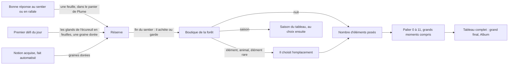

# Numebois : plan d'action

Ce document est vivant : il est mis à jour à chaque nouvelle demande (voir [Tenue du plan](#tenue-du-plan-et-personnalisations-copilot)). Le cahier des charges d'origine reste dans [PLAN.md](PLAN.md), et le workflow GitHub dans [GITHUB_WORKFLOW.md](GITHUB_WORKFLOW.md).

Numebois est un jeu web éducatif pour un enfant de CE2 : chaque exercice réussi fait grandir une forêt cartoon. Il couvre les tables, le calcul mental, les opérations posées (addition, multiplication par 1 chiffre) avec un atelier guidé, les fractions, les unités et conversions, les mesures, l'heure et les durées. S'y ajoutent de petites leçons interactives, un mode « rafale » pour automatiser les calculs et des défis chronométrés bienveillants.

Stack : Vite + TypeScript + Preact, scène 3D Three.js en style cartoon low-poly, PWA hors-ligne sur la tablette de l'enfant (Lenovo Tab M10 Gen 3), déploiement GitHub Actions vers GitHub Pages. Tout le contenu (notions, leçons) est du TypeScript typé, organisé en modules par domaine ; les devoirs de la semaine se règlent sur la tablette, dans le tableau de bord parent. Ajouter « les divisions » ou « les triangles » revient à ajouter un module selon une recette fixe.

## Objectif principal : donner envie, malgré la difficulté à se concentrer

L'enfant a beaucoup de mal à se concentrer. Le but n°1 est qu'il ait envie de revenir de lui-même pour embellir sa forêt, et qu'il travaille ses leçons sans s'en rendre compte. Chaque choix de conception est jugé à cette aune.

1. **Boucles très courtes :**
   - un micro-retour à chaque bonne réponse (une feuille qui jaillit dans le panier de Plume, une étincelle) ; à la fin du sentier, Plume verse le panier dans la réserve ;
   - à la fin de chaque sentier, de quoi acheter au moins un élément (voir [Boucle de progression](#boucle-de-progression)) ;
   - jamais plus de quelques questions sans changement visible.
2. **La fin toujours visible :** le sentier s'affiche comme un chemin de 10 pierres au plus. Il sait à tout moment combien il en reste. Longueur par défaut : court (environ 5 minutes). Une mini-session de 2 minutes compte aussi. Le sentier garde la durée de 10 questions rapides : quand ses questions sont longues (opération posée, règle, problème…), il a moins de pierres (#153, point 8 de la boucle de progression).
3. **C'est sa forêt :** il accumule des ressources et décide lui-même quoi acheter, quand, et où le poser parmi 2 ou 3 emplacements qui brillent.
4. **Un but visible pour le tableau :** les grands moments du tableau (dans la clairière : un lac, une grande montagne) sont des paliers annoncés avant d'arriver (silhouette dans la brume, cuvette sèche, puis étincelles dorées au palier d'avant) et se révèlent au fil du jeu, avec un grand final quand le tableau est complet. Une saison achetée reste ensuite au choix de l'enfant pour ce tableau.
5. **De petites surprises :** de temps en temps, une visite imprévue et offerte (oiseau rare, papillons, arc-en-ciel). Pas de tirage au sort.
6. **Le travail déguisé :**
   - le mot « leçon » n'apparaît jamais : c'est « Plume te montre une astuce » ;
   - les exercices parlent du décor du tableau (glands, cabane, ruisseau, horloge du moulin) ;
   - les devoirs de la semaine, réglés par le parent sur la tablette, deviennent des « quêtes » ;
   - le ton des textes : l'enfant a un très bon vocabulaire, donc ni mots d'école ou d'adulte, ni langage enfantin (propriétaire, 2026-11-25).
7. **Concentration protégée :**
   - pendant une question, une seule chose à l'écran, sans menu ni animation qui attire l'œil en dehors des moments de récompense ;
   - les animaux et les arbres ne réagissent au toucher qu'entre deux sentiers (promenade, visite d'un tableau de l'Album), jamais pendant le sentier (#28).
8. **Manipuler plutôt qu'écrire :** horloge, règle, parts et opérations posées se manipulent au doigt, ce qui est plus engageant que la saisie seule.
9. **À éviter :** chronomètre imposé, classement, tirage au sort ou pochette surprise, ressource qu'on peut perdre, notifications, compte à rebours, tout ce qui ressemble à une punition.

## Boucle de progression

Décisions du propriétaire (2026-11-23) : l'enfant accumule des ressources et les dépense quand il le décide. C'est la référence pour toute la mécanique de jeu.

1. **Deux ressources, jamais perdues :** les **feuilles**, une par bonne réponse, deux au record de la notion dans le sentier (sentier, rafale ; au défi, les glands de l'écureuil, voir les points 6 et 7) ; les **graines dorées**, plus rares, gagnées en apprenant (notion acquise, fait automatisé, cran franchi) et au premier défi du jour. La réserve passe d'un tableau au suivant ; une erreur ou une absence ne retire rien.
2. **Il dépense quand il le décide, à la fin du sentier :** après le résumé, la boutique de la forêt s'ouvre (plus tard aussi à la fin d'une rafale ou d'un défi). Il achète, ou garde tout pour plus tard. Pendant le sentier, rien à acheter : les feuilles du sentier s'accumulent dans le panier de Plume, à ses pieds sur l'ardoise ; à la fin, Plume le verse dans la réserve, feuille après feuille, puis la boutique s'ouvre (demande du propriétaire, 2026-11-23 : donner envie d'aller au bout du sentier). Ce n'est qu'une mise en scène : chaque feuille est sauvegardée dans la réserve dès la bonne réponse, et un sentier quitté en route ne perd rien (le panier est dans la réserve au retour).
3. **Ce qui s'achète** (catalogue propre à chaque décor) : les éléments à poser (arbres, massifs, rochers, objets), les animaux et les éléments rares, les saisons du tableau en cours et sa nuit. Proposition à calibrer (#29) : éléments en feuilles ; animaux, éléments rares, saisons et nuit en graines dorées. Un article peut demander un palier (le loup a besoin du promontoire du palier 10). Un article hors de portée montre ce qu'il reste à gagner, jamais un message de manque.
   - **Boutique de la clairière (#83, `src/scene/shop.ts`) :** au plus 4 articles, en cartes de 148 px avec une grande image et un prix : « Une pousse » (6 feuilles au palier 0, une de plus tous les deux paliers, `leavesPerElement`, #141, #29 ; elle devient un arbre ou un massif selon la place choisie parmi celles qui brillent, #25), puis les animaux ouverts à ce palier (un de chaque espèce) et le prochain à venir. Les animaux (1 graine dorée) s'ouvrent aux paliers où ils arrivaient (`ANIMAL_OFFERS` : biche 3, renard 5, cerf 7, seconde biche 8, loup 10) ; un animal pas encore ouvert dit « Encore 3 pousses », un article trop cher « Encore 2 feuilles ». Les images des animaux sont rendues une fois par le moteur de la scène (de trois quarts, `src/scene/render/portrait.ts`). Un animal acheté entre aussitôt dans la prairie (gerbe d'étincelles, caméra qui se penche, « Une biche arrive ! ») et la description du tableau le garde (`animals`). Les animaux achetés ne sont jamais retirés par la qualité automatique.
   - **Saisons du tableau (#82) :** la boutique vend la saison suivante de l'année, une à la fois, juste après « Une pousse » : un tableau commencé en été propose l'automne, puis l'hiver, puis le printemps (2 graines dorées, `SEEDS_PER_SEASON`, #29 ; la deuxième saison du tableau s'ouvre au palier 3, la troisième au palier 7, la quatrième au palier 10, `SEASON_STAGES`). Une saison achetée arrive aussitôt sous le voile de lumière (« L'automne arrive ! »). Les saisons du tableau (`seasons`, celle de départ puis celles achetées) et la saison montrée (`season`) restent dans sa description ; le tableau suivant n'a que sa saison de départ.
   - **Nuit du tableau (#85, décisions du propriétaire, 2026-11-24) :** la boutique vend la nuit du tableau juste après la saison, annoncée dès le palier 4 et ouverte au palier 5 (`NIGHT_STAGE`, 2 graines dorées, `SEEDS_PER_NIGHT`, #29), une fois par tableau (« La nuit arrive ! »). Elle se choisit comme une cinquième saison dans la barre des saisons (lune et étoile) ; elle garde les plantes de la saison montrée avant elle et ne change que la lumière, la vie et le son. Dans la description : `night` (`none`, `owned`, `shown`).
4. **Les paliers avancent tout seuls** avec le nombre d'éléments posés ; ils ne s'achètent pas. Les grands moments (lac, montagne) sont des paliers (#81). Le tableau est complet quand ses emplacements sont remplis.
5. **À surveiller (le propriétaire joue à la place de l'enfant, #128) :** la forêt ne change plus pendant le sentier, seulement à la fin (environ toutes les 5 minutes en sentier court) ; la boutique doit rester courte (quelques articles, grandes images, un toucher) pour ne pas devenir un menu où il se perd.
6. **Ce que rapporte chaque mode (#124, décision du propriétaire du 2026-11-25, niveau « cible ») :** le sentier fait pousser le paysage ; la rafale fait pousser l'arbre de ce qu'on sait par cœur ; le défi est un jeu avec l'écureuil. Ni la rafale ni le défi ne sont un meilleur moyen que le sentier d'embellir le paysage.
   - **Sentier :** une feuille par bonne réponse, deux au record de la notion (point 7), multipliées par l'effort d'une question longue (point 8) ; seule source régulière de feuilles.
   - **Rafale (#125, livré) :** un fait pas encore su par cœur donne une feuille au plus une fois par jour (`paid`, jour de la dernière feuille du fait ; `Drill.earned`), 10 feuilles par jour au plus, toutes branches confondues (`DRILL_LEAVES_PER_DAY`, #29 : la première rafale du jour rapportait plus par minute que le sentier) ; un fait déjà su par cœur n'en donne pas ; un fait qui devient su par cœur donne sa graine dorée (inchangé). Une rafale rapporte donc moins d'une feuille par question, le sentier au moins une.
   - **Défi (#120, #126) :** les glands sont ceux de l'écureuil, un par bonne réponse, sans feuille dans le panier de Plume. Au premier défi du jour, l'écureuil remercie avec une graine dorée et échange ses glands contre autant de feuilles ; ensuite, on joue pour le record. Un rendez-vous, pas une série : rien n'est perdu si l'enfant ne vient pas.
   - Les prix en graines baissent ensuite avec la simulation des trois modes (#29).
7. **Payer l'effort, pas la répétition (règle du propriétaire, 2026-11-25) :** l'enfant est débrouillard ; s'il trouve un moyen de gagner beaucoup en évitant le difficile, il le prendra. Les gains suivent la difficulté et la nouveauté ; répéter en boucle un exercice simple ne rapporte rien de plus. Avant #141, rater exprès faisait baisser la difficulté sans baisser le gain (3 erreurs de suite, sentier « en difficulté »). Décision du propriétaire (#141, 2026-11-25, proposition validée telle quelle) :
   - **record par notion** (`best` dans la progression, plus haut niveau atteint, ne baisse jamais, `bestLevel`) ;
   - **sentier :** deux feuilles (`LEAVES_AT_RECORD`) pour une bonne réponse au record de la notion (cœur, nouveauté, retour d'une erreur, révision ; `atRecord` dans `src/core/trail.ts`, `Session.worth`), une sinon (échauffement, fin, question facile, sous le record, notion acquise rejouée hors révision) ; deux feuilles s'envolent alors vers le panier de Plume ; rien ne baisse par rapport à avant, le difficile reçoit un bonus ;
   - **une graine dorée par cran franchi** (`level` dans les `Achievement`, « Tu montes d'un cran : … »), la première fois qu'une notion atteint un niveau en y montant elle-même (pas par la plage du parent) : la graine suivante demande toujours un exercice plus dur ;
   - **prix des pousses qui montent avec les paliers** (6 feuilles au palier 0, une de plus tous les deux paliers, `leavesPerElement`, #29) ; pas de graine « par sentier terminé », qui paierait la répétition ;
   - **montrer où il reste des feuilles à gagner aujourd'hui** (#143, maquettes choisies par le propriétaire) : une pastille feuille au-dessus de la souche tant qu'une branche en donne encore aujourd'hui, une pastille gland au-dessus du panneau « Défi » et sur la proposition de l'écureuil (aussi quand il passe après un sentier) tant que le cadeau de l'écureuil n'est pas donné ; sans pastille, la souche ou le panneau ne se balance plus et seul le « Chemin du progrès » appelle ; dans l'arbre, une pastille feuille sur la planche des branches qui en donnent encore (`paysToday`), et Plume ne fait briller qu'une de celles-là (aucune une fois tout cueilli) ; jamais « plus rien à gagner ».
8. **Payer l'effort des notions longues (#153, décision du propriétaire, 2026-11-26) :** une opération posée ou une mesure à la règle dure bien plus qu'une table ; payée pareil, elle rapporterait moins par minute.
   - **Temps estimé par niveau** (`questionSeconds` de la notion, `src/domains/*/skills.ts`), à défaut 12 s, une question rapide (`QUESTION_SECONDS`, séance #128). Estimations faites sans séance, pour un enfant de 8 ans : poser une addition 25 à 70 s, une multiplication 25 à 60 s, mesurer 15 à 55 s, tracer 15 à 22 s, l'heure 10 à 30 s, les durées 15 à 30 s, le calendrier 12 à 25 s, la monnaie 20 à 25 s, convertir 12 à 22 s, la balance 10 à 20 s, les problèmes 25 à 40 s. À remplacer par des temps mesurés quand le propriétaire pourra jouer à la place de l'enfant.
   - **Effort** = temps / 12 s, arrondi au-dessus (`effort`, `src/core/economy.ts`) : une minute sur une notion longue ne rapporte jamais moins qu'une minute sur une notion rapide. Il multiplie les feuilles de la question (`Session.worth`) et les graines dorées d'une notion acquise ou d'un cran franchi (`seedsOf` ; un fait su par cœur reste à une graine).
   - **Sentier en temps** (`fitTime`, `src/core/trail.ts`) : il garde la durée de 10 (ou 6) questions rapides ; les questions du cœur partent d'abord (une reste), puis les révisions (elles attendent le sentier suivant), puis l'échauffement (un reste) ; la notion en focus garde la moitié du temps. Au pire : un échauffement, une question, la fin, tous longs.
   - **Simulations :** `tests/unit/economy.test.ts` (un tableau en 35 à 45 minutes ; une notion longue en focus ne ralentit pas le tableau par rapport à une rapide) et `tests/unit/simulation.test.ts` (six mois au même temps de jeu : une notion longue demande plus de temps, un peu moins de notions s'ouvrent).

Tickets : réserve et micro-retour (#22), boutique (#83), pose et paliers (#24), emplacement (#25), saisons (#82), nuit (#85), éléments rares (#46), calibrage (#29).

## Décisions

- **Stack :** Vite + TS strict + Preact (interface et widgets en DOM/SVG, par-dessus la scène) + Three.js en WebGL2 (paysage 3D uniquement). PWA hors-ligne via vite-plugin-pwa.
- **Visuels : le rendu est la priorité n°1, c'est la motivation première de l'enfant.** Style cartoon low-poly en 3D temps réel. Base : les packs **KayKit** de Kay Lousberg (Forest Nature Pack et Medieval Hexagon Pack, licence CC0, conçus pour le mobile, une seule texture de dégradé partagée). Le MCP Blender sert à compléter dans le même style (stades de croissance, cabane, grands moments, animaux si besoin). Le code ajoute la vie : lumière, ciel, brouillard, vent, eau, particules, animations de pousse, ambiance qui s'enrichit. Le rendu est validé par une tranche verticale avant de construire le reste du jeu.
- **Assets :** seulement les versions gratuites de KayKit (CC0) ; pas de pack payant, les modèles et variantes manquants sont générés (code ou MCP Blender). Pas de dépôt privé. Les fichiers bruts des packs et nos sources Blender restent hors du dépôt (`assets/` et `assets-private/` en local, ignorés par git). Les modèles optimisés par la chaîne de traitement (`public/assets/kaykit.glb`, CC0) entrent dans le dépôt avec un fichier `LICENSES.md` (décision du propriétaire, 2026-11-22, ticket #3) : le site publié affiche ainsi les vrais modèles. Tout autre pack (animaux, sons) doit avoir une licence vérifiée compatible (CC0 de préférence) : les animaux Quaternius (CC0) suivent le même chemin (`public/assets/animals.glb`, #10).
- **Scène de démonstration (2026-11-22, `src/scene/`) :**
  - **Un seul atlas pour les deux packs.** La disposition est déclarée une seule fois dans `src/scene/atlas.ts`. L'atlas KayKit Forest (1024², 8×4 cases) garde ses 3 cases d'origine ; les nouvelles couleurs occupent des cases libres ; les 7 cases du Medieval Hexagon utilisées par nos modèles (montagnes, nénuphars, plante d'eau, nuages) et par l'eau y sont copiées au pixel près, et les UV de ces modèles sont seulement décalés d'un nombre entier de cases. La fusion est donc sans perte, avec un seul matériau. Il reste 2 cases libres : ajouter des bâtiments du pack hexagonal demanderait un atlas plus large ou une deuxième texture. Pas de mipmaps (les dégradés n'en ont pas besoin, et ils feraient baver les cases voisines).
  - **Manifeste et modèles optimisés commités.** `npm run assets` écrit `public/assets/kaykit.glb` et `src/scene/assets.gen.ts` (noms, tailles, triangles), commités tous les deux (#3) ; un test échoue s'ils ne correspondent plus. Sans le GLB (clone sans ce fichier, `?assets=placeholder`), la scène utilise des formes de remplacement de même taille et un atlas peint depuis la disposition.
  - **Pousse et vent dans le shader.** Chaque arbre est généré adulte ; ses sommets portent un point d'origine et deux âges de naissance, et une petite texture de données donne l'âge de chaque arbre. Faire pousser un arbre ne modifie donc aucune géométrie, et toute la forêt reste un seul appel de dessin.
  - **Tableau flottant.** La clairière flotte dans le ciel, entourée de nuages KayKit ; son ruisseau tombe dans le vide.
  - **Fleurs et champignons générés en TypeScript** (`src/scene/props.ts`), sans passer par Blender.
  - **Le relief est un axe de progrès des paliers (demande du propriétaire, 2026-11-22).** Le terrain de la clairière dépend du palier (`RELIEF_BY_STAGE` dans `src/scene/terrain/clearing.ts`) : le tableau s'agrandit à chaque palier (27 × 21 unités au palier 0, 60 × 54 au palier 11), les montagnes du fond montent (corniche au palier 2, colline au palier 3, puis de 11 à 26 unités de haut, avec neige à partir du palier 6), et l'eau en descend (de 0 à 7 chutes, une de plus à la fois ; le petit étang de la source reçoit la première cascade au palier 2 et déborde en ruisseau au palier 3 ; un ruisseau venu de l'est rejoint le ruisseau principal au palier 5, un troisième se jette dans le lac au palier 9). Les éléments sont placés une fois pour toutes dans la disposition finale, tirée de la graine : un palier décide seulement lesquels sont présents et à quelle hauteur. Un arbre garde donc sa place, sa graine et sa forme d'un palier au suivant. La caméra se cadre toute seule sur le bord du tableau et les sommets, dans l'écran au-dessus du sentier (`TRAIL_ROOM_PX`, `src/scene/render/stage.ts` : le centre de la vue monte, demande du propriétaire, 2026-11-26 : le sentier ne cache plus le bord de l'île) ; les images de l'Album gardent le tableau au milieu. Changer de palier reconstruit le tableau ; la transition animée reste à concevoir.
  - **Douze paliers, progressifs (demande du propriétaire, 2026-11-22).** Plus de paliers donnent plus d'occasions de progresser : chaque palier est un petit pas, et la plupart apportent une seule nouveauté. Les valeurs sont écrites en colonnes, une ligne par paramètre et une valeur par palier (`RELIEF_BY_STAGE` pour le relief, `LIFE` dans `src/scene/render/richness.ts` pour les densités et la vie), ce qui rend chaque progression lisible et facile à régler. La lumière glisse entre cinq ambiances (matin brumeux, matin clair, midi, après-midi chaud, heure dorée), atteintes aux paliers 0, 3, 6, 9 et 11. Le nombre de paliers est déclaré une seule fois (`STAGES` dans `src/scene/description.ts`).
  - **Chaque graine, une clairière différente (demande du propriétaire, 2026-11-22).** Sinon le jeu lasse vite. La topologie reste la même (massif et cascade au fond, lac, ruisseau vers l'avant, affluents de l'est et de l'ouest), mais la graine tire toute la disposition (`drawLayout` dans `src/scene/terrain/clearing-layout.ts`) : position des groupes, hauteur, profil et arêtes des sommets, tracé des ruisseaux, bord du tableau, buttes, emplacements d'arbres et rochers, lisière, part de sapins ; la végétation a son essence et sa fleur préférées (`floraOf` dans `src/scene/populate.ts`). Les règles de composition sont du code : un tirage qui ne les respecte pas est refait. Pour juger un changement, comparer plusieurs graines (`npm run capture -- --seed 1,2,3,4`).
- **Contenu en TypeScript, pas en YAML :** c'est toujours l'agent qui ajoute les notions et les leçons, à la demande du propriétaire. Le compilateur et les tests vérifient tout, sans schéma ni validateur à part.
- **Devoirs de la semaine sans programmation (décision du propriétaire, 2026-11-24) :** les devoirs ne sont souvent connus que quelques jours avant, et une mise à jour du jeu n'arrive sur la tablette qu'au lancement suivant. Tout se règle donc dans le tableau de bord parent, sur la tablette, même hors ligne : notions et astuces disponibles, niveaux, focus jusqu'à une date, rafale recommandée, défi à proposer (voir « Pour le parent et le code »). Aucun fichier de quête, aucune activation par la date. Ce que le jeu ne couvre pas encore devient une nouvelle notion (recette `add-skill`), à anticiper sur le programme de CE2 plutôt que sur les devoirs d'une semaine.
- **Un module par domaine** (`src/domains/<domain>/`), branché sur un registre. Le moteur (sentier, maîtrise, rafale, défis) est générique et ne connaît aucun domaine en particulier.
- **Surimpression du jeu (2026-11-23, `src/ui/`) :** Preact par-dessus la scène. Réserve en haut à gauche (feuilles et graines dorées, #22 ; un appui long ouvre l'espace parent), chemin du sentier toujours en bas au centre (un petit diorama dessiné avec les modèles et les couleurs de la forêt, `src/scene/render/trail-art.ts` : chemin de terre sur une tuile d'herbe, une pierre par question, jusqu'à un arbre ; petit et immobile pendant le sentier, pour ne pas distraire pendant une question, l'ardoise au-dessus ; entre deux sentiers, plus grand, son panneau qui appelle, voir « Accueil et promenade »), saisons du tableau et bouton du son en haut à droite ; l'exercice est sur l'ardoise (ci-dessous), qui s'écarte pendant une graine dorée. Le jeu s'affiche par défaut ; `?scene` (captures de `npm run capture`, specs du rendu) et `?debug` montrent le paysage seul. Gains et prix dans `src/core/economy.ts` (une feuille par bonne réponse, deux au record de la notion, une graine dorée par notion acquise, fait automatisé ou cran franchi, multipliées par l'effort d'une notion longue, #153, 6 feuilles par élément au palier 0 puis une de plus tous les deux paliers, 1 graine dorée par animal, 2 par saison, nuit, lucioles ou arc-en-ciel, 5 pour le grand élément du décor, 10 feuilles de rafale par jour au plus, #141, #29).
- **Écran d'exercice : l'ardoise (choix du propriétaire, 2026-11-23, #84) :** parmi trois maquettes (pupitre à droite, ardoise au centre, établi en bas), le propriétaire choisit l'ardoise : la concentration d'abord.
  - Pendant une question, la forêt s'assombrit (calque `#dim`), et l'exercice tient sur une ardoise au centre, toujours de la même taille (840 × 692 px en 1280×800) : la consigne en haut, bien visible sur un bandeau vert pâle, puis l'énoncé seul sur toute la largeur au-dessus de la zone de réponse (ou la zone de travail à gauche pour un widget large : horloge, opération posée…), la zone de réponse en bas à droite (pavé, choix), toujours au même endroit sous le doigt. Un calcul au pavé s'écrit comme sur une feuille (saisie `keypad` avec `inline`) : le nombre tapé va dans une case juste après le « = » ajouté au bout de l'opération (« 7 × 8 = ▢ », « Le double de 12 = ▢ », « 300 + 20 + 4 = ▢ »), ou à la place du « ? » d'une opération à trou (« 37 + ▢ = 100 ») ; case en pointillés tant qu'elle est vide. Un énoncé en phrase (nombre en lettres, problème, question) garde la réponse au-dessus du pavé.
  - Plume est perchée sur le bord gauche de l'ardoise. Calme pendant la question, elle donne l'indice dans une bulle, sous la zone de travail, qui ne couvre jamais la zone de réponse ; après la deuxième erreur, sa bulle montre la méthode et le bouton « Suivant » (ou Entrée), et le widget montre la réponse en jaune. Elle saute de joie après une bonne réponse. Son modèle 3D (#26) est dessiné dans son propre petit canevas : elle respire et cligne des yeux, penche la tête quand elle donne l'indice, sautille en battant des ailes après une bonne réponse.
  - Pendant une graine dorée, l'ardoise s'écarte et la forêt s'éclaire. À la fin du sentier (décision du propriétaire, 2026-11-23), une courte carte « Sentier terminé ! » montre Plume qui verse son panier dans la réserve, puis l'enfant est directement dans la promenade. La boutique n'a pas de nom : entre deux sentiers (au lancement comme après un sentier), la réserve est un bouton comme les autres (fond plein, rebord, une pousse au bout), même vide ; un appui l'ouvre, un second la ferme (la réserve brille quand un article est à portée), une carte en bas au centre avec seulement « Fermer », où chaque article hors de portée dit ce qu'il reste à gagner ; elle s'écarte pendant qu'un élément pousse ou qu'un animal arrive. Le sentier suivant attend en bas, son panneau « Chemin du progrès » planté à son départ. Pendant le sentier, la réserve n'est qu'un affichage : la toucher n'ouvre rien.
  - L'énoncé est écrit d'autant plus gros qu'il est court (quatre tailles, de 56 à 28 px). L'assombrissement est un calque CSS : à mesurer sur la tablette (une fusion plein écran de plus par image).
- **Accueil et promenade dans la forêt (décisions du propriétaire, 2026-11-23, #72) :** le jeu s'ouvre directement sur le paysage éclairé, sans carte : entre deux sentiers, au lancement comme après un sentier, l'écran est le même (décision du 2026-11-24 ; la carte d'accueil « Bonjour ! », « Se promener », « Commencer le sentier » faisait doublon avec le sentier et son panneau) ; `?practice` commence directement par la question. Entre deux sentiers, l'enfant explore : un doigt déplace la vue, deux doigts pincent pour zoomer, tournent et glissent vers le haut ou le bas pour la plongée (souris : glisser, clic droit ou Maj pour tourner, molette). Limites (`EXPLORE_LIMITS`, `src/scene/render/explore.ts`) : ±35° autour du cadrage, plongée ±8°, zoom jusqu'à ×2,5 ; la vise se déplace dans une ellipse du tableau qui grandit avec le zoom (nulle au cadrage), si bien qu'on ne sort jamais du tableau. Pendant la promenade, pas de carte ni de consigne du geste (intuitif sur tablette, choix du propriétaire) : en haut au centre, « Revenir » (retour au cadrage, dès que la vue a bougé ; d'ici là, le sentier s'efface) ; en bas, la suite : le sentier lui-même, plus grand (×1,35) que pendant un sentier, et, planté sur la même tuile d'herbe, à gauche, là où le chemin de terre commence, un panneau en bois bas, « Chemin du progrès » (deux planches claires taillées en flèche, clouées sur deux poteaux, une ligne du nom sur chacune, des feuilles sur un coin, de l'herbe et des fleurs au pied), qui brille doucement et se balance de temps en temps ; un appui sur le sentier ou sur le panneau le commence : il rapetisse sur place, panneau compris (immobile, sans halo), et devient le chemin de pierres de la question (décisions du propriétaire, 2026-11-24 : « c'est par là que tout commence », puis « qu'il reste en bas ») ; il s'efface pendant la boutique ; la vue revient en glissant au cadrage dès la fin de la promenade. Pendant une question, aucun geste ne déplace la caméra. Le fond peint reste placé d'après la caméra du cadrage (`Stage.home`) ; de près, le plan de coupe se rapproche pour ne pas couper les arbres. `?view=yaw,pitch,zoom,x,z` (parts des limites) montre une vue explorée dans `?scene`, pour les captures.
- **Toucher le paysage (#28, 2026-11-24) :** pendant la promenade (et la visite d'un tableau de l'Album), un appui bref, sans glisser, sur un animal ou un arbre le fait réagir ; pendant le sentier, rien (la vue ne suit aucun geste et le paysage est assombri derrière l'ardoise). L'appui vise ce qui est le plus proche du doigt sur l'écran, avec une portée d'au moins 36 px (cibles d'enfant), les animaux d'abord. L'animal s'arrête, se tourne aux trois quarts vers l'enfant, saute (clip `Jump_toIdle` du pack Quaternius), fait un tour au galop autour de sa place (clip `Gallop`, demande du propriétaire : prolonger et rendre plus fort ; une boucle d'un corps de rayon, plus serrée faute de place, sur l'herbe, loin des arbres, des emplacements, des rochers et de l'eau ; environ 95 % des animaux en trouvent une, les autres regardent un instant), refait face à l'enfant, se retourne et reprend sa journée là où il l'avait laissée (`Herd.react`, le temps de la réaction est mis de côté) ; une seule réaction à la fois. Les deux clips ajoutés font passer `animals.glb` de 765 à 1 025 ko. L'arbre touché (n'importe quel arbre du tableau, ou un bosquet posé par l'enfant) se tasse et s'étire comme un ressort, lâche quelques feuilles, et un oiseau y chante (merle ou pinson, pas plus d'un chant toutes les 2,5 s, à gauche ou à droite selon l'appui). Pas encore de cri d'animal (point ouvert 1).
- **Prénom de l'enfant (#138, choix du propriétaire, 2026-11-25) :** au lancement, tant que la sauvegarde n'a pas de prénom (premier lancement ou sauvegarde plus ancienne), Plume le demande avant le paysage, sur une carte en haut de l'écran (`#naming`, `src/ui/naming.tsx` ; le clavier de la tablette prend la moitié du bas). C'est le seul champ de texte du jeu. « Plus tard » joue sans prénom, jamais bloqué ; Plume redemande au lancement suivant. Le prénom est nettoyé et borné (`cleanName`, `src/core/name.ts` : lettres, espaces, traits d'union et apostrophes, 20 caractères, majuscule), affiché en texte seulement, gardé sur la tablette dans la sauvegarde (champ facultatif `name`, export compris) et modifiable dans le tableau de bord parent (onglet « Réglages » ; vide, Plume le redemande). Il reste rare, jamais pendant une question : « Bonjour, Prénom ! » en haut du paysage à l'ouverture (`#greeting`, 2,5 s), la carte de fin (« Sentier terminé, Prénom ! », « Belle récolte, Prénom ! », « Défi terminé, Prénom ! »), la fin du défi et le grand final (« Ton tableau est terminé, Prénom ! ») ; sans prénom, les mêmes phrases sans lui (`named`). Ni `?scene`, ni `?practice`, ni `?sandbox` ne le demandent ; `?name=<prénom>` le donne sans le demander (tests, captures ; vide : sans prénom).
- **Sauvegarde :** un seul enfant, IndexedDB sous le préfixe `numebois:` (l'origine github.io est partagée avec les autres dépôts), export/import JSON. Les identifiants de notions sont stables. Le tableau en cours porte son décor (`biome`, version 4 du format, #31). La compatibilité devient obligatoire dès que le propriétaire déclare « l'enfant joue pour de vrai » (voir [GITHUB_WORKFLOW.md](GITHUB_WORKFLOW.md#compatibilité-des-sauvegardes)).
- **Paysage seulement (propriétaire, 2026-11-22) :** la tablette n'est jamais utilisée en portrait. Ni mise en page ni tests en portrait ; la PWA verrouillera l'orientation (`orientation: "landscape"` dans le manifeste).
- **Tablette cible (propriétaire, 2026-11-22) :** Lenovo Tab M10 Gen 3 (2022), 64 Go, 4 Go de RAM. D'après la fiche technique (à confirmer sur l'appareil) : Unisoc T610, GPU Mali-G52 MP2, écran 10,1 pouces 1920×1200, Android 11. Le GPU est d'entrée de gamme : le budget de rendu est mesuré sur elle en priorité, et le palier de qualité par défaut en dépendra. Les tests l'émulent en paysage 1280×800 (viewport CSS supposé à un `devicePixelRatio` de 1,5, à vérifier : l'espace parent affiche la taille vue par le jeu, à lire dans l'application installée).
- **Pas de synthèse vocale :** textes courts, gros caractères.
- **Bienveillance partout :** aucune ressource perdue, indices progressifs, comparaison uniquement avec soi-même, aucune formulation d'échec.
- **Opérations posées V1 :** addition (2 ou 3 nombres, jusqu'à 4 chiffres) et multiplication par un nombre à 1 chiffre. Pas de soustraction posée.
- **Hors périmètre V1** (à ajouter plus tard, module par module) : division, géométrie, soustraction posée, multiplication par 2 chiffres, synthèse vocale, plusieurs profils, synchronisation.

## Tenue du plan et personnalisations Copilot

- Ce fichier porte la vision : décisions et recettes. Les tickets GitHub, les commits et les PR portent l'avancement et l'historique (pas de journal ici). À chaque demande (« ajouter les divisions », « l'enfant doit travailler les triangles »…), l'agent met à jour dans le même commit les décisions et les recettes. Le tableau de couverture est mis à jour à chaque jalon terminé, pas à chaque commit.
- Les instructions et skills Copilot sont maintenus en continu (voir [Personnalisations Copilot](#personnalisations-copilot)). Dès qu'une préférence ou une correction durable du propriétaire apparaît, l'agent met à jour le bon fichier dans le même commit, et le signale en une ligne à la fin de sa réponse.

## Conventions et glossaire

Le code (identifiants, fichiers, dossiers) est en anglais. Les textes affichés, les leçons, les docs et les instructions Copilot sont en français.

| Terme du jeu (FR)             | Nom dans le code          |
| ----------------------------- | ------------------------- |
| notion                        | `Skill`                   |
| fait (7×8)                    | `Fact`                    |
| domaine                       | `Domain`                  |
| sentier                       | `Trail`                   |
| rafale                        | `Drill`                   |
| défi                          | `Challenge`               |
| tableau                       | `Painting`                |
| Album                         | `Album`                   |
| grand final                   | `finale`                  |
| décor                         | `Biome`                   |
| grand moment                  | `Reveal`                  |
| emplacement                   | `Slot`                    |
| feuilles                      | `leaves`                  |
| graine dorée                  | `seeds`                   |
| réserve                       | `Reserve`                 |
| boutique de la forêt          | `Shop`                    |
| quête (devoirs de la semaine) | `Requests`, focus `until` |
| astuce de Plume (leçon)       | `Lesson`                  |
| ardoise (écran d'exercice)    | `Slate`                   |
| Carnet de la forêt            | `Notebook`                |

Domaines : `numbers`, `mental-math`, `times-tables`, `column-arithmetic` (opérations posées), `fractions`, `units`, `measures`, `time`, `word-problems`. Prévus : `division` (M6), `data` (M9), `geometry` (M10, M11).

Widgets : `Keypad`, `Choice`, `CompareSigns`, `FractionInput`, `TimeInput`, `Clock`, `Ruler`, `ScaleDial` (balance, verre doseur), `ConversionTable`, `FractionParts`, `NumberLine`, `PlaceValueFigure` (tableau de numération), `BlocksFigure` (plaques, barres, cubes), `ColumnOperation`.

## Couverture du programme

Vérifiée contre les fiches et leçons de la classe, que le propriétaire envoie en photo (skill `classwork-check`) : le contenu et la progression viennent seulement du programme officiel en vigueur (BO n° 41 du 31/10/2024) et des ressources éduscol (décision du propriétaire, 2026-11-27) ; la méthode et les mots, de la classe d'abord, puis de [maitrelucas.fr](https://maitrelucas.fr/ce2/maths-ce2/), ressource de qualité (décision du propriétaire, 2026-11-26 ; beaucoup de fiches en viennent). La colonne « Rafale » indique les faits à connaître par cœur que la rafale entraîne jusqu'à l'automatisme (décision du propriétaire, 2026-11-24 : seulement ce qui se répond instantanément ; le reste se travaille au sentier et dans les défis).

| Domaine (module)    | Notions                                                                                                                                                                                                                                                                                                                                                                             | Interaction                                                   | Leçon                                                      | Rafale                                                                         | Chrono             | État              |
| ------------------- | ----------------------------------------------------------------------------------------------------------------------------------------------------------------------------------------------------------------------------------------------------------------------------------------------------------------------------------------------------------------------------------- | ------------------------------------------------------------- | ---------------------------------------------------------- | ------------------------------------------------------------------------------ | ------------------ | ----------------- |
| `numbers`           | Lire et écrire jusqu'à 10 000, comparer, ranger, décomposer (M/C/D/U), droite graduée ; à venir (M6) : les mots des opérations (somme, différence, produit, multiple, pair, impair)                                                                                                                                                                                                 | Pavé, choix <, >, =, droite graduée                           | Valeur des chiffres                                        | Non                                                                            | Non                | Réalisé (M1) ; M6 |
| `mental-math`       | Additions simples (répertoire additif), addition et soustraction de tête ≤ 100, compléments à 10 et 100, passage de la dizaine, +9/+11, doubles et moitiés, ×10/×100 ; à venir (M7) : ± 8, 9, 18, 19, 28, 29, 38, 39, × 4 et × 8 en doublant, × un nombre de dizaines, 23 × 7, doubles et moitiés du CE2, multiples de 25, décompositions de 60, égalités à trou dans les deux sens | Pavé                                                          | Stratégies                                                 | Additions simples, compléments à 10 et aux dizaines de 100, doubles et moitiés | Oui                | Réalisé (M1) ; M7 |
| `times-tables`      | Tables de 2 à 10, commutativité, produit à trou                                                                                                                                                                                                                                                                                                                                     | Pavé, quadrillage de points                                   | Quadrillage                                                | Tables et produit à trou (suivi fait par fait)                                 | Oui                | Réalisé (M1)      |
| `column-arithmetic` | Addition avec retenues, multiplication par 1 chiffre ; à venir (M6) : soustraction avec retenues, multiplication par 2 chiffres, prix en euros posés                                                                                                                                                                                                                                | Atelier « opération posée », sac à retenue, table sur demande | Poser l'addition, la multiplication ; la soustraction (M6) | Non                                                                            | Non                | Réalisé (M3) ; M6 |
| `division`          | Partager, grouper, le signe ÷, la division inverse de la multiplication                                                                                                                                                                                                                                                                                                             | Figure de partage, pavé                                       | À décider                                                  | À décider (tables à l'envers)                                                  | Non                | Prévu M6          |
| `fractions`         | Fractions d'un tout et de l'unité, dénominateurs jusqu'à 12, toutes ≤ 1 : lire, écrire, colorier, égalités, comparer, additionner et soustraire, règle graduée en fractions d'unité                                                                                                                                                                                                 | Parts à colorier, saisie a/b, choix <, >, =, règle graduée    | Oui                                                        | Non                                                                            | Non                | Prévu M5          |
| `units`             | Longueurs km/m/dm/cm/mm, masses kg/g, contenances L/dL/cL, monnaie : relations, conversions, ordres de grandeur ; à venir (M9) : la tonne                                                                                                                                                                                                                                           | Tableau de conversion, choix                                  | Oui                                                        | Relations par cœur (1 m = 100 cm)                                              | Non                | Réalisé (M4) ; M9 |
| `measures`          | Règle (cm, mm), tracer un segment, ligne brisée, graduations (balance, verre doseur) ; à venir (M9) : périmètre                                                                                                                                                                                                                                                                     | Règle, graduations                                            | Oui                                                        | Non                                                                            | Non                | Réalisé (M4) ; M9 |
| `data`              | Tableau à double entrée et diagramme en barres : lire, compléter, résoudre un problème                                                                                                                                                                                                                                                                                              | Tableau, diagramme, barre à tracer                            | Non                                                        | Non                                                                            | Non                | Prévu M9          |
| `geometry`          | Figures planes (vocabulaire, propriétés, codage), reproduire sur quadrillage, symétrie axiale ; solides (noms, faces, sommets, arêtes, patron du cube)                                                                                                                                                                                                                              | Figures, quadrillage, solides en 3D                           | À décider                                                  | Non                                                                            | Non                | Prévu M10, M11    |
| `time`              | Lire l'heure (pile, demie, quarts, 5 en 5, minute près), placer les aiguilles, 14 h = 2 h, durées, h/min/s, calendrier                                                                                                                                                                                                                                                              | Horloge, saisie « 14h10 », frise, calendrier                  | Oui                                                        | Relations par cœur (1 h = 60 min), pas la lecture de l'heure                   | Lecture de l'heure | Réalisé (M4)      |
| `word-problems`     | Énoncés à variables sur le thème de la forêt, en une ou deux étapes, mobilisant les autres domaines ; à venir (M8) : comparaison et schéma en barre, partage et groupement, fois plus et fois moins, plusieurs étapes, produits cartésiens, prix                                                                                                                                    | Pavé, choix                                                   | Non                                                        | Non                                                                            | Non                | Réalisé (M1) ; M8 |

### Façons de faire de la classe

Confirmées par le propriétaire ou par une photo de la classe ; le jeu les suit (méthode, mots, présentation).

- Multiplication posée (#49, propriétaire, 2026-11-26) : la retenue va « à côté, dans le sac à retenue ». Photo (2026-11-26) : colonnes c d u ; « Je calcule 4 × 6 = 24. Je pose 4 et je retiens 2. », le multiplicateur d'abord ; à la dernière colonne, le nombre s'écrit en entier (« 8 + 2 = 10. J'écris 10. »), comme chez Maître Lucas.
- Heure (#55, propriétaire, 2026-11-26) : « 14h10 », et « 3h45min20s » avec les secondes.
- Longueurs (photo, 2026-11-26) : équivalences 1 m = 10 dm = 100 cm = 1 000 mm, 1 dm = 10 cm, 1 cm = 10 mm ; tableau m | dm | cm | mm (sans km, hm ni dam) ; méthode en 4 temps : repérer l'unité de départ, placer le chiffre des unités dans sa colonne, compléter par des 0, lire dans l'unité demandée ; « vers la droite, × 10 à chaque colonne ; vers la gauche, ÷ 10 ». Fiche : choisir l'unité (m, dm, cm, mm), relier les mesures égales, convertir dans les deux sens (5 000 mm = 5 m, 230 cm = 23 dm, 456 cm = 45 dm 6 cm), comparer (56 m et 60 cm).
- Fractions (photo, 2026-11-26, vues en classe avant M5) : « une fraction permet de mesurer une partie d'un tout » ; le numérateur, en haut, est le nombre de parts que l'on prend en compte ; le dénominateur, en bas, le nombre de parts égales en tout ; un rond partagé en 9, 6 parts coloriées, 6/9 se lit « six neuvièmes ». Maître Lucas n'a pas de fractions en CE2 (son site suit l'ancien programme) : le contenu suit le programme en vigueur (BO n° 41 du 31/10/2024), sa leçon de CM1 seulement les mots (2026-11-27).

## Architecture

- `src/core/` : moteur générique en TS pur.
  - `rng.ts`, `expr.ts` (interpréteur limité, pas d'`eval`) ;
  - `mastery.ts` (cycle de vie et Leitner), `facts.ts` (suivi fait par fait), `trail.ts` (sentier), `drill.ts` (rafale), `challenge.ts`, `records.ts` ;
  - `registry.ts` et `types.ts` : les contrats `Domain`, `Skill`, `Generator`, `Exercise`, `Lesson` ;
  - `content.ts` : les règles de contenu vérifiées sur chaque exercice tiré (`exerciseErrors` : réponse exacte et de la forme que rend le widget, 2 à 4 choix, phrases de 12 mots, bulles de 3 phrases ou lignes et 120 caractères, énoncé de 25 mots, aucun mot d'échec, fait déclaré).
- `src/domains/<domain>/` : un module autonome.
  - `index.ts` : `defineDomain` (id, nom affiché en français, icône, liste des notions) ;
  - `skills.ts` : notions avec id stable, prérequis, niveaux de difficulté internes, drapeau `challenge` ; une notion à faits (`facts`) se joue en rafale ;
  - `generators.ts`, `validate.ts`, `hints.ts` : fonctions pures ;
  - `facts.ts` (facultatif) : découpage en faits élémentaires pour l'automatisation, par exemple « 7×8 » ou « 3+7=10 » ; `exercise(fait, rng)` pose un fait donné (rafale), `groups` regroupe des faits pour une rafale ciblée (« La table de 7 », id stable `table-7`) ;
  - `lessons/*.ts` : leçons écrites avec `defineLesson` ;
  - `widgets/*.tsx` : seulement si le domaine a besoin d'une interaction qui lui est propre ;
  - `problems.ts` : modèles d'énoncés ;
  - `*.test.ts`.
- `src/domains/index.ts` : le registre, une ligne par domaine.
- `src/ui/widgets/` : widgets partagés (voir le glossaire). Un widget par type de saisie (`ExerciseInput`), déclaré dans `src/ui/widgets/index.tsx`. Un nouveau type ne compile pas sans ses quatre morceaux : le type, sa règle de réponse (`ANSWER_FITS`, `src/core/content.ts`), son widget et son pilote de test (`DRIVERS`, `tests/e2e/helpers.ts`). Le widget reçoit l'exercice et son état (`locked`, `right`, `shown` : la réponse montrée après la deuxième erreur) et renvoie une réponse (`onSubmit`). Il se place lui-même sur l'ardoise avec `Work` et `AnswerZone`. Les modes `demo` et `guided` viendront avec le `LessonPlayer` (#50). La validation et les indices viennent du domaine.
- **Regarder ou manipuler (décision pour #21 et les ateliers) :** ce que l'enfant regarde et ce qu'il manipule restent séparés. Une illustration en lecture seule (droite graduée à lire, horloge, parts coloriées, quadrillage) est un champ `figure` de l'exercice, affiché dans `Work` sous l'énoncé, à côté de la zone de réponse ; la saisie (`ExerciseInput`) dit seulement comment il répond. Lire une graduation = figure « droite graduée » + pavé ; placer un nombre = saisie `number-line` qui occupe `Work wide`. Une figure a son composant par type, exhaustif comme les saisies (`FIGURES` dans `src/ui/widgets/index.tsx`, #21).
- **Essayer une notion :** `?practice=<notion>&level=<n>` joue cette notion seule à partir de ce niveau, sur un tableau neuf, sans lire ni écrire la sauvegarde (tests, revue d'une nouvelle notion sur la tablette).
- **Bac à sable :** `?sandbox` joue sans lire ni écrire la sauvegarde ni l'Album, sur le tableau de l'adresse (`biome`, `seed`, `season`, `fill` ; le palier suit le nombre d'éléments posés, aucun animal acheté), avec la réserve `leaves` et `seeds`, et `practice`/`level` pour une notion seule. Le panneau `?debug` y mène (section « Jouer (bac à sable) ») ; en jeu, le panneau du bac à sable (`src/ui/debug.ts`, raccourcis `GameDebug` de `game.tsx`) répond juste ou faux, finit le sentier, ajoute des feuilles ou des graines, et montre la phase, la réponse attendue, le palier et la progression de chaque notion.
- `src/scene/` : paysage Three.js, `render/` (moteur de rendu), `biomes/` (décors) et `painting.ts`. Le module `word-problems` puise le vocabulaire et les objets du décor en cours pour habiller les énoncés.
- `src/ui/` : surimpression (`game.tsx`), ardoise (`slate.tsx` : `Slate`, `Work`, `AnswerZone`, `Statement`) et les personnages, Plume et l'écureuil (`character.tsx`). Gabarit des widgets larges : la zone de travail fait environ 430 × 450 px à côté de la zone de réponse (300 px de large) ; `Work wide` prend toute la largeur (environ 760 px) pour un énoncé seul, une règle ou une droite graduée, et la zone de réponse passe dessous.

### Leçons sans YAML

Une leçon est une courte liste d'étapes typées dans le module :

- `explain` : texte court et widget en démo animée, avec un petit script d'actions (par exemple « déplacer la grande aiguille sur 30 », « surligner la colonne des unités ») ;
- `manipulate` : consigne, widget en mode libre et condition de réussite ;
- `guidedExample` : widget en mode guidé, par exemple une opération posée commentée par Plume ;
- `check` : 2 ou 3 exercices tirés des générateurs du domaine, sans effet sur la maîtrise.

`LessonPlayer` les joue toutes de la même façon. Les illustrations sont les widgets eux-mêmes, donc pas d'images à produire. Une leçon fait au plus 6 étapes (vérifié par un test).

## Recette : ajouter une notion ou un domaine

Exemples de demandes : « ajouter les divisions », « l'enfant doit travailler les triangles ». Le skill `add-skill` en donne la liste de contrôle.

1. Mettre à jour ce plan : décisions.
2. Si le domaine existe, ajouter la notion dans son `skills.ts`. Sinon, créer `src/domains/<domain>/` et l'enregistrer dans `src/domains/index.ts`.
3. Écrire générateurs, validation et indices, avec leurs tests (1 000 graines, contraintes respectées). L'indice 1 nomme les erreurs typiques de la notion dès sa création (#168) : erreurs et textes proposés au propriétaire et validés avant d'être écrits, un test par erreur. Les règles communes (`exerciseErrors`) sont vérifiées sans rien ajouter par `tests/unit/content.test.ts`.
4. Réutiliser un widget partagé si possible. Sinon, ajouter un type de saisie à `ExerciseInput`, sa règle de réponse, son widget dans `src/ui/widgets/index.tsx` (placé sur l'ardoise avec `Work`, ou `Work wide`, et `AnswerZone`) et son pilote de test.
5. Écrire une leçon courte, et éventuellement des modèles de problèmes.
6. Déclarer les prérequis pour placer la notion dans le parcours.
7. Pas de quête à écrire : le parent met la notion en focus depuis le tableau de bord quand elle arrive dans les devoirs.
8. `tests/e2e/notions.spec.ts` joue déjà chaque notion sur l'ardoise (indice, réponse montrée, dernier niveau, capture jointe) ; ajouter un test Playwright pour ce que le widget a de propre (glisser, aimanter), puis relire les captures et essayer `?practice=<notion>`.

Ajouter un décor (« fais un tableau de montagne »), détail dans le skill `add-biome` :

0. Maquette d'abord : un terrain de concept derrière `?biome=` (relief, eau, arbres, sans emplacements ni grands moments animés), captures aux paliers 0, 6 et 11 à côté de la clairière, validées par le propriétaire avant de construire le décor.
1. Terrain : un module `src/scene/terrain/<nom>.ts` qui implémente l'interface `Terrain` (sol, eau, hauteur en tout point, emplacements d'arbres par rôle, gros rochers, cascades, berges, cultures, pièces qui tournent, cadrage). Le sol et le dessous du diorama viennent de `terrain/diorama.ts` ; tout le reste (arbres, végétation, lumière, effets) est partagé.
2. Décor : `src/scene/biomes/<nom>.ts`, ajouté à `BIOMES` (et son identifiant à `BIOME_IDS`) : nom, terrain, noms des paliers, colonnes de vie et de son remplacées, teinte de la lumière, effets inédits, vocabulaire ; ses animaux dans `ANIMAL_OFFERS`.
3. Couleurs : une nouvelle couleur est une nouvelle case dans `src/scene/atlas.ts` (jamais une case d'origine), puis `npm run assets`. Les bâtiments du pack hexagonal réutilisent des cases existantes (`HEX_ALIASES`).
4. Modèles KayKit : les ajouter à `src/scene/asset-catalog.ts`, puis `npm run assets` (le manifeste est régénéré). Un modèle manquant est généré en TypeScript (`src/scene/props.ts`) ; le MCP Blender n'est qu'un recours.
5. 22 emplacements, grands moments (des paliers, annoncés au palier d'avant), effet inédit, ambiance sonore, boutique, vocabulaire des problèmes.
6. Vérifier : tests Vitest (budget de triangles, emplacements valides sur des centaines de graines, grands moments, sons), spec Playwright du paysage, puis revue visuelle avec le skill `visual-review`.

Exemples anticipés :

- **Division :** partage, quotient et reste, ? × 6 = 42. Prérequis : tables. Réutilise le pavé et une saisie « quotient + reste », et ajoute une manipulation de partage de glands. La division posée viendra plus tard, en étendant le widget `ColumnOperation`.
- **Triangles :** module `geometry` avec un nouveau widget de géométrie en SVG : toucher les sommets, tracer avec règle et équerre, reconnaître et classer les triangles (rectangle, isocèle, équilatéral). Prérequis : mesures (règle).

## Rendu : un paysage de plus en plus riche et joli

C'est le cœur de la motivation. Chaque bonne réponse doit se voir, et chaque tableau doit devenir nettement plus beau du début à la fin.

### Direction artistique

1. **Style cartoon low-poly en 3D temps réel,** celui des packs KayKit : formes simples et arrondies, couleurs franches et chaleureuses, une seule texture de dégradé partagée par tous les modèles. Aucun asset d'un autre style ne s'y mélange.
2. **Sources d'assets :**
   - [KayKit Forest Nature Pack](https://kaylousberg.itch.io/kaykit-forest) : arbres, buissons, herbes, rochers. Version gratuite uniquement : les variantes de couleur et les modèles manquants sont générés.
   - [KayKit Medieval Hexagon Pack](https://kaylousberg.itch.io/kaykit-medieval-hexagon) : tuiles hexagonales (rivières, lacs, côtes), moulins à vent et à eau, maisons, puits, montagnes, nuages.
   - **MCP Blender :** compléments dans le même style, en réutilisant la texture de dégradé KayKit. Il produit la cabane, les grands moments et les éléments rares (les arbres, les fleurs et les champignons sont générés dans le jeu). Il exporte aussi en lot et fait les rendus de contrôle.
   - **Répartition (décision du propriétaire) : le code compose, KayKit fournit les pièces.** Procédural en TypeScript pour ce qui est continu ou dépend de la forme du décor ; assets pour les objets posés.
     - Arbres : procéduraux (voir plus bas).
     - Terrain : procédural (relief bas-poly à facettes, couleurs de l'atlas selon la hauteur et la pente, bord de diorama).
     - Ruisseaux et lacs : tracé procédural (courbe qui creuse le terrain), ruban d'eau animé dans le shader (rides et écume qui défilent, couleurs franches de l'atlas, opaque) ; berges garnies de rochers et d'herbes KayKit le long du tracé.
     - Cascade : falaise en rochers KayKit empilés, nappe d'eau procédurale animée, écume et embruns en particules ; retouche dans Blender si c'est un grand moment.
     - Rochers, buissons, herbes : modèles KayKit (43 rochers, 22 buissons, 20 touffes d'herbe dont une version prévue pour un shader de vent), posés par le code selon la densité du palier de richesse, en `InstancedMesh` (un appel de dessin par modèle) ; saisons par cases de l'atlas (mousse, neige, herbe sèche).
     - Fleurs et champignons : générés en TypeScript dans le style KayKit (`src/scene/props.ts`), colorés par des cases de l'atlas choisies par instance.
     - Cabane, moulin : modèles (KayKit ou MCP Blender).
   - **Saisons des arbres (prototype Blender, remplacé par la génération dans le jeu ; on en garde les cases de couleurs de l'atlas et les recettes de saison) :** l'atlas `forest_texture.png` reçoit de nouvelles cases de dégradé dans les emplacements que KayKit réserve aux couleurs supplémentaires ; les cases d'origine ne bougent pas. Chaque variante garde le maillage, l'échelle et le matériau unique de l'arbre KayKit, seuls les UV changent. La neige vient du dégradé lui-même (le haut des cases éclaire les faces tournées vers le ciel). 120 modèles :
     - feuillus `Tree_1`, `Tree_2` : `Spring`, `Blossom`, `Summer`, `Fruit` (pommes), `AutumnGold`, `AutumnOrange`, `AutumnRed`, `AutumnMixed` (couleur tirée par touffe), `Winter` ;
     - parasols `Tree_3` : les mêmes sans `Fruit` ; sapins `Tree_4` : `Spring`, `Summer`, `AutumnLarch`, `Winter`, `Festive` (boules et étoile) ; arbres nus : `Summer`, `Winter` (neige sur les branches).
   - **Nouvelles essences (prototype Blender, remplacé par les familles procédurales) :** assemblées à partir des touffes et des troncs KayKit (mêmes faces, UV, normales et matériau, seulement déplacés et mis à l'échelle), en tailles A, B, C : `Tree_Lollipop` (sucette, avec `Fruit`), `Tree_Poplar` (peuplier), `Tree_Oak` (grand chêne), `Tree_Birch` (bouleau, écorce blanche tachetée), `Tree_Fir` (sapin de Noël, avec `Festive`). Les pousses `Sapling_Round`, `Sapling_Cube`, `Sapling_Umbrella`, `Sapling_Pine` servent de premier stade de croissance. Toutes reçoivent les variantes de saison : 249 modèles au total.
     - Scripts reproductibles dans `assets-private/forest-seasons/` : `atlas.py` (disposition des cases), `make_atlas.py`, `species.py` (assemblage), `build_seasons.py` (variantes, export, rendus). On y trouve aussi le `.blend`, les glTF (saison, variante et provenance dans les `extras`) et les rendus de contrôle.
   - **Forêt procédurale dans le style KayKit (décision du propriétaire) :** le code génère le squelette de l'arbre (tronc, racines, branches), habillé de tubes low-poly lisses collés à la case d'écorce KayKit ; les feuillages sont les touffes du pack, posées au bout des branches. Une graine donne un arbre ; couper le même squelette selon l'âge (0 à 1) donne ses stades de croissance, donc un arbre peut pousser branche par branche à chaque bonne réponse. Environ 2 000 à 5 000 triangles par arbre adulte. Prototype : `assets-private/procedural-trees/kaykit_tree.py` (familles `Round`, `Cube`, `Gnarly`, `Umbrella`). Le style « peint » à cartes de feuilles (`gen_tree.py`) est écarté.
     - **Générée dans le jeu, en TypeScript (décision du propriétaire, tant qu'on n'est pas bloqué) :** `src/scene/trees/` porte l'algorithme du prototype. Générateur aléatoire à graine (jamais `Math.random`) pour que l'Album rejoue les mêmes arbres ; touffes KayKit chargées depuis le manifeste ; arbres d'un tableau regroupés en un seul appel de dessin (fusion ou `BatchedMesh`) ; pousse et vent par attributs de sommets (âge d'apparition, souplesse) dans le shader. Blender reste disponible pour créer de nouvelles pièces et faire des rendus de contrôle.
   - **Animaux (décision du propriétaire, 2026-11-23, #9) :** la biche, le cerf, le renard et le loup du pack Quaternius « Ultimate Animated Animals » (CC0, environ 2 000 triangles, squelette et clips de repos, broutage et marche). On ne garde que les clips doux (ni attaque, ni mort, ni coup reçu). Préparés dans Blender : un seul matériau (couleurs portées par les sommets), donc un appel de dessin par animal, et environ 300 ko par animal avec 4 clips après compression (l'animation pèse l'essentiel). Pack CraftPix « Free Wild Animal » écarté : licence non CC0 qui interdit de redistribuer les fichiers, aucune animation, et petits animaux à peine visibles. À la distance de la caméra, la biche ne fait qu'une vingtaine de pixels de haut : il faut grossir les animaux (1,5 à 2 fois) et aviver leurs couleurs, trop ternes sur l'herbe KayKit. Plume la chouette (#26), vue de près à côté de la question, est modélisée avec le MCP Blender par un script commité (`scripts/plume.py`). L'écureuil des défis l'est de la même façon (`scripts/squirrel.py`).
   - **Troncs tombés et souches (#76) :** `WoodLog`, `WoodLog_Moss`, `WoodLog_Snow`, `TreeStump`, `TreeStump_Moss`, `TreeStump_Snow` du pack Quaternius « Ultimate Nature » (CC0, juin 2019), lus en OBJ par `npm run assets` : chaque couleur unie du pack devient une case de l'atlas KayKit (bois → `DarkBark`, bois coupé et champignons → `Cream` et `Earth`, mousse → `Summer`, neige → `SnowGround`), éclairée par le haut comme KayKit. Ils partagent donc le matériau et l'atlas des autres modèles, en `InstancedMesh` sans ombre.
3. **Forme du tableau : la clairière à relief libre (décision du propriétaire, 2026-11-22).** Un diorama 3D flottant, vu en légère plongée avec une caméra presque fixe, bordé de forêt, adossé à des montagnes d'où descendent cascades et ruisseaux jusqu'au lac. Il grandit et prend du relief de palier en palier (voir [les paliers](#ce-que-le-code-ajoute-la-vie)). L'île de tuiles hexagonales, maquettée pour comparaison, est écartée et son code a été retiré (#2) ; les montagnes du pack restent au catalogue pour un grand moment possible (#7).
4. **Compositions réglées par le code :** pour chaque décor, l'agent écrit de vraies règles de composition (premier plan qui encadre, profondeur, lisibilité depuis la caméra, respiration), et la graine les applique : chaque tableau a sa propre disposition. Vu de la caméra, un arbre cache le sol loin derrière lui : aucun emplacement devant le lac, les chutes, les bassins ou le confluent. L'enfant choisit entre 2 ou 3 emplacements qui sont tous beaux : son choix ne peut pas enlaidir la scène.
5. **Emplacements et grands moments de la clairière (#7, #81, à valider par le propriétaire) :**
   - 22 emplacements tirés de la graine (`slots` dans `src/scene/terrain/clearing-layout.ts`), dans l'ordre où ils s'ouvrent : par le premier palier qui les montre, puis les plus proches du centre du premier tableau ; au moins 4 dès le palier 0, puis le tableau qui s'agrandit en ouvre d'autres, strictement dans cet ordre. Un sur quatre est un massif (un grand buisson, deux petits et les fleurs du tableau), les autres reçoivent un arbre. Règles vérifiées pour chaque graine : rien devant l'eau, loin des ruisseaux, espacés, donc beaux quel que soit l'ensemble rempli.
   - 2 grands moments, d'où le terrain tire leur état `Reveal` (`waiting` : sa forme seulement ; `announced` : étincelles dorées ; `shown`) ; la chaîne lointaine est un palier (#81, colonne `chain` de `RELIEF_BY_STAGE` dans `src/scene/terrain/clearing.ts`), le lac des castors s'achète (#46) :
     - **le lac des castors** (décision du propriétaire, 2026-11-23 ; en vente dès le palier 7, #46) : le ruisseau de l'est (palier 5) traverse une cuvette de sable, visible dès le premier tableau, puis rejoint le ruisseau principal ; une fois les castors achetés, un barrage à la sortie de la cuvette en fait un lac avec un îlot et son petit arbre. Le ruisseau garde le même tracé avant et après : le lac le recouvre, et il repart sous le barrage. Le lac est plus grand que celui de la cascade à chaque palier (rayon de 2,4 à 2,8 au palier 0, 2,3 fois plus au palier 11, croissance rapide au début) ; il s'agrandit vers l'avant, sa rive intérieure ne bouge pas, et le pré s'aplanit autour, à un niveau entre le bassin de l'est et le confluent. Barrage : un monticule de boue sous des branches entrecroisées (`beaverDam` dans `src/scene/props.ts`, environ 440 triangles), avec trois gros troncs Quaternius posés en biais (#76) ; quelques souches fraîchement rongées autour du lac ;
     - **la chaîne lointaine** (palier 6) : trois montagnes (la grande et deux plus basses derrière elle) sur leur propre île flottante, au loin dans le coin du ciel opposé au soleil, silhouette dans la brume dès le palier 0, puis colorées et enneigées au palier 6 « neiges » ; elle garde sa place à l'écran quelle que soit la taille du tableau.
   - La saison n'est plus un grand moment : elle s'achète (#82, #83).
   - Description du tableau : `elements` (emplacement et jour de chaque élément posé, dans l'ordre, #23). Dans le jeu, c'est le tableau en cours de la sauvegarde ; pour les captures et `?debug`, `fill` en tire une part des 22 emplacements (`DEMO_FILL` par palier). Aux premiers paliers, au-delà d'environ 30 % tous les emplacements ouverts sont déjà remplis.
   - Le palier vient du nombre d'éléments posés (`ELEMENTS_AT_STAGE` : 0, 1, 2, 3, 5, 7, 9, 11, 13, 15, 17, 19 ; #24, #29) : un élément par palier au début, puis deux. Les emplacements ouverts laissent toujours au moins deux places libres au choix (300 graines mesurées : jamais bloqué, un seul cas à une place). Le tableau prépare, cachés, l'arbre ou le massif de 3 emplacements libres au plus (`candidateSlots` : le premier à s'ouvrir, un du milieu, le dernier) : un nouvel élément pousse sans reconstruire la scène. Un arbre de l'enfant pousse à moitié et grandit à chaque élément posé après lui, adulte au cinquième. Chaque emplacement ouvert garde sa place, rempli ou non, et les arbres de l'enfant n'attirent ni buisson, ni tronc, ni champignon : poser un élément ne déplace rien d'autre.
   - Le lac ne déplace que ce qu'il touche : buissons, herbes, fleurs, rochers et vie ambiante tirent leurs nombres élément par élément (ou par catégorie), jamais dans un flux partagé dont la consommation dépend du terrain.

### Ce que le code ajoute (la vie)

1. **Profondeur :** brouillard de distance teinté, ciel en dégradé, arrière-plan lointain (montagnes et nuages KayKit), vignette douce.
2. **Lumière :**
   - lumière hémisphérique et soleil directionnel, dont la couleur et l'angle sont propres à chaque tableau et à chaque palier (matin doré, après-midi, coucher de soleil) ;
   - ombres douces, limitées au diorama ;
   - halos et rayons de soleil simulés par des sprites, pas par du post-traitement coûteux ;
   - reflets sur l'eau.
3. **Mouvement :**
   - vent : un shader de sommets fait onduler la végétation depuis sa base, avec des rafales qui traversent la scène ;
   - eau animée (ondulation des sommets et texture qui défile) ;
   - nuages qui dérivent ;
   - la caméra tourne lentement autour du tableau entier pour en montrer le relief par la parallaxe (#148, `ORBIT` dans `src/scene/render/stage.ts` : ±6° de lacet et ±3° de plongée, un tour en 30 s, réglés par le propriétaire, fonction du temps de la scène, donc figée par `?time=`). Décision du propriétaire (2026-11-26) : elle ne bouge que quand la vue est entière, jamais pendant que l'enfant explore ; au premier geste, la vue part de là où l'orbite l'avait amenée, sans saut, et l'orbite reprend doucement (3 s) après « Revenir ». Elle s'efface aussi (0,8 s) pendant une question (comme le son), la pousse, l'approche d'un animal, le tour du final, et avec la préférence « réduire les animations ». Les captures de l'Album et du tableau suivant restent faites au cadrage (`Stage.home`). Hors du sentier, l'enfant peut se promener dans sa forêt (#72, voir « Accueil et promenade »).
4. **Vie :** animaux animés (déplacements courts, réactions au toucher hors du sentier, #28), oiseaux qui traversent, papillons, pollen, feuilles qui tombent, lucioles le soir.
5. **Pousse :** chaque nouvel élément sort de terre avec un effet d'étirement, une gerbe d'étincelles et de feuilles, et un léger mouvement de caméra vers lui. Les arbres passent par des stades visibles.
6. **Paliers de richesse dans chaque tableau : 12 paliers (0 à 11), nombreux et progressifs.** La richesse ne fait pas que s'accumuler. Chaque palier change visiblement l'ambiance (lumière, ciel, vie, son) **et le relief** : le tableau s'agrandit un peu, et la plupart des paliers apportent une nouveauté. On part de presque rien pour finir sur un paysage spectaculaire, par petits pas.
   - 0 « prairie » : une petite prairie nue, une source qui forme un petit étang, un grand arbre, trois jeunes pousses ; dépouillée mais déjà jolie ;
   - 1 « premières fleurs » : la prairie s'étend, premières fleurs, premier arbre de la forêt ;
   - 2 « cascade » : une corniche rocheuse et la première cascade, nénuphars ;
   - 3 « ruisseau » : le lac déborde en un ruisseau qui traverse la prairie et tombe dans le vide ; une colline monte derrière la corniche ;
   - 4 « montagne » : la colline devient une montagne, deuxième chute ;
   - 5 « confluent » : un ruisseau venu de l'est, avec sa chute et son bassin, rejoint le premier en traversant la cuvette sèche ; papillons, champignons ; des étincelles dorées sur la chaîne lointaine ;
   - 6 « neiges » : sommet enneigé, la chaîne lointaine sort de la brume, colorée et enneigée ; lumière de midi, prairie en fleurs ;
   - 7 « grande cascade » : troisième chute de la cascade principale, la forêt s'épaissit ; des étincelles dorées sur la cuvette, tant que les castors attendent dans la boutique ;
   - 8 « deux chutes à l'est » : deuxième chute à l'est, une colline se lève à l'ouest, oiseaux ;
   - 9 « trois ruisseaux » : un troisième ruisseau descend de l'ouest jusqu'au lac ; rayons de soleil, cascades qui scintillent ;
   - 10 « doré » : massif plus haut, forêt dense, la lumière tourne à l'or ;
   - 11 « féerique », le grand final : massif au plus haut, heure dorée, rond de sorcières.

   **Les éléments rares s'achètent (décision du propriétaire, 2026-11-25, #46).** Les lucioles, l'arc-en-ciel et le grand élément de chaque décor (les castors de la clairière, le moulin du verger, la montgolfière des îles du ciel, le téléphérique de la montagne, choix du propriétaire) quittent les paliers : chacun s'achète en graines dorées pour le tableau en cours (`RARE_OFFERS` dans `src/scene/description.ts`, `rares` dans la description), à partir d'un palier (lucioles 4, arc-en-ciel 6, castors 7 ; arc-en-ciel 8 aux Îles du ciel, où la première chute qui tombe dans l'eau arrive au palier 8). Surprise : la boutique ne montre un élément rare qu'une fois ouvert, un à la fois (après la saison et la nuit, avant les animaux ; 5 articles au plus). La nuit (#85) garde ses lucioles ; achetées, elles brillent aussi de jour. Le barrage des castors fait de la cuvette un lac avec son îlot ; tant qu'ils sont en vente, des étincelles dorées flottent sur la cuvette. La forêt est tirée avec le lac du tableau final, pour qu'aucun arbre ne pousse là où les castors inonderont. Les tableaux gardés avant #46 n'ont aucun élément rare ; les démonstrations (`?scene`, captures) ont ceux ouverts à leur palier, ou ceux de `?rares=beavers,rainbow`.

   **Les grands moments sont des paliers (décision du propriétaire, 2026-11-23, #81).** Un seul axe de progression pour l'enfant : pas de deuxième mécanisme qui change la même scène à un autre rythme. Chaque grand moment montre sa forme avant son palier (silhouette dans la brume, cuvette sèche) et des étincelles dorées l'annoncent au palier d'avant ; la saison n'est plus un grand moment, elle s'achète (#82, #79). La chaîne lointaine se colore et s'enneige au palier 6 « neiges » ; le lac des castors s'achète depuis #46.

   **Sa saison (demande du propriétaire, 2026-11-23, #82).** Une saison achetée reste au choix de l'enfant, pour ce tableau seulement : le tableau suivant repart de sa propre saison de départ. Un bouton discret à côté de celui du son (choix du propriétaire) change la saison du tableau ; rien n'y bouge pendant une question. Changer de saison ne déplace aucun élément. Les saisons achetées et la saison choisie sont gardées dans la description du tableau. Le bouton (`src/ui/seasons.tsx`) est une barre à gauche de celui du son : une icône par saison du tableau (fleur, soleil, feuille rousse, flocon), la saison montrée cerclée d'or ; un toucher sur une autre la montre sous le voile. La barre n'apparaît que lorsqu'elle sert (retour du propriétaire, 2026-11-24 : toujours visible mais inactive la plupart du temps, elle déroutait) : seulement si le tableau a au moins deux saisons, et seulement entre deux sentiers (promenade) et dans la boutique ; jamais pendant une question. Le feuillage d'un arbre tire ses couleurs à part (`foliage` dans `buildTree`) : sa forme est la même dans les quatre saisons.

   **Sa nuit (demande du propriétaire, 2026-11-23, #85).** Une ambiance de nuit pour le tableau en cours, achetée une fois, puis choisie dans la même barre, comme une cinquième saison (choix du propriétaire, plutôt qu'un bouton jour/nuit combiné aux saisons). Elle garde les plantes de la saison montrée avant elle (nuit d'hiver, nuit d'été) : rien ne bouge, seules la lumière, la vie et le son changent. `NIGHT_LIGHT` (`richness.ts`) tire la lumière du palier et de sa saison vers un clair de lune de dessin animé : ciel bleu nuit, ombre bleue encore assez claire pour lire le tableau, lune argentée. Le ciel (`sky.ts`) dessine la lune dans son coin et des étoiles fixes, sans scintillement ; la mer de nuages des Îles du ciel devient bleu argent. Vie : lucioles à tous les paliers (sauf en hiver, où la neige tombe), ni papillons, ni oiseaux, ni rayons, ni arc-en-ciel. Son (choix du propriétaire) : grillons (sauf en hiver), chouette hulotte et eau, plus de chants d'oiseaux, avec les sons déjà dans le jeu. Pas de cycle jour/nuit automatique ni lié à l'heure, pas de « fin de journée ». Pendant une question, l'ardoise reste lisible et rien ne clignote. Aucun maillage ni appel de dessin en plus (le ciel calcule les étoiles dans son shader). Elle remplace le décor « nuit étoilée » (décision du propriétaire).

   **Les animaux dorment la nuit, sauf le loup (#119, décisions du propriétaire, 2026-11-27).** Dans le tableau montré de nuit, chaque animal acheté dort là où commence sa journée : couché, pattes repliées, la tête enroulée contre le flanc (les canidés en boule, la queue jusqu'au museau), avec une lente respiration ; il se couche de profil, le flanc de la tête tourné vers la caméra. Les loups veillent (sur leur rocher ou dans le pré), les aigles dorment chacun sur son sommet, la tête tournée dans le dos. Touché, un animal endormi se lève, se tourne vers l'enfant, le regarde un instant et se recouche, sans saut ni galop. Le passage du jour à la nuit se fait sous le voile qui reconstruit le tableau : aucun saut visible, rien de nouveau dans la sauvegarde. Le geste de sommeil (clip `sleep`) est fait dans Blender pour tous les animaux (`scripts/sleep.py`), aucun appel de dessin ni triangle en plus.

7. **Escalade d'un tableau à l'autre (choix du propriétaire, 2026-11-23) :** chaque nouveau décor est au moins aussi intéressant que la clairière, avec au moins un effet inédit.
   - **Ce qui rend la clairière intéressante** n'est pas son thème mais quatre ressorts : un axe physique qui grandit à chaque palier (le relief monte, l'eau descend), de l'eau qui bouge, des grands moments annoncés (silhouette, étincelles, révélation), la vie et la lumière qui tourne à l'or. Les deux derniers sont partagés par le moteur ; un nouveau décor apporte **son propre axe de croissance** et son effet inédit.
   - **Un décor change la géographie, pas la couleur :** les saisons s'achètent pour chaque tableau (#82). Les décors « forêt d'automne » et « neige » sont donc écartés, comme le « ruisseau avec cascade », que la clairière contient déjà (7 chutes, 3 ruisseaux, deux lacs) ; la « nuit étoilée » aussi, remplacée par la nuit du tableau (#85).
   - **Verger des collines** (#31, deuxième décor, `?biome=orchard`) : une colline en terrasses monte du pré, terrasse par terrasse (deux collines de côté aux paliers 5 et 9), et ses bandes se plantent du centre vers les bords : tulipes, blé, lavande et rangs de fruitiers font un patchwork le long des terrasses. Un ruisseau part du sommet au palier 3, longe chaque terrasse en zigzag et tombe de muret en muret jusqu'à l'étang (une cascade de plus avec chaque terrasse, l'arc-en-ciel au palier 11). Grands moments : d'abord une maisonnette au sommet (palier 4, demande du propriétaire), puis le moulin à vent du pack hexagonal qui prend sa place, dont les ailes tournent (en vente dans la boutique dès le palier 8, #46 ; la maisonnette reste jusqu'à l'achat) ; la grande floraison, où les fruitiers et la forêt passent au rose et perdent leurs pétales dans le vent (palier 6) ; puis les fruits (palier 10). Effets inédits : ailes qui tournent, grande floraison, pétales qui volent. Emplacements : les rangs de fruitiers (ceux de devant d'abord) et des massifs bas au milieu du pré. Boutique : âne, alpaga, cheval blanc, vache (Quaternius CC0). Les cases d'atlas du moulin sont prises sur des cases existantes (`HEX_ALIASES`), sans élargir l'atlas. Problèmes : rangées de fruitiers (une multiplication visible), paniers, sacs de farine. Restent à faire plus tard : ruches et abeilles, sons propres au verger (ailes, abeilles) après écoute du propriétaire, animaux du décor chargés à la demande.
   - **Îles du ciel** (#32, troisième décor, `?biome=sky`, le plus spectaculaire de la V1) : un archipel flotte sur une mer de nuages et s'élève, une île à la fois. Une épine fixe porte la cascade : l'île principale (qui grandit jusqu'au palier 6), l'île haute loin derrière (5), qui monte palier après palier, et le palier de la cascade (7). Autour, de 4 à 6 îlots forment un arbre tiré de la graine (demande du propriétaire : des îles intermédiaires plutôt que tout relié à l'île principale) : chacun s'accroche à une île déjà là (l'île principale, un autre îlot ou l'île haute), dans une direction qui s'éloigne de l'île principale, et son pont part de celle-ci. Dans l'ordre : le premier îlot devant (1, pont de cordes au 4), l'île voisine sur le côté ou derrière, accrochée à l'île principale ou au premier îlot (3, pont suspendu au 6), un chapelet d'un ou deux îlots (9), une ou deux îles perchées, près de l'île haute ou au bout d'une chaîne (10). Règles : plus bas devant, plus haut derrière (une île n'en cache jamais une autre), un pont ne monte pas plus d'environ 30°, aucune île devant la chute de la source ni dans l'axe de la cascade, tout dans le cadre ; un tirage qui en viole une est refait. Sur 300 graines : 68 % ont au moins un îlot intermédiaire, 9 % une chaîne de trois, 53 structures différentes. Chaque île a son dôme, sa jupe rocheuse et sa propre hauteur. La source de l'île principale (palier 2) part de l'étang et tombe dans les nuages, où sa chute finit en brume. Ponts de cordes vers le premier îlot (4), puis le long des chaînes (9, 10). Grands moments, annoncés par des étincelles au palier d'avant : le pont suspendu vers l'île voisine, avec ses tours (6) ; la grande cascade sur trois étages, de l'île haute au palier, puis à l'étang de l'île principale, puis dans les nuages (8) ; la montgolfière qui dérive entre les îles (en vente dans la boutique dès le palier 8, #46). Effets inédits : mer de nuages (un disque de moutons lisses éclairés par le soleil, qui dérivent, figés en qualité basse), chutes dans la brume, ponts de cordes, pont suspendu, montgolfière. Emplacements sur l'île principale et les îlots proches (des massifs bas seulement sur ceux de devant : rien de haut au milieu du premier plan) ; devant l'eau et les bouts des ponts, un massif bas plutôt qu'un arbre. Deux prés restent libres pour les animaux sur l'île principale. Boutique : alpagas, renard, cerf, biche. Problèmes : planches, cordes, plumes, cristaux, nuages. Palier 11 : environ 90 000 triangles (137 000 avec les ombres), 49 appels de dessin.
   - **Le Grand Arbre de Plume** (#92, après la V1) : un arbre géant passe de la pousse au colosse (le générateur coupe déjà le squelette selon l'âge) ; plateformes, échelles et cabanes apparaissent dans ses branches. Grands moments : la cabane de Plume ; les lanternes qui s'allument au crépuscule. Effet inédit : rayons de soleil à travers la couronne, feuilles en spirale. Problèmes : étages, échelons, hauteurs.
   - **L'enfant juge :** les maquettes des décors lui sont montrées pour qu'il choisisse (#12). Les décors suivants viennent à la demande.
   - **La montagne des torrents** (#136, demande du propriétaire, `?biome=mountain`, validé par le propriétaire le 2026-11-26) : une gorge de haute montagne, presque sans prairie (retour du propriétaire : du rocher, plusieurs pics escarpés, des torrents qui se rejoignent, de grandes chutes). Des gradins de rocher à sommet d'herbe se lèvent autour d'un bassin au fond de la gorge, un ou deux par palier : le gradin du milieu (palier 0), la vallée suspendue derrière lui (1), les gradins bas de l'ouest et de l'est avec leur aiguille (2, 5), les gradins de l'ouest et de l'est (4, 7), puis les gradins hauts (8, 9). Derrière, des pics escarpés enneigés : le grand pic (3, qui gagne sa dernière flèche au palier 11), le pic de l'ouest (8), celui de l'est (10). Trois torrents naissent chacun sur le plus haut gradin déjà levé de leur côté et tombent de gradin en gradin. Le torrent principal descend la vallée suspendue puis le gradin du milieu jusqu'au bassin ; les torrents de côté le rejoignent sur le gradin du milieu, chacun à un endroit différent (demande du propriétaire), et il s'élargit après chaque confluent. Une fois sur deux environ, l'un d'eux ne le rejoint pas : il finit dans un petit lac sur son gradin arrière, alimenté plus tard par la chute du gradin haut. Toute l'eau finit par tomber de l'île, comme le ruisseau de la clairière (demande du propriétaire) : le bassin déborde vers l'avant en une grande chute dans le vide, le petit lac vers son côté, et une source sur un gradin bas (au moins une sans petit lac) court vers le bord ; en chemin, l'eau suit la pente et tombe de chaque gradin qu'elle quitte. Une chute de plus avec chaque gradin, la chute du bassin plus large à chaque palier. Grands moments annoncés au palier d'avant : la grande cascade (6, la vallée suspendue monte très haut, ses grandes chutes dans les embruns), le grand pic (11). Le grand élément rare, en vente dès le palier 8 (#46), est le téléphérique (#154, choix du propriétaire, les aigles ne faisant pas assez « wahou ») : deux cabines rouge vif se croisent sur deux câbles, du bassin jusqu'à une petite gare sous le sommet du grand pic, et attendent un peu en gare ; un seul pylône, un mât simple avec une traverse pour les deux câbles (au pied du premier gradin ou au bord d'un gradin), monte aussi haut que ses portées l'exigent, 8 au plus ; les gares sont de petites cabanes à toit rouge, à l'échelle des montagnes (retours du propriétaire : gares trop grandes, pylône à quatre pieds qui ressemblait à deux poteaux) ; les cabines s'allument la nuit, les gares ont leur halo (`cableway.ts`, tracé `cablewayOf` tiré dans la disposition finale, refaite tant qu'il ne passe pas : cabines loin du sol et des arbres des places, pas d'arbre sous la ligne, achat sans rien déplacer). Les aigles arrivent d'eux-mêmes au palier 9 (« les aigles ») : deux aigles planent autour du grand pic, battent des ailes de temps en temps et se posent tour à tour sur chaque sommet levé, quelques secondes à regarder autour d'eux et à se lisser les plumes, puis repartent (`render/soaring.ts`, fonction du temps seul ; ils quittent leur boucle quand elle les mène vers le sommet et la rejoignent quand elle s'en éloigne, sans demi-tour). Effets inédits : pics enneigés, torrents qui se rejoignent, embruns, aigles qui planent, téléphérique. Le fond de la gorge est un éboulis qui monte vers les côtés et l'arrière, avec un peu d'herbe autour du bassin. Disposition tirée de la graine dans des plages par élément, retirée tant qu'une règle casse (chaque bras de torrent reste sur son gradin, hors de portée des gradins plus hauts et des pics) ou que les places manquent. Emplacements : sur les sommets des gradins, à l'écart du bord et hors de portée des gradins plus hauts, ou au fond de la gorge ; un arbre ne cache une chute que si elle passe sous la ligne de visée au-dessus de lui (`hidesWater`), sinon l'emplacement devient un massif. Les gradins bas et le fond restent des pâturages sans forêt, pour les animaux. Arbres de l'enfant en sapins (un sur quatre en bouleau). Boutique : marmotte (palier 3, une deuxième au 10), chamois (5), bouquetin (7), loup (9). Le pack Quaternius n'a aucun animal de montagne : le chamois, le bouquetin et la marmotte sont faits avec le MCP Blender à partir de la biche, du cerf et du renard (`scripts/mountain_animals.py`, `made` dans `animal-catalog.ts`, export lu par `npm run assets`) ; ils gardent le squelette et les clips de leur modèle, seuls la robe, les cornes et la silhouette changent (la marmotte : pattes courtes, corps rond, os et pas des pieds remodelés avec elle). L'aigle est fait avec le MCP Blender sans modèle de départ (`scripts/eagle.py` : corps, ailes, queue et serres, squelette, clips plané, battements, atterrissage, posé, regard, toilette), dans `animals.glb` sans être vendu en animal ; le modèle généré dans le code (`eagle` de `props.ts`) le remplace sans le fichier des animaux. Problèmes : cailloux, myrtilles, edelweiss, cristaux ; la bergère et le guide. Reste à faire : mesure sur la tablette.
8. **Ambiance sonore en couches : un axe de progrès des paliers, au même titre que la lumière.** Une nouvelle couche aux paliers 0, 2, 3, 6, 9 et 11 ; on entend chacune arriver quand le palier l'atteint (#8) :
   - palier 0 : vent léger, clapotis de la source ;
   - palier 2 : la cascade ;
   - palier 3 : le ruisseau, premiers oiseaux (fond lointain et chants de pinson et de merle de temps en temps) ;
   - palier 6 : un chœur d'oiseaux plus vif, bourdonnement de la prairie ;
   - palier 9 : pic épeiche, coucou, bruissement des feuilles dans les rafales ;
   - palier 11 : grillons, chouette hulotte et carillons féeriques.

   Règles :
   - les couches sont déclarées par palier dans `src/scene/render/richness.ts` (colonnes `*Sound` pour le volume des boucles, `songs`, `woodpecker`, `cuckoo`, `owl`, `magic` pour les cris par minute), avec la lumière et les densités, et la saison les ajuste (ni insectes ni coucou en hiver, plus de chants au printemps, coucou parti en automne) ;
   - des sons courts récompensent le sentier (#36) : bonne réponse (le plus discret, il revient souvent), graine dorée, élément posé ou animal qui arrive (carillon), nouveau palier, grand final (tableau complet). Ce sont des récompenses, jamais coupées, même pendant une question : ils passent à côté du volume baissé de l'ambiance (`Soundscape.reward`). Aucun son d'erreur ni de bip. Choisis à l'écoute par le propriétaire (`assets-private/sounds/rewards.html`) ; quand deux sons lui plaisent pour un même moment, l'un des deux est tiré à chaque fois (`REWARDS` dans `soundscape.ts`) ;
   - pendant une question, l'ambiance reste basse (60 %) et continue, sans aucun cri ponctuel ;
   - jamais tout à la fois (propriétaire, après écoute) : quand une couche arrive, les plus anciennes baissent, pour que l'ensemble reste à peu près aussi fort (somme des boucles sous 2,7, test) ; et les familles de boucles (air, eau, oiseaux, insectes) passent tour à tour au premier plan, environ 40 s chacune, les autres à 40 % (`familyWeights`) ;
   - le son démarre au premier toucher (règle des navigateurs), se met en pause quand l'onglet est caché, et un bouton le coupe ;
   - budget : boucles courtes, environ 1 Mo par décor, mises en cache hors-ligne ;
   - sources (décision du propriétaire à l'écoute, 2026-11-23) : le vent reste synthétisé par le code ; l'eau synthétisée était moins bonne, et le reste ne se fait pas bien en procédural. Eau, oiseaux, insectes, feuilles et carillons sont des enregistrements CC0 de Freesound choisis à l'écoute par le propriétaire, listés dans `src/scene/audio/sound-catalog.ts` et préparés par `npm run sounds` (`scripts/build-sounds.ts` : aperçus Freesound mis en cache dans `assets-private/sounds/`, fenêtre découpée, boucle fermée par un fondu enchaîné de 2 s, volume égalisé, Opus mono 32 ou 40 kbit/s dans `public/assets/sounds/`, manifeste `sounds.gen.ts`). Les cris ponctuels sont tirés au hasard (environ N par minute, jamais deux d'une sorte à moins de 6 s), à gauche ou à droite ; chaque boucle démarre ailleurs, pour que leurs raccords ne tombent jamais ensemble.

### Contraintes tablette

1. **Rendu :** WebGL2, résolution plafonnée à `min(devicePixelRatio, 1.5)` (2 en qualité haute), caméra adaptée au format de l'écran (paysage seulement).
2. **Modèles :** glTF optimisés par la chaîne de traitement (fusion, élagage, quantification, compression meshopt). Une seule texture de dégradé de 1024² au maximum, réductible à 256².
3. **Budget :**
   - moins de 100 appels de dessin, grâce à `InstancedMesh` pour la végétation répétée et au matériau partagé ;
   - moins de 150 000 triangles visibles ;
   - environ 64 Mo de mémoire graphique au maximum ;
   - 50 images par seconde visées et 30 au minimum. Mesure sur la tablette (2026-11-23) : 24 images par seconde dans le pire cas (palier 11, tout rempli, tout révélé, tout à fond). Le propriétaire l'accepte pour l'instant, à surveiller : tout ajout au rendu se mesure contre ce pire cas.
4. **Paliers de qualité automatiques** (haut, moyen, bas), d'après un petit test de fluidité au lancement.
   - En qualité moyenne : ombres plus petites, moins de particules.
   - En qualité basse : pas d'ombres portées (remplacées par des ombres de contact pré-calculées), pas de vent en shader ni d'eau ondulante, résolution réduite.
   - Les animations de pousse et de récompense ne sont jamais coupées.
   - L'espace parent choisit la qualité (Auto, Haute, Moyenne, Basse, comme le panneau `?debug`) ; le choix reste sur l'appareil (`localStorage`, hors de la sauvegarde) et `?quality=` le remplace.
5. **Téléchargement :** environ 5 Mo au premier lancement (Three.js et un décor). Les autres décors sont chargés à la demande, puis gardés en cache par le service worker.
6. **Écrans plus petits (téléphone) :** sous 1280×720 CSS, `index.html` élargit le viewport (`width=` au format de l'écran, au moins 1280×800) et le navigateur réduit toute la page : même mise en page que la tablette, plus petite. La résolution du rendu suit les pixels réels (`devicePixelRatio` × échelle de la page). La tablette n'est pas touchée.

## Progression dans la durée sans surcharge

Principe : le contenu grandit, mais la charge par session reste fixe. Tout est limité par un budget, jamais par la quantité de contenu.

### Deux façons de jouer

1. **Sentier**, le mode par défaut, guidé et à budget fixe :
   - échauffement : 2 ou 3 questions faciles, sur les notions acquises vues il y a le plus longtemps (#48 : une notion ancrée n'a plus de révision prévue et ne doit pas attendre le hasard) ;
   - cœur : 6 à 8 questions sur la notion en cours ou en focus ;
   - au plus une nouveauté (leçon, atelier ou défi) ;
   - fin sur une réussite, puis résumé.

   Réglage parent : court (environ 5 min) ou normal (environ 10 min).

2. **Rafale**, pour enchaîner des calculs jusqu'à l'automatisme (voir la phase 7). Pas de budget : il joue tant qu'il veut.

### Pour l'enfant

1. Au plus 3 notions « en cours » à la fois dans le sentier. Une nouvelle notion ne s'ouvre que lorsqu'une autre est acquise. Une notion en focus (au plus 2) occupe l'une de ces places.
2. Cycle de vie d'une notion :
   - découverte ;
   - en cours ;
   - acquise ;
   - automatisée (pour les notions à faits, quand ses faits le sont) ;
   - entretien : révision espacée (boîtes de Leitner) aux intervalles 1, 3, 7, 21 puis 60 jours ;
   - ancrée.

   Les révisions sont plafonnées à environ 25 % du sentier, et le surplus est reporté.

3. La difficulté monte à l'intérieur d'une notion (niveaux internes). Les acquis se combinent dans des problèmes mixtes au lieu de s'empiler.
4. Viser environ 80 % de réussite. En dessous de 70 %, plus de nouveauté et davantage de réussites faciles. Si les temps de réponse s'allongent nettement, le sentier est raccourci.
5. Une leçon par session au maximum, jamais imposée deux fois, puis rangée dans le Carnet.
6. Un focus avec une date de fin (devoirs de la semaine) repasse en Auto le lendemain de cette date : ses notions rejoignent la révision normale. L'astuce demandée est proposée au départ du prochain sentier, le défi demandé par l'écureuil à la fin du prochain sentier (dès que sa notion est acquise), une seule fois chacun, toujours refusables.

### Pour l'écran et la forêt : les tableaux

1. Écran principal invariable : la forêt, une question et la réserve, la boutique à la fin du sentier, plus deux points d'entrée dans la scène, la souche « Par cœur » (la rafale) et le panneau « Défi ». Le Carnet et l'Album sont les seuls endroits qui grandissent.
2. La forêt est découpée en **tableaux** de taille fixe (environ 25 emplacements ; les grands moments sont des paliers). Un tableau est conçu pour être complété en environ 40 minutes de jeu, soit une semaine de sessions courtes, mais il n'y a pas de calendrier.
3. **Un nouveau tableau commence quand le précédent est complet, quel que soit le jour.** Grand final animé, puis le tableau est encadré dans l'Album.
4. **Décor du nouveau tableau :** l'enfant choisit parmi 2 ou 3 décors (aucune quête ne l'impose plus, 2026-11-24).
5. **Album des paysages :** tous les tableaux terminés sont conservés et revisitables, animés et en vie (pas une simple photo), avec les dates et ce qu'il a appris pendant ce tableau. Le tableau en cours n'est jamais archivé tant qu'il n'est pas complet.
6. Le nombre d'objets de chaque tableau est plafonné, ce qui règle aussi la question des performances sur tablette.

### Pour le parent et le code

1. Tests de contenu sur le registre :
   - prérequis existants, pas de boucle ;
   - au plus 6 étapes par leçon ;
   - énoncés de longueur limitée.
2. Identifiants stables. Une notion nouvelle démarre à zéro, et une notion inconnue de la sauvegarde est ignorée.
3. Tableau de bord parent (menu caché, #47) : **tout réglage pédagogique passe par lui, sur la tablette** (décision du propriétaire, 2026-11-24), jamais par du code ni une mise à jour. L'enfant ne voit que l'effet : les notions des devoirs reviennent plus souvent, l'astuce ou le défi demandés lui sont proposés.
   - par domaine, puis notion par notion : étape (à découvrir, en cours, acquis, à revoir, ancré, automatisé), niveau atteint sur le nombre de niveaux, taux de réussite récent ;
   - les faits fragiles ;
   - temps et taux de réussite des dernières sessions ;
   - réglage de chaque notion (2026-11-23, demande du propriétaire) :
     - **Auto** (par défaut) : le sentier décide ;
     - **Fermée** : jamais proposée, ni comme nouveauté ni en révision ;
     - **Ouverte** : disponible tout de suite, même sans prérequis acquis ;
     - **Focus** : prioritaire, au moins la moitié du sentier ; au plus 2 notions en focus à la fois ;
   - **niveaux** de chaque notion : le plus bas et le plus haut proposés, pour coller à ce qui est vu en classe (#47) ;
   - **devoirs de la semaine (quête, #54)** : un focus peut avoir une date de fin (voir « Pour l'enfant », point 6) ; s'y ajoutent, pour la notion, « Proposer l'astuce au prochain sentier » et « Proposer un défi » (l'écureuil le propose au prochain sentier, toujours refusable, seulement sur une notion maîtrisée) ;
   - **astuces** : chacune disponible ou non dans le Carnet (#54) ;
   - réalisé (#54) : onglet « Devoirs » (`Homework`, `src/ui/dashboard.tsx`) : notions en focus avec leur dernier jour (−/+, « Retirer » ; une notion ajoutée l'est pour une semaine), astuce à proposer au prochain sentier, défi à proposer (notions acquises avec un défi), rafale recommandée (venue de l'onglet « Notions »), astuces du Carnet (« Une fois vue », « Toujours », « Jamais »). Sauvegarde : `until` d'un réglage, `requests`, `notebookChoices` (absents = aucun) ; `endFocus` (`src/core/settings.ts`) au tirage de chaque sentier, `lessonAsked`/`challengeAsked` (`src/core/homework.ts`). Le code de la quête en fichier est retiré ;
   - les réglages sont dans la sauvegarde (exportés avec elle) et le sentier les respecte (`composeTrail`, `src/core/settings.ts`) : une notion fermée ne vient jamais (ni rafale ni défi), une ouverte arrive sans ses prérequis (avant les autres nouveautés), les notions en focus prennent au moins la moitié des questions (le cœur d'abord, puis l'échauffement et la fin s'il le faut ; la nouveauté et les révisions restent ; une notion en focus déjà acquise est révisée sans compter parmi les 3 en cours, #54), une troisième en focus remplace la plus ancienne ; le niveau demandé et celui qui progresse restent dans la plage choisie, et une notion est acquise au plus haut de sa plage ;
   - autres actions : régler la longueur, la rafale recommandée (entrée « Recommandé », en premier sur la carte de la souche) et le seuil d'automatisation (« Exigeant », « Normal », « Souple » : ×0,75, ×1, ×1,5 sur le temps d'une réponse rapide) ;
   - réalisé (#47) : appui long sur la réserve, trois onglets « Suivi » (séances des 7 derniers jours avec du jeu : temps compté question par question, 2 minutes au plus chacune ; par mode, sentier, rafale et défi, sur les 60 dernières parties : questions, temps par question, réussite, #128 ; notions par domaine ; faits fragiles), « Notions » (réglage, plage de niveaux, rafale recommandée) et « Réglages ». Champs `settings`, `automation`, `longChallenges` (défis longs, #132), `plays` (60 dernières parties), `recommended` et `name` (prénom, #138) de la sauvegarde, absents = valeurs par défaut. Le bas des « Réglages » montre l'écran vu par le jeu et la version qui tourne (commit et sa date, `__COMMIT__` injecté par `vite.config.ts` au build).

## Jalons

Chaque jalon est livré en ligne et jouable. Les jalons GitHub portent les mêmes noms.

- **M0 « Tranche verticale visuelle »** (phases 0 et R) : assets gratuits et compléments générés, chaîne de traitement des assets, un décor complet (clairière) avec ses 12 paliers de richesse, à la qualité visée, fluide sur la vraie tablette. Validation par le propriétaire et test de la réaction de l'enfant avant d'aller plus loin. Terminé le 2026-11-23.
- **M1 « Boucle jouable »** (phases 1 à 4) : forêt en tableaux avec Album, nombres, calcul mental, tables, sentier, sauvegarde.
- **M2 « Rafale et défis »** (phases 7 et 8) : automatisation des tables et du calcul mental.
- **« Équilibrage du jeu, temps et économie »** (sans numéro, ouvert le 2026-11-25) : ce que rapporte chaque mode (#124), progression qui ne se gagne ni ne se perd à tort (#122, #123), gains de la rafale et du défi (#125, #126, #127), temps par question mesuré par le propriétaire qui joue à la place de l'enfant (#128), puis calibrage des prix et de la durée d'un tableau (#29, en dernier). Fermé le 2026-11-26 (13 tickets, dont #141, #143, #149, #150, #152 venus en route) ; le poids d'effort des notions longues suit avec M4 (#153).
- **M3 « Opérations posées et leçons »** (phases 5a et 6).
- **M4 « Temps et mesures »** (phases 5b et 5c).
- **M5 « Fractions »** (phase 5d).
- **« Suivre la classe »** (permanent, jamais fermé, décision du propriétaire, 2026-11-26, à l'essai) : les écarts relevés sur les fiches de la classe (skill `classwork-check`) quand aucun jalon ouvert ne les prévoit ; chaque série de photos a son ticket parent (#165 pour le 26/11), fermé avant la série suivante. Un jalon fini n'est jamais rouvert.
- **M6 « Soustraction, division et opérations posées »** (phase 5e), **M7 « Calcul mental du CE2 »** (5f), **M8 « Problèmes du CE2 »** (5g, après M6), **M9 « Tableaux, diagrammes et mesures »** (5h), **M10 « Géométrie plane et symétrie »** (5i), **M11 « Les solides »** (5j) : ce qui reste du programme CE2 (revue du 2026-11-27, acceptée par le propriétaire), dans cet ordre, après M5.
- Ensuite : notions à la demande, selon la recette.

## Phase 0 : socle et déploiement

1. Vite + TS strict + Preact, ESLint, Prettier, Vitest, Playwright. `base: '/numebois/'`.
2. vite-plugin-pwa : manifest (paysage, plein écran, icônes), précache.
3. `.github/workflows/ci.yml` (voir [GITHUB_WORKFLOW.md](GITHUB_WORKFLOW.md#ci-et-déploiement)) : jobs `checks`, `e2e` et `Delivery gate`, puis `deploy` sur `main`. Pages (source « GitHub Actions »), protection de `main`, squash et fusion automatique sont configurés.
4. Docs et personnalisations : ce plan, [GITHUB_WORKFLOW.md](GITHUB_WORKFLOW.md), les formulaires de tickets, le modèle de PR et les personnalisations Copilot initiales (commités). Dépôt public ; labels, jalons M0 à M5, réglages de fusion (squash seul, titre de la PR, suppression des branches, fusion automatique) et protection de `main` (`Delivery gate` requis) en place.
5. Fait quand : la page vide est en ligne et installable.

État (2026-11-22) : socle réduit en place avec la scène de démonstration (Vite, TypeScript strict, Three.js, ESLint, Prettier, Vitest, Playwright, CI avec `checks`, `e2e`, `Delivery gate` et `deploy` sur Pages, PWA). Preact ajouté le 2026-11-23 avec la première boucle jouable.

## Phase R : tranche verticale visuelle (priorité n°1)

Dépend de 0. Bloque les phases 3 et 4. Peut avancer en parallèle de la phase 1.

1. **Assets de départ :**
   - télécharger KayKit Forest et Medieval Hexagon en version gratuite pour les maquettes ;
   - animaux : biche, cerf, renard et loup de Quaternius (CC0), retenus (#9).
2. **Sources des assets :** les packs gratuits et nos sources Blender restent en local, hors du dépôt. Seuls les modèles optimisés par la chaîne de traitement (`public/assets/kaykit.glb`, `public/assets/animals.glb`, `public/assets/plume.glb`) entrent dans le dépôt, avec `LICENSES.md` (#3, #10).
3. **MCP Blender :** configuration et premier lot de compléments dans le style KayKit (fleurs, champignons, cabane, cascade), avec la même texture de dégradé, exportés en glTF. Rendus de contrôle pour le propriétaire. Les arbres, eux, sont générés dans le jeu (étape 5).
4. **Chaîne de traitement des assets** (`scripts/build-assets.ts`, avec glTF-Transform) :
   - fusion, élagage, quantification, compression meshopt, texture de dégradé partagée ;
   - génération d'un manifeste typé (`src/scene/assets.gen.ts`), pour que chaque référence à un modèle soit vérifiée par le compilateur.
5. **Moteur de rendu** (`src/scene/render/`) :
   - `stage.ts` (moteur de rendu, caméra, redimensionnement), `sky.ts` (ciel, brouillard), `lighting.ts` (lumière hémisphérique, soleil, ombres, halos) ;
   - `instancing.ts` (végétation en `InstancedMesh`), `wind.ts` (shader de vent), `water.ts`, `particles.ts`, `ambient-life.ts` (animaux, oiseaux, papillons) ;
   - `growth-fx.ts` (pousse, étincelles, caméra), `richness.ts` (paliers 0 à 11 : lumière, densité, effets, ambiance) ;
   - `src/scene/trees/` : forêt procédurale (squelette, tubes, touffes KayKit, âge de pousse), avec un test qui vérifie qu'une graine donne toujours le même arbre et le temps de génération mesuré sur la tablette ;
   - `quality.ts` (paliers de qualité automatiques).
6. **Deux maquettes comparées,** une île de tuiles hexagonales (Medieval Hexagon gratuit) et une clairière à relief libre générée par le code, avec les mêmes arbres et effets, chacune avec des captures aux paliers 0, 2 et 4. Première étape : la scène de démonstration sans mécanisme de jeu (`.github/prompts/scene-validation.prompt.md`), qui valide seulement le look sur la station de travail. Le propriétaire choisit ensuite la forme du tableau ; la tablette vient après. **Fait le 2026-11-22** (pousse avec la touche G). Choix du propriétaire : la clairière ; l'île et l'option `form` sont retirées (#2).
7. **Décor « Clairière » complet** : composition, environ 25 emplacements, 3 grands moments (pistes du propriétaire, ticket #7 : l'apparition d'un lac, une grande montagne en fond, le déblocage d'une nouvelle saison ; depuis #81, le lac et la montagne sont des paliers et la saison s'achète), les 12 paliers de richesse, ambiance sonore en couches par palier (`src/scene/audio/`, voir [Ce que le code ajoute](#ce-que-le-code-ajoute-la-vie)). Emplacements et grands moments en place le 2026-11-23 (voir [Direction artistique](#direction-artistique), point 5), à valider par le propriétaire.
8. **Mode démo** `?debug&stage=0..11&fill=0..100` : curseurs du palier et du remplissage, compteur d'images par seconde, mesures de mémoire graphique, d'appels de dessin et de triangles.
9. **Fait quand :**
   - sur la vraie tablette : 50 images par seconde ou plus en qualité haute, au moins 30 en moyenne (pire cas mesuré le 2026-11-23 : 24, accepté pour l'instant par le propriétaire) ;
   - le propriétaire valide les captures des paliers 0, 6 et 11 ;
   - L'enfant regarde la démo et veut voir la suite (critère qualitatif, noté dans le ticket).

## Phase 1 : moteur générique et premiers modules

Dépend de 0. En parallèle de la phase R.

1. `src/core/types.ts` et `registry.ts` : contrats, et `defineDomain`, `defineLesson`.
2. `rng.ts`, `expr.ts`.
3. `mastery.ts` (cycle de vie, maîtrise sur les 10 dernières réponses, Leitner) et `facts.ts` (pour chaque fait : réussites, temps de réponse, état d'automatisation).
4. `trail.ts` : sentier à budget fixe, au plus 3 notions en cours, révision ≤ 25 %, au plus une nouveauté, adaptation au taux de réussite et aux temps de réponse.
5. Indices progressifs : 1re erreur → méthode ; 2e erreur → réponse et méthode, et une question proche revient plus tard. Une erreur ne fait jamais perdre de ressource. Après la 1re erreur, la réponse essayée (case du pavé, signe de « comparer », repère de la droite graduée) prend une couleur pêche douce, jamais rouge, jusqu'à ce que l'enfant la change (#121, couleur choisie par le propriétaire) ; au QCM, le choix essayé est grisé. Indice adapté à l'erreur (#167) : `hint(exercise, 1, tried)` reçoit la réponse fausse et ce que montrait le widget (`Tried`, `WidgetState` : la position de la règle) ; une erreur reconnue est nommée avec ce qu'il faut regarder, une erreur inconnue garde l'indice de méthode. Fait pour « Mesurer à la règle » (textes validés par le propriétaire : 0 sur aucun bout, bord de la règle sur le bout, règle pas tournée, seulement les mm, seulement les cm, cm mal lus, 1 ou 2 mm d'écart, mm au lieu de cm, un seul segment de la ligne brisée). Étendu à toutes les notions avec #168, domaine par domaine, textes validés par le propriétaire avant chaque domaine : fait pour le calcul mental (à 1 près, dizaine oubliée, unités bonnes et dizaines fausses, retenue oubliée, dizaine défaite gardée, soustraction à l'envers, 9 et 11 : correction oubliée ou inversés, compléments vérifiés « 3 + 6 = 9, pas 10 », double recopié, moitié prise pour le double, moitié vérifiée, × 10 et × 100 : mauvais rang ou addition) et les tables (produit voisin dans la même table d'abord, addition, facteur voisin vérifié, facteur recopié), les nombres (0 d'un rang vide oublié, chiffre d'un autre rang, nombre d'un autre rang ou nombre recopié, droite graduée à 1 ou 2 traits près), convertir (une colonne de moins ou de trop, nombres collés sans les 0, ce qui reste : nombre enlevé, 0 de trop, plus que la grande unité ; vers la grande unité : recopié ou lu jusqu'à une autre colonne), les unités de temps (100 par heure, unités ajoutées, recopié, à 10 près ; au niveau 0, la relation est la réponse : le rappel de l'horloge à la place) et les graduations (un trait près, 1 par trait, le nombre d'après), l'heure (aiguilles lues ou placées à l'envers, le chiffre lu au lieu des minutes, l'heure d'après, l'après-midi oublié, minutes et secondes échangées, grande aiguille sur le nombre des minutes, une seule aiguille fausse), les durées (100 min par heure, minutes de la fin recopiées, à 5 min près, une heure de trop ou de moins, l'heure pile passée) et le calendrier (jour d'à côté, une semaine de trop ou de moins, à 1 jour près), comparer et ranger (signe à l'envers, « = » pour deux nombres différents, l'autre bout, moins de chiffres), comparer des longueurs (nombres comparés sans les unités, signe à l'envers, mêmes chiffres autre unité), les relations (un 0 de trop ou de moins), la monnaie (pièces comptées une par une, à 1 € près, le prix pris pour le rendu), les ordres de grandeur (beaucoup trop, beaucoup trop peu), tracer (mm au lieu de cm, à 1 ou 2 mm près), les opérations posées (retenue oubliée, colonne mal calculée, dernier chiffre manquant) et les problèmes (l'autre opération, la 1re étape seule, la fin à l'envers, bon calcul à 1 ou 10 près) : toutes les notions ont leur indice adapté, sauf « lire un nombre » (choix d'écritures) ; l'erreur nommée, puis la méthode (`named`), `triedNumber` lit la réponse du pavé ; spec `tests/e2e/hints.spec.ts` (une erreur typique par domaine). Recette pour reprendre une autre notion : partir de ses leurres (`lures`, erreurs typiques), reconnaître chacun dans `hints.ts`, un test par erreur ; `exerciseErrors` vérifie la bulle après chaque leurre ; un état de widget utile s'ajoute à `WidgetState` et part avec `onSubmit(answer, state)`.
6. Modules `numbers`, `mental-math`, `times-tables` (avec faits) et `word-problems` (premiers modèles).

## Phase 2 : interface de base

Dépend de 1.

1. Carte question, pavé numérique dans le jeu (réaction dès que le doigt touche, touches clavier, jamais le clavier Android).
2. Widgets `Keypad`, `Choice`, `FractionInput`, `TimeInput`.
3. Réserve de feuilles et de graines dorées, retour immédiat (#22).
4. Paysage seulement, cibles de 56 px minimum, `touch-action: none` sur les zones à faire glisser.
5. Reprise de l'interface des exercices avant les nouvelles notions et les widgets larges : l'ardoise (#84, fait le 2026-11-23).

## Phase 3 : scène de jeu et tableaux

Dépend de R. En parallèle des phases 1 et 2.

1. Brancher le moteur de rendu de la phase R sur l'état du jeu : les éléments achetés sont posés et poussent, leur nombre fait passer les paliers.
2. **Décors** (`src/scene/biomes/`) : chaque décor définit son terrain, sa variante de couleurs, sa lumière et son ciel, ses emplacements composés (environ 25), ses paliers et leurs grands moments, ses éléments, son effet inédit, son ambiance sonore et son vocabulaire pour les problèmes. V1 : clairière (issue de la phase R), puis Verger des collines (#31), puis Îles du ciel (#32) ; ensuite le Grand Arbre de Plume (#92). Les suivants viennent à la demande (voir « Escalade d'un tableau à l'autre »).
3. **Tableau** (`src/scene/painting.ts`) : il est décrit par des données compactes (décor, graine, éléments posés avec type, variante, emplacement, stade et date). La même description sert pour le jeu et pour l'Album.
4. Boutique de la forêt (#83), puis choix de l'emplacement parmi 2 ou 3 emplacements qui brillent (#25). Annonce du prochain grand moment (étincelles, cuvette sèche, silhouette dans la brume). Choix de la saison parmi celles achetées (#82), ou de la nuit (#85). Stades de croissance. Plafond d'objets.
5. Animations : vent, eau, apparition avec rebond et particules, animaux et arbres qui réagissent au toucher (seulement hors du sentier, fait le 2026-11-24, #28), ombres douces, grand final.
6. Personnages : Plume la chouette, la souche « Par cœur » (la rafale), le panneau « Défi ».

## Phase 4 : boucle complète, tableaux, Album, sauvegarde, son

Dépend de 2 et 3.

1. Sentier complet, avec son chemin de 10 pierres visible : question → micro-retour → feuille dans la réserve → suite, puis résumé de fin et boutique (acheter, poser).
2. Calibrage des gains et des prix : de quoi acheter au moins un élément par sentier court, un tableau en environ 40 minutes de jeu (#29). Le réglage est centralisé dans un seul fichier. Repoussé en M2 (décision du propriétaire, 2026-11-24), quand la rafale, les défis et les éléments rares seront là : avec les seules notions acquises et faits automatisés, un tableau rapporte 0 à 4 graines dorées pour 19 à dépenser. Fait le 2026-11-26 (#29) : simulation `tests/unit/economy.test.ts`.
3. Fin de tableau : grand final, encadrement, entrée dans l'Album, puis choix du décor suivant (2 ou 3 au choix) et démarrage immédiat. **Fait le 2026-11-23 (#33) :** le dernier élément posé, le grand final dure 9 s (« Ton tableau est terminé ! », son du grand final, la caméra balaie le tableau de gauche à droite et s'élève un peu, `Stage.tour`, pendant que 8 gerbes d'étincelles et de feuilles jaillissent d'élément en élément, `Painting.finale`) ; puis un cadre en bois se referme autour de l'écran, avec sa plaque (nom du décor, dates) et « Il rejoint ton album ! » ; puis, sous le voile de lumière, « Un nouveau tableau ! » propose les décors (`nextBiomes` : jusqu'à 3, les moins peints d'abord ; le décor imposé par une quête part avec #54), chacun montré tel qu'il sera une fois complet (sa propre graine au palier 11, image rendue sous le voile). Un toucher démarre le tableau, dans sa saison de départ. Un tableau complet retrouvé au chargement (jeu fermé pendant le grand final) rejoue le grand final, ou repropose le choix s'il est déjà dans l'Album.
4. Album des paysages :
   - une grille de vignettes, une page par tableau, avec le tableau rejoué en vie à partir de sa description ;
   - les dates, et ce qu'il a appris pendant ce tableau (notions acquises, faits automatisés, records) ;
   - les vignettes sont générées à la fin du tableau (rendu Three.js hors écran, WebP d'environ 30 Ko).

   **Fait le 2026-11-23 (#34) :** le livre de l'Album (`#album-button`, sous le bouton du son) apparaît dès le premier tableau encadré, seulement entre deux sentiers (promenade). L'Album (`src/ui/album.tsx`) montre les tableaux encadrés, le dernier d'abord (nom, « Fini le 3 décembre ») ; un toucher rejoue le tableau en vie sous le voile (`SceneApp.show`, la description du tableau en cours ne bouge pas), où l'enfant peut se promener aux doigts, avec une petite carte : dates, notions apprises, nombre de calculs par cœur, « Retour à l'album ». Vignette : le cadrage du tableau rendu en WebP de 480 px (`Stage.capture`, environ 20 ko). Les records attendront les défis (M2).

5. (Abandonnée : petite nouveauté du lendemain, #35, décision du propriétaire : difficile à articuler avec la boucle de progression, où tout ce qui arrive dans le tableau s'achète.)
6. Sauvegarde IndexedDB versionnée (`SAVE_SCHEMA_VERSION`) : tableau en cours, Album (descriptions et vignettes), progression. `navigator.storage.persist()`. Export/import dans le menu parent caché (appui long), Album compris. L'Album est gardé à part (`numebois:album`, écrit seulement quand un tableau est encadré), la sauvegarde écrite à chaque réponse reste légère ; elle porte le journal du tableau en cours (`journal` : jour de départ, notions acquises, faits automatisés). Le fichier exporté contient les deux ; un Album illisible, comme une sauvegarde illisible, n'est jamais écrasé.
7. Effets sonores Web Audio débloqués au premier toucher, bouton pour couper le son.

## Phase 5 : ateliers interactifs

Dépend de 1 et 2. Les sous-phases sont indépendantes entre elles. Chaque atelier appartient à un module de domaine.

### 5a. `column-arithmetic` : widget `ColumnOperation`

1. Grille M/C/D/U colorée, cases de retenue, trait de résultat. L'enfant pose d'abord les nombres (#158).
2. Saisie de droite à gauche, curseur qui avance tout seul (chiffre, puis retenue).
3. Addition : 2 ou 3 nombres, jusqu'à 4 chiffres. Multiplication par 1 chiffre, avec la table concernée affichée sur demande.
4. Trois modes :
   - guidé : la colonne active est surlignée et Plume explique (« 7 + 8 = 15, j'écris 5, je retiens 1 ») ;
   - accompagné : vérification colonne par colonne, l'indice est le calcul de la colonne ;
   - autonome : vérification à la fin, en montrant doucement la première colonne qui coince.
5. Le module calcule les chiffres et les retenues attendus par colonne. Le widget ne fait qu'afficher.
6. Réalisé pour l'addition (#48) : notion `column-arithmetic.add` (« Poser une addition », prérequis : additionner de tête), saisie `column` (`ExerciseInput` : nombres, colonnes attendues `Column` avec leur calcul et la phrase de Plume, mode), widget `ColumnOperation` (`src/ui/widgets/column-operation.tsx`) avec le pavé à droite. Six niveaux : guidé (2 nombres de 2 chiffres, puis de 3 avec 2 retenues), accompagné (2 nombres de 3 chiffres, puis 3 de 2 chiffres), seul (2 nombres de 3 ou 4 chiffres, puis 3 de 2 à 4 chiffres, 2 retenues ou plus) ; résultat jusqu'à 9 999 (nombres du CE2). Guidé : un chiffre qui n'est pas le bon attend dans sa case, sans compter. Accompagné : il compte comme un essai manqué pour la maîtrise (`onSlip`), la bulle donne le calcul de la colonne. Seul : ✓ à la fin, puis le parcours habituel (indice, puis réponse montrée) ; la première colonne qui coince est montrée doucement, le curseur y va, un appui sur une case l'y déplace.
7. Réalisé pour la multiplication par un nombre d'un chiffre (#49) : notion `column-arithmetic.multiply` (« Poser une multiplication », prérequis : poser une addition et les tables), même saisie (`operator: '×'`, colonnes `multiplyColumns`) et mêmes trois modes, six niveaux (2 chiffres par 2 à 5, puis 3 chiffres, multiplicateur 6 à 9, 4 chiffres avec un zéro ; résultat jusqu'à 9 999). Méthode de l'école de l'enfant : la retenue va « à côté, dans le sac à retenue » (une case à côté de l'opération, qui garde la retenue de la colonne en cours ; Plume : « J'écris 2, je mets 4 dans le sac. »). Comme la classe (#164) : le multiplicateur d'abord (« 4 × 6 = 24 ») ; à la dernière colonne, pas de sac, le nombre s'écrit en entier, de gauche à droite (« 4 × 2 = 8, puis 8 + 2 = 10 », « J'écris 10. » : colonnes `joined`). « Voir la table de 6 » montre la table du multiplicateur à la place de l'opération, le temps d'y jeter un œil, sans compter.
8. Réalisé (#158, décision du propriétaire : poser correctement l'opération est aussi important que la résoudre) : l'enfant pose les nombres avant de calculer (`setup` de la saisie `column`, `useColumnSetup` dans `src/ui/widgets/column-setup.tsx`), sous deux formes de la même question, comme le pavé et les choix multiples. D'un appui (facile) : il touche la case où commence le nombre, qui s'écrit tout seul ; mal posé, il s'affiche là où il tombe et Plume rappelle « Les unités sous les unités ». Écrite (difficile) : il remplit les cases une par une (un appui, puis un chiffre, le curseur va à droite, la gomme reprend depuis la droite), puis ✓ ; le premier nombre mal posé est montré doucement. Tirage (`WRITTEN_SHARE`, à part des nombres de la graine) : guidé = appui avec Plume, accompagné = écrite 1 fois sur 2, seul = 2 fois sur 3. Une erreur de pose compte comme une colonne fausse (pas réussie du premier coup), sans rien perdre. Les démos des astuces restent posées par Plume.

### 5b. `time`

1. Horloge SVG : en lecture, réponse en hh:mm ; en réglage, il fait glisser les aiguilles. La grande entraîne la petite, avec un pas d'1 ou de 5 minutes.
2. Niveaux : heures piles, demies, quarts, 5 en 5, minute près. Matin et après-midi (14 h ↔ 2 h).
3. Frise des durées, h/min/s, calendrier du mois.
4. Réalisé (#55) : domaine `time` (« L’heure et les durées »). Notation de l'école de l'enfant (propriétaire) : « 14h10 », sans espace, et « 3h45min20s » avec les secondes (`timeText`/`parseTime`, `src/core/time.ts`). `time.read-clock` (« Lire l’heure », 7 niveaux : piles, demies, quarts, 5 en 5, minute près, puis « C’est l’après-midi. » où l'on attend 14h10, enfin les secondes sur la trotteuse ; défi oui, rafale non) : figure `clock`, saisie `time` (`TimeEntry` : une case par unité, les heures en orange comme la petite aiguille, les minutes en bleu comme la grande, la trotteuse en vert ; un appui sur une case la vide, le curseur passe seul à la case suivante quand elle est pleine ou qu'une heure de 3 à 9 est écrite). Sans moment de la journée dit, 3h45 et 15h45 sont justes. `time.set-clock` (« Placer les aiguilles », 6 niveaux, les mêmes sans les secondes, 14h10 se place sur 2h10) : saisie `clock` (`ClockSet`, partant de 12h00 : la grande aiguille tourne par pas de 5 minutes, d'1 minute au niveau « minute près », et entraîne la petite ; la petite, prise près du centre, saute d'heure en heure ; calcul pur dans `src/ui/widgets/dial.ts`).
5. Réalisé (#56) : `time.units` (« Heures, minutes et secondes », au pavé dans l'opération : les relations par cœur, 1 h = 60 min, 1 min = 60 s, une demi-heure, un quart d'heure, 1 jour = 24 h, 1 semaine = 7 jours, 1 an = 12 mois, qui sont ses faits pour la rafale, deux branches « Heures, minutes, secondes » et « Jours, semaines, mois » ; puis 3 h = ? min, 1 h 20 min = ? min, 80 min = 1 h ? min ; leurre typique : 100 minutes dans une heure). `time.durations` (« Calculer une durée », 5 niveaux : dans l'heure, heures entières, à cheval sur l'heure, plus d'une heure en « 1h20 » dans la saisie `time` avec `duration` (« min » après les minutes), puis l'heure de fin) sur la figure `timeline` (frise : le début et la fin sous la ligne, des bonds en pointillés sans leur longueur, jamais plus courts que 72 px pour que les heures ne se touchent pas ; choix du propriétaire, #166 : des bonds d'une heure depuis le début, puis les minutes, 14h10 → 15h10 → 15h30, et sous une heure un bond jusqu'à l'heure pile, 14h40 → 15h00 → 15h10 ; les arrêts `stops` viennent du domaine, `stopsOf`, pour que la figure, l'indice et l'astuce « par bonds » disent la même chose ; l'indice détaillé fait au plus deux bonds, les heures puis les minutes). `time.calendar` (« Lire le calendrier », 4 niveaux : le jour d'une date entourée, la date du deuxième lundi, une ou deux semaines après, puis sans calendrier « Le 12 est un jeudi. Quel jour est le 15 ? ») sur la figure `calendar` (un mois, une ligne par semaine depuis le lundi, le week-end teinté).

### 5c. `units` et `measures`

1. Règle à déplacer, segment à tracer, ligne brisée. Les longueurs sont générées en mm exacts. Réalisé (#57) : domaine `measures` (« Les mesures »). Une feuille en millimètres (`src/core/sheet.ts`) et une règle de 14 cm transparente (`src/ui/widgets/ruler.tsx`) : elle glisse sous le doigt, son 0 saute sur un bout de segment proche (aimant de 3 mm) ; le rond au bout la fait tourner autour de son 0, son bord se pose sur un segment proche. `measures.measure` (« Mesurer à la règle », saisie `ruler`, la longueur tapée au pavé sur deux rangées sous la feuille, l'unité à côté ; 6 niveaux : cm entiers, demi-cm en mm, mm, segment penché, ligne brisée de 2 puis 3 segments en cm). `measures.draw` (« Tracer à la règle », saisie `draw` : le doigt tire le trait depuis le point, au millimètre, juste à 1 mm près ; 3 niveaux : 7 cm, 45 mm, 7 cm 4 mm).
2. Graduations : balance, verre doseur. Réalisé (#58) : `measures.read-gauge` (« Lire une balance, un verre doseur », prérequis : lire une droite graduée), figure `gauge` (`ScaleDial` : cadran de balance de cuisine en g, l'aiguille orange ; `Jug` : verre doseur en cL, le liquide jusqu'à la quantité, `src/ui/widgets/gauge.tsx`), réponse au pavé. 5 niveaux, chacun avec plus de traits entre deux nombres (un nombre à chaque trait, puis 2, 5 et 2 à 5 traits) ; 4 fois sur 5, l'aiguille tombe sur un trait sans nombre ; leurres : un trait de plus ou de moins, les traits comptés sans leur valeur.
3. Tableau de conversion, relations entre unités, ordres de grandeur, monnaie. Réalisé (#59) : domaine `units` (« Les unités et la monnaie »). `units.relations` (les relations par cœur, 1 km = 1 000 m, 1 m = 100 cm, 1 kg = 1 000 g, 1 L = 100 cL, 1 € = 100 c…, dans les deux sens : ses faits pour la rafale, en trois branches, longueurs, masses et contenances, euros). `units.convert` (« Convertir », au pavé dans l'opération, la figure `conversion` à côté : `ConversionTable`, une colonne par unité, les chiffres donnés déjà placés, la colonne à lire entourée ; 8 niveaux : 4 m = ? cm, 3 m 25 cm = ? cm, masses et contenances, 325 cm = 3 m ? cm, puis sans tableau ; ajoutés pour suivre la classe (#161) : vers l'unité plus grande, 5 000 mm = ? m, 230 cm = ? dm, puis les paires m–mm, dm–mm, dm–cm, 2 m 400 mm = ? mm, puis 456 cm = ? dm 6 cm ou 45 dm ? cm ; le tableau de la classe, m | dm | cm | mm, quand le km n'est pas en jeu ; nombres groupés comme à l'école, 5 000). `units.compare-lengths` (« Comparer des longueurs », #162, après `units.convert`, saisie `compare` : une unité de chaque côté, loin, le plus grand nombre souvent la plus courte, 56 m et 60 cm, puis proches ou égales, puis la mesure égale à 34 cm parmi 4, saisie `choice`, enfin deux unités d'un côté, 4 m 876 mm et 5 m ; l'indice écrit les deux mesures dans la même unité). `units.money` (« La monnaie », figure `money` : billets et pièces à compter, en euros au pavé, puis avec les centimes parmi 4 sommes, enfin la monnaie rendue sur 10 €). `units.magnitude` (« Les ordres de grandeur », l'unité qui convient parmi celles de sa famille, au plus 4 : mm, cm, dm, m pour les longueurs, le km seulement pour une distance, à la place du mm, #163 : « Un crayon mesure environ 15… »). Un calcul écrit dans l'opération garde sa figure à côté (saisie `keypad` `inline` avec `figure`).

### 5d. `fractions`

Programme CE2 en vigueur (BO n° 41 du 31/10/2024, revu le 2026-11-27) : fractions d'un tout puis de l'unité de longueur, dénominateurs jusqu'à 12, toutes inférieures ou égales à 1. Comparer à 1, encadrer entre deux entiers et la fraction d'une quantité sont du CM1 : hors du jeu.

1. Lire, écrire et colorier (#61) : parts égales à colorier (galette, bande, tablette, tranche de tronc), saisie a/b, lecture en lettres, numérateur et dénominateur.
2. Égalités (#169, début du CE2) : 6/8 = 3/4, ?/8 = 1/2, celle qui vaut 1/2.
3. Comparer (#62) : même dénominateur, même numérateur, un dénominateur multiple de l'autre.
4. Additionner et soustraire (#170) : même dénominateur, compléter jusqu'au tout, dénominateur multiple, problèmes.
5. Règle graduée en fractions d'unité (#171, période 3) : mesurer et tracer en quarts et en dixièmes d'unité.

### 5e. Soustraction, division et opérations posées (M6)

1. Soustraction posée avec retenues jusqu'à 10 000 (#173, méthode de la classe à fournir : point ouvert 9) et son astuce (#174).
2. Division : partager, grouper, le signe ÷, l'inverse de la multiplication (#175, domaine `division`).
3. Multiplication posée par un nombre à deux chiffres (#176, période 4).
4. Additions et soustractions posées de prix en euros (#177).
5. Les mots des opérations : somme, différence, produit, multiple, pair, impair (#178).

### 5f. Calcul mental du CE2 (M7)

1. ± 8, 9, 18, 19, 28, 29, 38, 39 (#179) ; × 4 et × 8 en doublant (#180) ; × un nombre de dizaines et 23 × 7 (#181).
2. Faits par cœur : doubles et moitiés du CE2, multiples de 25, décompositions de 60 (#182) ; égalités à trou dans les deux sens (#183).

### 5g. Problèmes du CE2 (M8)

Comparaison et schéma en barre (#184), partage et groupement (#185), fois plus et fois moins (#186), plusieurs étapes, produits cartésiens et prix (#187).

### 5h. Tableaux, diagrammes et mesures (M9)

Tableau à double entrée (#188) et diagramme en barres (#189), domaine `data` ; périmètre (#190) ; la tonne (#191).

### 5i. Géométrie plane et symétrie (M10)

Figures planes (#192), reproduire sur quadrillage (#193, nouvelle saisie), axes de symétrie (#194), compléter par symétrie (#195), domaine `geometry`.

### 5j. Les solides (M11)

Nommer les solides en 3D (#196), faces, sommets et arêtes (#197), patron du cube (#198).

## Phase 6 : leçons

Dépend de 5 pour les modes démo et guidé.

1. `LessonPlayer`, scripts de démo des widgets, Carnet de la forêt. Réalisé (#50) : `src/ui/lesson.tsx` joue les étapes sur l'ardoise (`explain` avec une figure ou une démo, `manipulate`, `guidedExample`, `check` tiré à un niveau), « Suivant » ou Entrée entre deux ; un essai manqué montre l'indice, un deuxième la réponse ; ni maîtrise ni feuilles. Démo : `demo` sur les widgets (`WidgetProps`), le pavé tape la réponse, l'opération posée l'écrit colonne par colonne avec la bulle de Plume, les autres la montrent. Carnet (`Notebook`, `src/ui/notebook.tsx`) : bouton sous le son (sous l'Album s'il est là) dès la première astuce vue jusqu'au bout, une page par astuce, la dernière en haut, « Nouvelle page » marquée à la fin d'une astuce, un appui la rejoue ; pages dans la sauvegarde (`notebook`, absent = vide). `?lesson=<id>` joue une astuce au lancement ; l'astuce d'essai `column-arithmetic.add/essai` (hors registre) montre chaque sorte d'étape. Skill `write-lesson`.
2. Déclenchement :
   - au premier déblocage d'une notion ;
   - proposée (jamais imposée) après 3 erreurs sur les 5 dernières réponses ;
   - depuis le Carnet, à tout moment ;
   - à la demande du parent, au prochain sentier (#54).

   Réalisé (#51, `src/core/lessons.ts`, fonctions pures testées) : avant la première question d'une notion encore à découvrir, son astuce pas encore vue se joue d'abord (`lessonBefore`, jamais imposée deux fois : une astuce vue est dans le Carnet) ; après 3 erreurs sur les 5 dernières réponses de la notion, Plume la propose entre deux questions (`lessonAfter`, carte « On regarde une astuce ? », « D'accord ! » ou « Non merci », refuser ne coûte rien) ; au plus une par session de jeu, imposée ou proposée ; le Carnet rejoue à volonté sans compter. Après l'astuce, le sentier reprend où il était (la page entre dans le Carnet). L'astuce d'essai n'est jamais proposée. La demande du parent arrive avec #54.

3. Leçons V1, chacune dans son module (réalisées avec #52 : `numbers.decompose/valeur-des-chiffres`, tableau de numération, plaques-barres-cubes puis la somme ; `mental-math.nine-eleven/par-dix`, ajouter 9 ou 11 en passant par 10 ; `times-tables.products/quadrillage`, figure `dots` : un produit en rangées de points, comptées par rangées, puis le quadrillage tourné ; avec #53 : `column-arithmetic.add/poser` et `column-arithmetic.multiply/poser`, Plume pose une opération de 2 chiffres puis de 3, l'enfant en pose une guidée, puis 2 accompagnées ; la multiplication dit aussi le sac et « Voir la table » ; le texte d'une démo ou d'un exemple guidé vient après l'opération, en conclusion ; avec #60 : `time.read-clock/les-aiguilles`, la petite donne l'heure, la grande 5 minutes par chiffre ; `time.durations/par-bonds`, un bond jusqu'à l'heure pile sur la frise, puis la suite ; `measures.measure/le-zero`, le 0 de la règle et non son bord, puis les mm entre deux nombres ; `units.convert/le-tableau`, la méthode de la classe sur m | dm | cm | mm, un chiffre par colonne, un 0 par colonne vide, et vers la gauche les unités plus grandes (230 cm = 23 dm, #161) ; `units.relations/masses-contenances`, la balance et le verre doseur ; `units.money/compter`, les billets, puis les pièces, puis les centimes ; une démo sur l'horloge, la règle ou la frise montre sa réponse sans l'animer) :
   - valeur des chiffres ;
   - stratégies de calcul mental ;
   - tables ;
   - poser une addition ;
   - poser une multiplication ;
   - lire l'heure ;
   - durées ;
   - unités de longueur ;
   - masses et contenances ;
   - règle ;
   - fractions ;
   - monnaie.

## Phase 7 : mode rafale (automatisation)

Dépend de 4.

1. Accès depuis la souche « Par cœur » (nom choisi par le propriétaire, #135 ; « Rafale » avant), qui ouvre l'arbre de ce qu'on sait par cœur (#130, variante choisie par le propriétaire) : un arbre par notion à faits (onglets), une branche par groupe de faits (« La table de 7 »), une feuille par fait. Un appui sur une branche lance sa rafale : 2 appuis depuis la promenade. Plume fait briller une branche : celle que le parent recommande dans le tableau de bord, sinon celle qui a le plus de faits en cours, jamais une branche en fleurs. Plus de menu de texte, ni de « Recommandé » ou « Mes faits fragiles » à l'écran.
2. Flux rapide :
   - question suivante environ 400 ms après une bonne réponse ;
   - aucune leçon ni défi pour interrompre ;
   - après une erreur, la réponse s'affiche brièvement, et le fait revient 2 ou 3 questions plus tard ;
   - les questions difficiles sont entrecoupées de faits sûrs.
3. Pas de minuteur visible (c'est la différence avec les défis). Le temps de réponse est mesuré en silence pour suivre l'automatisation.
4. Un fait est « automatisé » quand il est juste du premier coup, avec un temps sous le seuil (environ 3 s pour les tables, ajustable par notion), 3 fois à des jours différents. Pour l'enfant, un fait su par cœur le reste (#123, `known` dans la sauvegarde) : sa feuille et les fleurs de sa branche ne reculent jamais, et sa graine dorée n'est donnée qu'une fois. Pour le moteur, une erreur relance l'automatisation : le fait redevient difficile en rafale et « à consolider » pour le parent.
5. Motivation :
   - un fait pas encore su par cœur donne une feuille au plus une fois par jour, un fait su par cœur n'en donne pas (#125, `paid` dans la progression du fait), et la boutique s'ouvre à la fin de la rafale ; la dernière feuille du jour d'une branche est un moment (« Toute la branche est cueillie ! » et le son d'un élément posé), et une rafale qui n'a rien rapporté finit sur « Bel entraînement ! » plutôt que « Belle récolte ! » (#150) ;
   - une guirlande de feuilles grandit avec les bonnes réponses du tour et ne perd jamais une feuille ;
   - l'arbre de la rafale : chaque fait automatisé devient une feuille verte, et une table complète fait fleurir sa branche.
6. Après environ 15 minutes, Plume propose une pause, sans l'imposer.
7. Le budget du sentier ne s'applique pas à la rafale. Les réponses en rafale n'alimentent que les faits (par cœur, temps de réponse) et le suivi du parent : l'étape, le niveau et les révisions d'une notion se jouent au sentier (#122).

État (2026-11-24, #39) : moteur `src/core/drill.ts` (`Drill`, cible `DrillTarget` : une notion, un groupe de ses faits ou « Mes faits fragiles », `fragileFacts`). La rafale ne pose que des faits (`facts.exercise`) : une notion sans faits n'y entre pas (décision du propriétaire, 2026-11-24 ; plus de drapeau `drill`). Une erreur revient 2 ou 3 questions plus tard, la même question ; entre-temps, seulement des faits sûrs (`isSure` : automatisé, ou au moins 3 essais justes à 90 %) ; ailleurs, un fait sûr après 2 difficiles ou dès que la réussite des 10 dernières passe sous 80 %. Un fait ne revient pas avant 6 questions tant qu'il en reste d'autres (`SPACING`, #149 : avec peu de faits sûrs, le même revenait jusqu'à 7 fois sur 20). Parmi les faits difficiles, ceux qui donnent encore leur feuille aujourd'hui passent d'abord : une branche de 25 faits se cueille en 2 tours au lieu de 4 ou 5 (#152). Les réponses passent par `Session.practise` (faits seulement, #122). « Mes faits fragiles » : les faits déjà rencontrés et pas automatisés, les moins automatisés d'abord (6 à la fois).

État (2026-11-24, #40) : la souche « Rafale » est dessinée dans l'interface comme le panneau du sentier (`TrailArt.stump`, souche moussue sur sa touffe d'herbe, planche avec le mot), en bas à droite, à côté du sentier (choix du propriétaire), seulement entre deux sentiers et dès qu'une notion à rafale a été rencontrée (`src/ui/drill.tsx`). Un appui ouvre l'arbre (`#drill-tree`, #130 ; avant : une carte de boutons de texte). Les questions passent sur l'ardoise, sans indice : la suivante 400 ms après une bonne réponse, la réponse montrée 1,8 s après une erreur. Une guirlande de feuilles sur le cadre de l'ardoise grandit d'une feuille par bonne réponse du tour (20 au plus) et ne recule jamais : une erreur n'en retire aucune (#129), un nouveau tour commence une guirlande neuve. Les feuilles vont dans le panier de Plume. La rafale va par tours de 20 questions (choix du propriétaire) : « Encore ! » ou « J'ai fini » ; après 15 minutes, une fois, Plume propose une pause (« Et si tu faisais une pause ? », « Je continue », « Une pause »). Pendant le tour, le chemin du sentier montre où il en est, dessiné de la même façon avec 20 pierres et le panneau « Par cœur » (#131, `TrailPath` avec `trailArt(20)` : au-delà de 10 pierres, elles se resserrent pour tenir à l'écran), et la guirlande a des feuilles de 40 px. Entre deux tours, la carte montre la branche jouée en grand (`FactBranch`), sans texte : les feuilles des faits venus tout de suite aujourd'hui poussent une à une et en laissent tomber une vers le panier de Plume, puis « Encore ! » ou « J'ai fini » (#131 ; avant : une grille d'étiquettes). Pas de chrono visible : il reste aux défis. La fin : « Belle récolte ! » (« Rafale terminée ! » avant #135), le panier versé dans la réserve, puis la promenade, d'où la réserve ouvre la boutique. La rafale recommandée par le parent (#47) est la branche qui brille.

État (2026-11-25, #130, remplace le Carnet de #41) : la souche ouvre l'arbre (`src/ui/fact-tree.tsx`, `DrillTree` dans `src/ui/drill.tsx`), en grand sur une carte. Un arbre par notion à faits avec des groupes (onglets, celle qui a le plus de branches d'abord : les tables), une branche par groupe, sa planche au bout (« table de 7 »), une feuille par fait : bourgeon, puis une feuille qui grandit et verdit à chaque jour où le fait est venu tout de suite, vert franc une fois automatisé ; une branche dont tous les faits sont automatisés fleurit (fleurs, planche rose), l'arbre entier aussi. Toute la bande de la branche répond au doigt (au moins 76 px). Plume, en bas à gauche, dit « Choisis une branche. Celle qui brille t'attend ! » (`suggestedBranch` dans `src/core/drill.ts`). Le bouton du Carnet sous le son est retiré (décision du propriétaire) : il reviendra avec les astuces (M3).

État (2026-11-27, #151, direction choisie par le propriétaire sur maquettes) : l'arbre est un « arbre de vie » dessiné avec les modèles du paysage. Le tronc se divise en grosses branches puis en rameaux ouverts en éventail, un peu irréguliers (disposition tirée du nom de la notion, `treeLayout` dans `src/ui/fact-tree-layout.ts`) ; une notion à peu de groupes ramifie chaque groupe en plusieurs rameaux autour de la tige qui porte son nom. Chaque fait a son petit rameau, où pousse sa touffe KayKit : bourgeon, puis plus grosse à chaque jour où le fait vient tout de suite, vert franc une fois su ; une branche sue fleurit (fleurs sur ses touffes et sur la touffe du nom). Pas de touffes de décor : tout le feuillage se gagne. Le nom d'un groupe est écrit dans une touffe claire au bout de sa branche (plus de planche). Le bois (écorce en sillons) est rendu une fois par arbre en image par `Stage.cutout` (`src/scene/render/fact-tree-art.ts`, `SceneApp.factTree`), les touffes une fois pour toutes (`factTufts`) puis posées par le SVG : rien n'est redessiné quand un fait progresse, les animations de la branche entre deux tours restent en CSS. Chaque endroit de l'arbre répond pour la branche la plus proche (zones sans recouvrement, carrés de 12 px).

## Phase 8 : défis chronométrés

Dépend de 4 et 7 (réutilise le suivi des faits).

1. Formats :
   - panier de glands : 30, 60 ou 90 secondes, compteur qui ne fait que monter ;
   - course de la feuille : 10 ou 20 questions, avec une feuille fantôme qui rejoue son meilleur temps ;
   - bonus éclair discret dans le sentier.
2. Seulement sur des notions maîtrisées, marquées `challenge`.
3. Déclenchement :
   - proposé par l'écureuil, au plus une fois par session, refusable, et pas juste après des erreurs ;
   - panneau « Défi » ;
   - à la demande du parent : l'écureuil propose ce défi au prochain sentier, toujours refusable (#54) ; il compte comme fait dès qu'il est tenté.
4. Le temps est représenté par un soleil ou un sablier de feuilles : pas de rouge ni de bip. Une erreur ne coûte pas de temps. Pause sur `visibilitychange`.
5. Objectif = médiane récente + 1, fin toujours positive, tendance sur les 3 dernières tentatives.
6. Un gland de l'écureuil par bonne réponse, pas de feuille pendant le défi ; au premier défi du jour, l'écureuil échange ses glands contre autant de feuilles et offre une graine dorée, ensuite on joue pour le record (#120, #126 : `firstOfDay`, `LEAVES_PER_ACORN`, `SEEDS_PER_CHALLENGE`). Les éléments rares s'achètent en graines dorées (#46).
7. Garde-fou : moins de 50 % de réponses justes → le défi suivant est plus facile ou plus long.

État (2026-11-24, #42) : moteur `src/core/challenge.ts` (`Challenge` : formats `basket` de 30, 60 ou 90 s et `race` de 10 ou 20 questions, horloge injectée avec `pause`/`resume` pour l'onglet caché et la réponse montrée, une erreur ne coûte pas de temps, les réponses passent par `Session.practise` (faits seulement, #122) ; `challengeable` : notions `challenge` acquises) et `src/core/records.ts` (tentatives gardées par notion et format, les 10 dernières ; `goal` : médiane des 3 dernières + 1 gland, ou 1 s de moins à la course, jamais plus vite qu'une réponse en 1,5 s sauf si la médiane l'est déjà, #127 ; `trend` sur les 3 dernières ; `ending` : première fois, record, objectif atteint, mieux que la dernière fois ou simplement joué, jamais un échec ; `challengeLevel` : un niveau plus facile après un défi sous 50 %). La sauvegarde des records vient avec le premier défi jouable (#43).

État (2026-11-24, #43) : le panneau « Défi » (`TrailArt.challenge`, poteau, planche et tas de glands sur sa touffe d'herbe) est en bas à gauche, à côté du sentier, comme la souche à droite, entre deux sentiers et dès qu'une notion acquise a un défi (`src/ui/challenge.tsx`). Depuis #132, un appui sur le panneau : l'écureuil propose un seul défi (« Un défi avec l'écureuil ? »), avec son image (le soleil sur le panier, ou la feuille et la feuille fantôme), son format, sa notion et son record, puis « D'accord ! », « Un autre » ou « Non merci » ; 2 appuis depuis la promenade. Les propositions tournent (`offers` dans `src/core/challenge.ts`) : notions et formats alternent, deux de suite ne se ressemblent jamais. Formats proposés : panier de 30 s, course de 10, panier de 1 min ; le panier de 1 min 30 et la course de 20 s'ajoutent quand le parent ouvre les « Défis longs » dans le tableau de bord (`longChallenges`, ajouté à la sauvegarde avec `false` par défaut). Pendant le défi, l'ardoise sans indice, un grand soleil qui traverse une bande de ciel au-dessus d'elle (#133 : collines aux deux bouts, plus chaud vers la fin, jamais rouge, aucun nombre ; l'ardoise descend pour lui laisser la place) et un seul compteur, le panier de l'écureuil à ses pieds (`AcornBasket`), qui ne fait que monter ; la course est un chemin de pierres jusqu'à un drapeau, la feuille de l'enfant en vert et la feuille fantôme du record en or, en pointillés ; l'horloge s'arrête pendant le bravo, la réponse montrée et quand le jeu est caché. À la fin (#133, simplifiée à la demande du propriétaire) : une seule phrase, la bonne nouvelle (« Ton premier panier ! », « Nouveau record ! », « Plus que d'habitude ! », « Plus que la dernière fois ! » ou « Bravo pour ce défi ! »), les glands en tas avec leur nombre (ou la feuille et le temps de la course) ; au premier défi du jour, ce que l'écureuil donne pour ses glands, en icônes (feuilles +N, graine dorée +1 ; #120, #126) ; plus d'objectif chiffré ; « Encore un défi » ou « J'ai fini » (« Défi terminé ! », le panier de Plume versé). Les records sont dans la sauvegarde (`records`, ajout compatible : une sauvegarde d'avant les défis s'ouvre sans records). La proposition de l'écureuil et le bonus éclair restent pour #45.

État (2026-11-24, #44) : la course de la feuille, dans la même carte que le panier (10 ou 20 questions, avec le record). La feuille de l'enfant avance sur un chemin au-dessus de l'ardoise à chaque bonne réponse ; une erreur montre la réponse, ne fait pas avancer et ne coûte pas de temps (horloge arrêtée) ; la course finit après 10 ou 20 bonnes réponses. La feuille fantôme rejoue le meilleur temps (dès la deuxième course). Aucun chiffre pendant la course ; à la fin, « 10 questions en 42 s. » et l'objectif (une seconde de mieux que la médiane récente).

État (2026-11-24, #45) : l'écureuil (modèle 3D depuis le 2026-11-25) passe à la fin d'un sentier, après le versement du panier, au plus une fois par session de jeu et seulement si les 3 dernières réponses étaient justes (`squirrelComes`) : « Un écureuil passe ! », avec la même carte que le panneau (#132), « D'accord ! », « Un autre » ou « Non merci » (refuser ne coûte rien). Si quelque chose peut s'acheter, l'achat passe d'abord : l'écureuil attend que la boutique se ferme (#134, choix du propriétaire ; un autre sentier, une rafale ou un défi le renvoient) ; sinon il vient tout de suite. Bonus éclair : au plus une fois par sentier, une question au pavé sur une notion acquise à défi est marquée d'un petit « Éclair » sur le cadre de l'ardoise (une fois sur quatre, `FLASH_SHARE`) ; juste du premier coup en 5 s, elle rapporte une feuille de plus (`LEAVES_PER_FLASH`, « Éclair ! ») ; sinon rien n'est dit. Le défi demandé par le parent viendra avec #54.

## Phase 9 : contenu CE2 et devoirs de la semaine

En parallèle des jalons.

1. Notions et prérequis de chaque module, du simple au complexe, ajoutés en avance sur le programme de CE2 pour être là quand les devoirs les demandent.
2. Banque de problèmes à variables sur le thème de la forêt.
3. Devoirs de la semaine réglés dans le tableau de bord parent (#54, réalisé) : focus jusqu'à une date, niveaux, astuce et défi à proposer, rafale recommandée. Le code de la quête en fichier (`src/quests/`, `Quest`, `defineQuest`, `questErrors`, décor imposé) est retiré.

## Phase 10 : performances tablette

Dépend de 4, puis à chaque jalon.

1. Respect du budget de la section [Contraintes tablette](#contraintes-tablette), vérifié à chaque jalon sur la vraie tablette avec `?debug`. Animations en pause quand l'onglet est caché.
2. Environ 5 Mo au premier lancement. Les autres décors sont chargés à la demande et gardés en cache hors-ligne.

## Vérification

1. Vitest, modules : 1 000 graines par générateur, toutes les contraintes respectées. Opérations posées comparées à un calcul direct. Horloge (aller-retour exact), conversions, fractions, `expr.ts` qui refuse toute entrée non autorisée.
2. Vitest, contenu (sur le registre) : prérequis et absence de boucle, limites des leçons, identifiants uniques, faits et groupes de faits déclarés, chaque fait tiré ou posé par la rafale est déclaré.
3. Vitest, moteur :
   - maîtrise, Leitner, sentier ;
   - rafale : retour d'un fait 2 ou 3 questions après une erreur, mélange qui garde environ 80 % de réussite, critère d'automatisation ;
   - défis avec temps simulé ;
   - aller-retour export/import ;
   - une fois la compatibilité activée, ouverture de chaque fixture figée `tests/fixtures/saves/schema-N.json`.
4. Simulation de 6 mois, avec un élève virtuel à 80 % de réussite et des devoirs chaque semaine (focus jusqu'à une date), qui vérifie (`tests/unit/simulation.test.ts` pour le sentier, sur le registre actuel et sur un registre d'une centaine de notions ; les devoirs avec #54 (chaque semaine, une notion en cours en focus jusqu'à la veille de la semaine suivante : la moitié des sentiers va aux devoirs, donc un registre d'une centaine de notions en ouvre moins, environ 30 au lieu de 50 en six mois), le tableau avec #29, l'Album avec #34) :
   - un sentier de taille constante ;
   - au plus 3 notions en cours ;
   - des révisions ≤ 25 % ;
   - aucune notion acquise oubliée plus de 60 jours ;
   - un nombre d'objets de la scène sous le plafond ;
   - un tableau complété en 35 à 45 minutes de jeu simulé ;
   - un Album qui contient tous les tableaux terminés, chacun rejouable à l'identique depuis sa description.
5. Playwright, en émulation de la tablette cible avec le processeur ralenti 4× :
   - sentier complet avec un nouvel élément ;
   - rafale « table de 7 » sur 40 questions (deux tours), sans interruption ;
   - addition posée avec 2 retenues, en mode guidé puis autonome ;
   - multiplication posée ;
   - régler l'horloge sur 3 h 45 en faisant glisser ;
   - mesurer à la règle ;
   - colorier 3/4 ;
   - convertir 3 m 25 cm ;
   - leçon jusqu'au bout et page ajoutée au Carnet ;
   - défi de 30 s avec horloge simulée ;
   - rechargement : la forêt reste identique ;
   - compléter un tableau (horloge et énergie accélérées en mode test) : grand final, choix du décor, nouveau tableau ; après rechargement, le tableau terminé est dans l'Album et se rouvre animé (`tests/e2e/album.spec.ts`, à partir d'une sauvegarde où il manque un élément) ;
   - choix de l'emplacement d'un élément au toucher ;
   - mode hors-ligne.
6. Captures en paysage de chaque widget, relues à l'œil.
7. Test sur la vraie tablette via l'URL Pages.
8. Contrôle qualité du rendu pour chaque nouveau décor, élément ou effet :
   - captures avant/après depuis une caméra fixe, aux paliers 0, 6 et 11 ;
   - mesure des images par seconde, de la mémoire graphique, des appels de dessin et des triangles, en qualité haute et basse ;
   - validation du propriétaire obligatoire pour un nouveau décor.
9. Vitest : chaque référence de modèle existe dans le manifeste généré ; chaque décor a ses 12 paliers (dont ses grands moments) et au moins un effet inédit ; chaque modèle utilise la texture de dégradé partagée.

## Workflow GitHub

Repris de PasCap, où il a donné de bons résultats pour itérer de façon cohérente, et adapté à Numebois. Le détail est dans [GITHUB_WORKFLOW.md](GITHUB_WORKFLOW.md). En résumé :

- **`main` est la production :** chaque push sur `main` déploie sur la tablette de l'enfant, mais seulement si le `Delivery gate` de la CI passe.
- **Changements courants** (interface, widgets, notions, leçons, textes, docs, tests, petites corrections) : contrôle local rapide, commit, push direct sur `main`.
- **Changements risqués** (format de sauvegarde ou de l'Album, service worker et cache PWA, moteur de rendu partagé, chaîne de traitement des assets, CI/workflows/secrets, dépendances) : branche courte, PR, `gh pr merge --auto --squash`.
- **Tickets :** une catégorie, une priorité, des domaines `area:*` et un jalon M0 à M5, sans GitHub Project. `/github-issue` crée un ticket, `/work-on-issue <X>` livre les X tickets les plus pertinents. Les tickets initiaux seront créés quand ce plan sera finalisé.
- **Sauvegardes :** compatibilité obligatoire dès que le propriétaire déclare « l'enfant joue pour de vrai ».

## Personnalisations Copilot

Tout est rangé dans le dépôt (`.github/`), donc versionné avec le code. Chaque fichier reste court et renvoie à ce plan plutôt que de le recopier.

### Instructions

- [copilot-instructions.md](../.github/copilot-instructions.md) : toujours chargé. Projet, règles non négociables, conventions, architecture, routes de livraison, auto-amélioration.
- [child-ux.instructions.md](../.github/instructions/child-ux.instructions.md) : textes et interactions pour un enfant de 8 ans (interface, scène, leçons, énoncés).
- [domain-modules.instructions.md](../.github/instructions/domain-modules.instructions.md) : moteur et domaines (fonctions pures, identifiants stables, tests sur 1 000 graines).
- [scene-art.instructions.md](../.github/instructions/scene-art.instructions.md) : rendu Three.js, direction artistique low-poly, budget tablette, assets.

### Skills et prompts

| Skill ou prompt                                  | Déclencheurs                                                                       | Contenu                                                                                                                                                                                                                                                                              | Créé                          |
| ------------------------------------------------ | ---------------------------------------------------------------------------------- | ------------------------------------------------------------------------------------------------------------------------------------------------------------------------------------------------------------------------------------------------------------------------------------ | ----------------------------- |
| `github-issue` (skill, `/github-issue`)          | invocation explicite                                                               | Créer ou réutiliser un ticket trié                                                                                                                                                                                                                                                   | Oui                           |
| `work-on-issue` (prompt, `/work-on-issue`)       | invocation explicite                                                               | Livrer les X tickets les plus pertinents                                                                                                                                                                                                                                             | Oui                           |
| `scene-validation` (prompt, `/scene-validation`) | invocation explicite                                                               | Scène de démonstration sans mécanisme de jeu, en deux formes (clairière, île hexagonale), pour valider le style sur la station de travail                                                                                                                                            | Oui                           |
| `tablet-ui-check`                                | vérifier l'affichage, capture, tablette, interface                                 | Émulation Playwright de la tablette cible, paysage, processeur ralenti, `?debug`, vérifications DOM d'abord, 4 captures au maximum par session                                                                                                                                       | Phase 0, avec Playwright      |
| `visual-review`                                  | rendu, plus joli, embellir, effet, paysage, décor moche                            | `npm run capture` : captures avant/après à caméra fixe aux paliers 0, 6 et 11, budget tablette, liste de contrôle de la direction artistique, validation du propriétaire                                                                                                             | Oui                           |
| `add-biome`                                      | nouveau décor, tableau de montagne, biome                                          | Maquette validée d'abord, terrain (`terrain/diorama.ts`), décor dans `biomes/`, emplacements, grands moments, effet inédit, vie et sons, animaux, tests sur le modèle du verger, puis `visual-review`                                                                                | Oui (#31)                     |
| `blender-asset`                                  | créer un modèle, asset manquant, Blender, low-poly                                 | MCP Blender : partir d'un modèle KayKit proche, réutiliser la texture de dégradé, respecter l'échelle et le nombre de polygones, exporter en glTF, passer la chaîne de traitement, rendu de contrôle                                                                                 | Phase R, après le premier lot |
| `add-skill`                                      | ajouter les divisions, l'enfant doit travailler…, nouvelle notion, nouveau domaine | La recette, une liste de contrôle, un modèle tiré de `times-tables` (#18)                                                                                                                                                                                                            | Oui (#93)                     |
| `write-lesson`                                   | leçon, astuce de Plume, explique-lui…                                              | Types d'étapes, scripts de démo des widgets, règles de formulation, au plus 6 étapes                                                                                                                                                                                                 | Phase 6, #50                  |
| `classwork-check`                                | photos de fiches, exercices de la semaine, leçon de la classe, maitrelucas.fr      | Relever chaque exercice, le retrouver dans le code (notion, niveau, astuce), tableau ✓/≈/✗, ticket parent par série et un sous-ticket par notion (label `classe`, fermés avant la série suivante), réglages de la semaine proposés au propriétaire, « Façons de faire de la classe » | Oui (2026-11-26)              |

Chaque skill est créé quand le code correspondant existe, pour que ses modèles soient tirés du vrai code. Dès qu'une même procédure revient une deuxième fois, elle devient un skill.

Vérification : frontmatter YAML valide, `name` identique au nom du dossier, `description` avec les mots déclencheurs français. Dans une nouvelle conversation, « ajoute les divisions » doit charger `add-skill`.

## Points ouverts

1. Petits animaux (écureuil, hérisson, oiseaux posés) : à peine visibles à la distance de la caméra. À décider : les montrer seulement en gros plan, les exagérer, ou s'en passer. Les sons d'animaux demandent aussi une licence vérifiée ; un cri court par animal touché (#28) attend un choix à l'oreille du propriétaire.
2. Sons : vent et eau synthétisés par le code ou enregistrés ; source CC0 pour les oiseaux et les animaux. À trancher à l'écoute, sur un premier essai au palier 0.
3. Grands moments intégrés aux paliers (#81) : la chaîne au palier 6 et le lac au palier 8, à valider sur les planches ; la taille de la montagne de fond aux derniers paliers, où le massif occupe déjà le haut de l'écran.
4. Changement de palier : aujourd'hui le tableau est reconstruit d'un coup. Animer la transition (le tableau qui s'étend, la montagne qui monte, l'eau qui arrive) serait un moment fort : à concevoir.
5. Taille du tableau : au dernier palier la caméra est nettement plus loin qu'avant, donc les fleurs et les petits détails sont plus petits à l'écran (entre 1,5 et 2 fois, estimé sur les captures, pas mesuré). Lisibilité et fluidité à vérifier sur la vraie tablette (ticket #3).
6. Seuil d'automatisation (environ 3 s) : à ajuster après quelques sessions réelles, grâce au tableau de bord.
7. Durée cible d'un tableau (environ 40 minutes de jeu) et longueur du sentier (10 pierres, moins pour des questions longues) : à ajuster selon l'attention réelle de l'enfant. Les deux réglages sont centralisés. Prix, gains de graines dorées et catalogue de la clairière : calibrés par simulation (#29, 2026-11-26) ; effort des notions longues sur des temps estimés (#153), à remplacer par une séance du propriétaire ; ce qui reste aux paliers (lucioles, arc-en-ciel) et ce qui s'achète (#46).
8. Nombres en lettres : orthographe rectifiée de 1990 (traits d'union partout : « trois-mille-deux-cents »), recommandée à l'école depuis 2016. À vérifier sur les cahiers de l'enfant.
9. Soustraction posée (#173) : méthode de la classe (compensation ou dizaine cassée), à fournir par le propriétaire avant de commencer.
